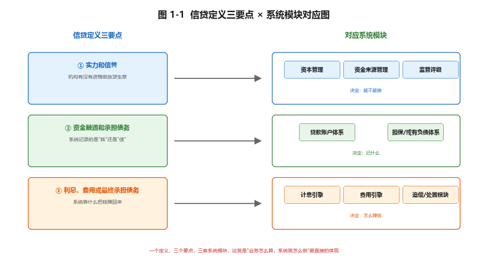
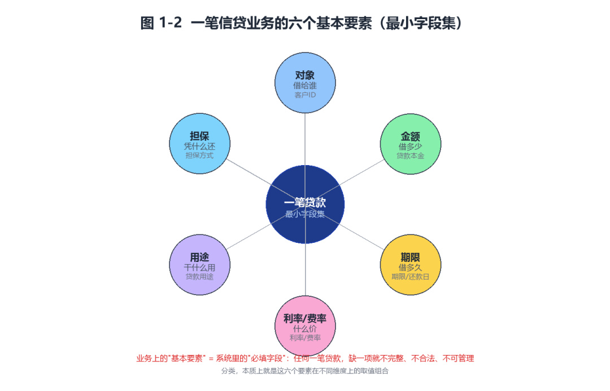
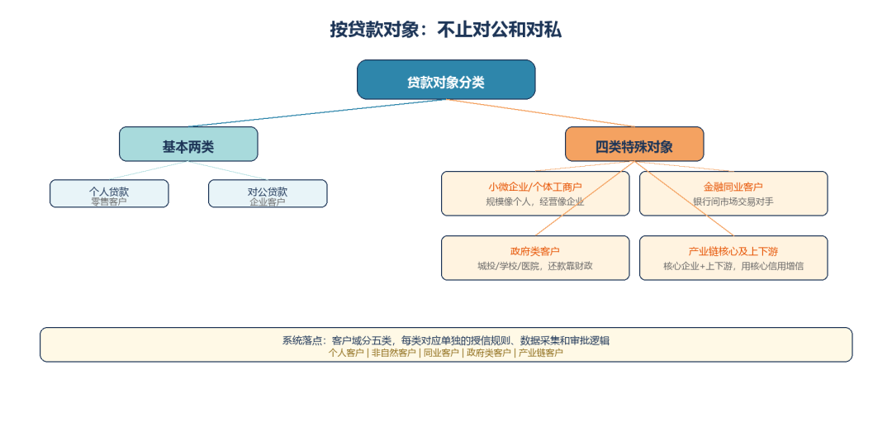
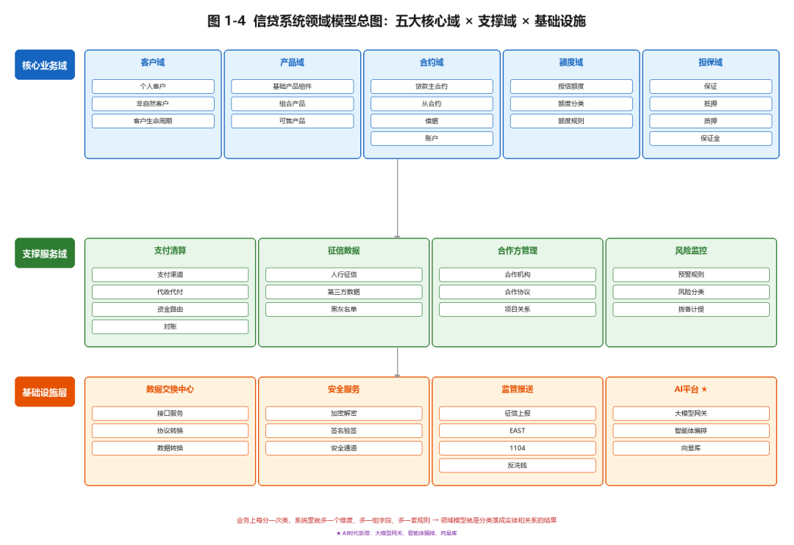

# 信贷的定义与分类

> 公众号：侃西东　·　发布日期：2026-09-16　·　[微信原文](https://mp.weixin.qq.com/s?__biz=MzIzNzQ5NjU5NQ==&mid=2247484159&idx=1&sn=e19e853ed5de87f36b146c71eb1d5856&chksm=e8c6f283dfb17b954ce3ae760950c3047dd93530f2c1f859980cbe62bfd5e22eb5afb15d5a09)

---

信贷不就是"借钱、收钱、控风险"吗？这是很多程序员接手信贷系统时的第一印象。可一旦坐进需求会，你很快会发现这三个词远远不够。信贷的商业逻辑千头万绪，但抽干了就三个字：资金、风险、收益。资金是这门生意靠什么运转，风险是这门生意最怕什么，收益是这门生意凭什么活下去。

这一章不讲代码，不画架构图，只讲一件事：信贷到底是一门怎样的生意。把它讲透了，后面所有章节才有了站得住脚的地基。

## 一、信贷的定义与分类

### （一）先给信贷一个能落进代码的定义

先给信贷一个业内公认的定义：银行等金融机构利用自身实力和信誉为客户提供资金融通和承担债务的行为，并以客户支付融通资金的利息、费用或最终承担债务为条件。这个定义看起来绕，但拆开看就是三句话。

第一句，"利用自身实力和信誉"。实力，就是手里有钱，或者能从市场上低成本地融到钱；信誉，就是被金融市场认可，借来的钱别人敢给、给了还不担心你还不上。这两个词，才是信贷这门生意真正的门槛，不是谁都做得起放贷生意，你得先有这两样东西。你在系统里看到的所有"资金路由""负债管理""同业拆借"模块，本质都在解决"实力"这两个字；而"信誉"这两个字，落在系统里就是资本充足率、拨备覆盖、监管评级这些看起来跟业务无关的合规字段。

第二句，"资金融通和承担债务"。这句话最容易被忽略，也最值得程序员琢磨。资金融通是"贷款"，把钱借出去；承担债务则是另一类业务，银行开承兑汇票、开保函、开信用证，本身没有把钱借出去，而是用自己的信誉为客户的债务做担保，客户到期还不上，银行要替他还。这两类业务在会计上一个记表内、一个记表外，在系统里一个生成贷款账户、一个生成担保合同和或有负债记录，形态完全不同。你写系统的第一天就得分清楚：你面对的是"融出去的钱"，还是"背上的债"。

第三句，"以利息、费用或最终承担债务为条件"。这句话点明了信贷的盈利本质，银行不是慈善机构，提供融通是要收费的，收费方式无非三种：收利息、收费用、或者最终替客户承担债务后追偿。这也就是后面要讲的"利差收入、服务费收入"的来源。

光讲定义容易飘，我给你一个把它落到地上的例子。你身边一个年轻人想买一辆二十万的车，手头只有八万，于是他向银行申请一笔十二万的车贷。在这个场景里，银行做的是"资金融通"，把钱借出去十二万；条件是年轻人按月还本付息，付的利息就是银行的"利息收入"；为了降低风险，银行要求这辆车抵押登记，这就是"担保"；如果年轻人信用不够，银行可能要求一家担保公司出面保证，这就是"增信"。这一笔看起来普通的车贷，背后其实是资金、风险、收益三角在真实世界的第一次咬合。而系统里要为它建的，是一张客户档案、一份借款合同、一张抵押登记记录、一份还款计划、一张贷款账户，缺一张，这笔贷款就立不住。

再往深里说一层。信贷定义的三个要点，恰好对应信贷系统里三个最底层的模块（见图 1-1）。一个定义，三个要点，三套系统模块，这就是"业务怎么算，系统就怎么做"最直接的体现。

从程序员的角度看，这个定义其实在告诉你要建几张表。信贷的实质是一组契约关系：主合同（借款合同）约定借贷双方的权利义务，借据（借据/借约）是每一笔具体放款的凭据，担保合同（保证、抵押、质押、保证金）是第二还款来源的约定，额度协议则是"给你一个可以循环使用的上限"。把信贷画成领域模型，"合约主题"下面会挂着一串对象：贷款主合约、担保合同-从合约、贷款账户信息、合约费用、合约生命周期。这就是信贷在系统里的样子，它不是一句"借钱"的日常口语，而是一张严密的主从合同关系网。后面第四章讲领域建模时，你会看到信贷核心的数据模型，就是围绕"主合同—从合同—借据—账户"这四件套展开的。

定义讲完，我把信贷的"基本要素"也一并交代了，因为它和定义是一体两面。一笔信贷业务，掰开就是六个要素（见图 1-2）。你把这六个要素想成一张"信贷合同的最小字段集"，任何一笔贷款，系统里都得有这六项，缺一项，这笔贷款就不完整、不合法、不可管理。业务上的"基本要素"，就是系统里的"必填字段"，它们不是一个概念，是同一件事的两面。下面讲分类时你会发现，分类其实就是这六个要素在不同维度上的取值组合。

**图1-2一笔信贷业务的六个基本要素（最小字段集）**

### （二）信贷的分类：每一刀都切在系统的对象模型上

信贷分类的体系很成熟，我结合系统视角重新梳理一遍，你会发现一个规律：业务上每分一次类，系统里就多一个维度、多一组字段、多一套规则。这句话我建议你读三遍，它是从业务到系统最直接的翻译规则。业务人员谈"分类"，谈的是认识贷款的角度；程序员听"分类"，听到的是系统要管的维度。同一笔贷款，在业务会议上可能被讨论"它是消费贷还是经营贷"，在系统里它同时具有贷款对象、担保方式、期限、用途、还款方式、资金性质、合作方式、利率类型、币种九个维度，不是一个标签，是六个字段的组合。下面我把这些分类一把一把讲清楚。

这里我要特别说一下"按贷款对象"这一维，它不是简单的"对公vs对私"二分法。除了这两个基本类，实际业务里还有四类特殊对象：小微企业/个体工商户、金融同业客户、政府类客户、产业链核心及上下游（见图 1-3）。每一类的业务特点和系统要求都不同，对应系统里单独的一套规则。

**图1-3 按贷款对象分类：不止对公和对私**

表**1-1信贷产品谱系：分类维度×系统落点**

| **分类维度** | **类别** | **系统落点** |
| --- | --- | --- |
| 按贷款对象 | 个人贷款/ 对公贷款 / 小微企业·个体工商户 / 金融同业 / 政府类客户 / 产业链核心企业及上下游 | 客户域分个人/非自然/同业/政府类/产业链，对象模型与授信规则差异大 |
| 按担保方式 | 信用/ 保证 / 抵押 / 质押 / 保证金 / 组合担保 | 担保域实体不同，押品管理、估值频率、处置流程复杂度不同 |
| 按期限 | 短期（≤1年）/ 中期（1-5年）/ 长期（>5年） | 期限字段+ 利率参数 + 重定价规则 + 流动性管理 |
| 按用途 | 消费贷/ 经营贷 / 项目贷 / 按揭贷 / 供应链融资 | 用途字段+ 受托支付规则 + 资金用途监控，不同用途放款条件不同 |
| 按还款方式 | 等额本息/ 等额本金 / 先息后本 / 到期还本付息 / 灵活还款 | 还款计划生成引擎不同，现金流预测模型不同 |
| 按资金性质 | 表内/ 表外（承兑汇票/保函/信用证） | 会计科目不同，表外要处理或有负债、出表与承诺 |
| 按合作方式 | 自营/ 助贷 / 联合贷 / ABS出表 | 资金路由、分账比例、增信对接、出表处理差异最大 |
| 按利率类型 | 固定利率/ 浮动利率（LPR挂钩） | 利率重定价规则不同，利率风险计量与对冲方式不同 |
| 按币种 | 人民币/ 外币 | 结售汇、汇率风险、跨境监管报送不同 |

### （三）技术落点·分类背后，是对象模型的骨架

这一小节的落点很直接：信贷的每一种分类，最后都要变成系统对象模型里的一个字段或一组关系。信贷系统的领域模型整张图，其实就是把这些分类落成了实体和关系，分为五大核心域、支撑服务域和基础设施层（见图 1-4）。

我给刚入行的同事讲系统设计时常说一句话：先别急着写代码，先把"这是一笔什么贷款"问清楚。是个人还是对公？是信用还是抵押？是表内还是表外？是短期还是长期？是等额本息还是先息后本？是自营还是助贷？这一串问题问完，系统的模块划分、表结构、状态机设计基本就浮出水面了。九个维度，九个模块，一一对应。商业逻辑不是"做完业务再补"的东西，它本身就是系统设计的第一输入。
