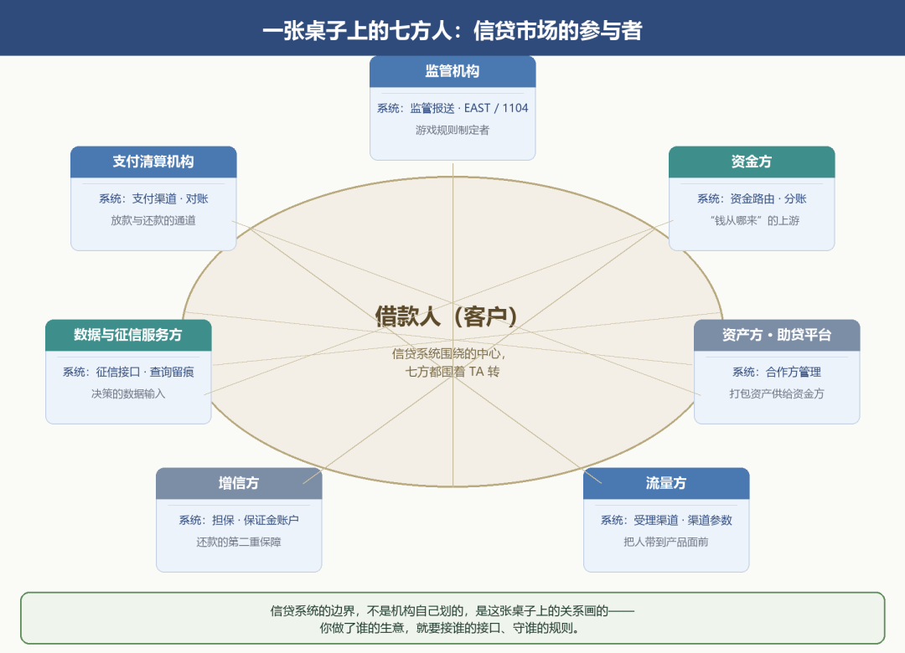
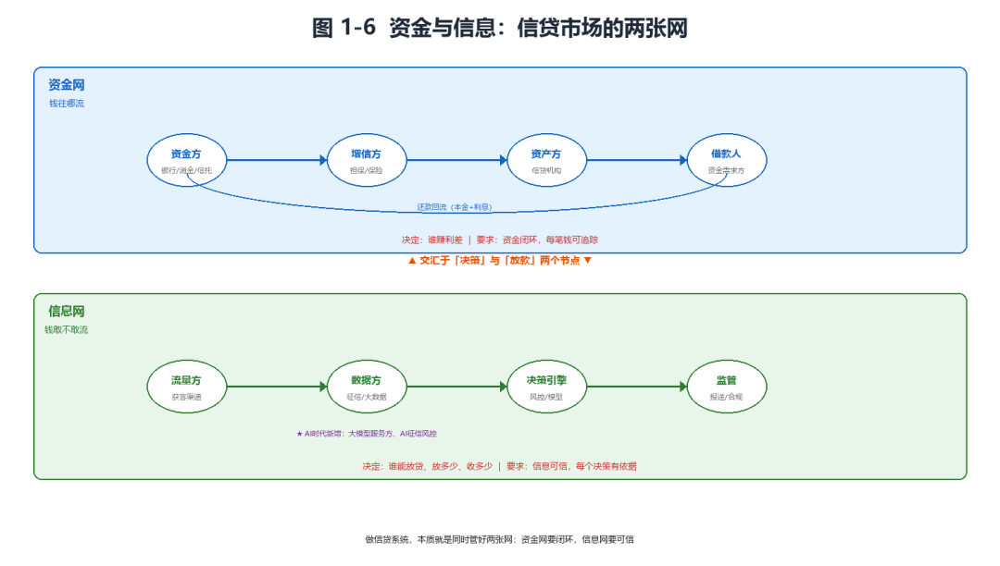
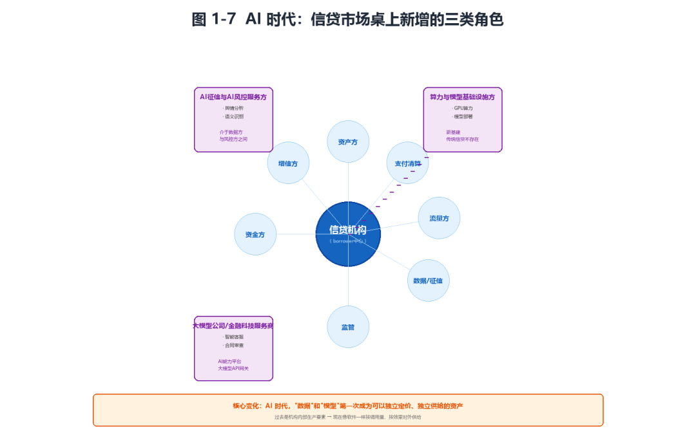
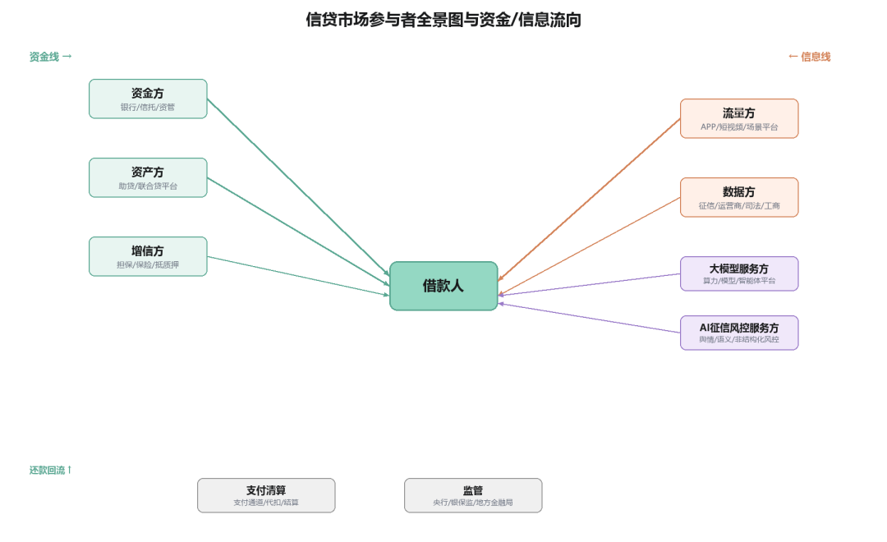

# 信贷市场的参与者

> 公众号：侃西东　·　发布日期：2026-09-17　·　[微信原文](https://mp.weixin.qq.com/s?__biz=MzIzNzQ5NjU5NQ==&mid=2247484210&idx=1&sn=e3538836e638072e0cde65c872e90d0d&chksm=e8c6f34edfb17a585ae9f2510c0e14bed69e1badafd0b97bd78ee58fc5f75218f755ea2f9034)

---

## 二、信贷市场的参与者

### （一）一张桌子上的七方人

信贷从来不是"银行和借款人"两个人的事，而是一张桌子上坐了七八方人。我按信贷系统的角色划分，结合这些年的从业经验，把信贷市场的参与者拆成七类，每一类都对应系统里的一批模块。这里先给你一个提醒：学信贷市场，别只记"有哪些角色"，要记"每个角色背后是系统里的哪几块"。因为信贷系统的边界，不是机构自己画的，是这张桌上的各方关系画的，你做了谁的生意，就要接谁的接口、守谁的规则。

第一类，资金方。这是"钱从哪来"的答案。银行、消费金融公司、信托、保险资管，都可能是出资人。资金方决定了信贷机构的资金来源和成本，也决定了系统要不要做"资金路由"，当一家互金平台对接了好几家出资方时，系统得决定每一笔贷款由哪家出资、按什么比例分账。后面讲资金闭环时你会看到，没有低成本负债的机构，系统一半的复杂度都花在"把钱接进来、把钱分清楚"上。这里先记住一点：资金方是信贷系统的"上游"，它的一举一动（放款节奏、利率、合作政策）都会变成系统里的资金参数和路由规则。

第二类，资产方（助贷平台）。资产方自己不兜资金，但负责获客、风控、放款、贷后管理，把"优质借款需求"打包成资产供给资金方。在信贷系统的领域模型里，资产方对应的是"合作方管理"那一整块，合作方及项目与机构关系、合作项目重检、合作方重检、合作保证金扣划。你会发现，系统里管合作方的复杂度，几乎不亚于管客户，因为合作方涉及分润、保证金、项目额度、合作状态，全是资金往来。

第三类，流量方。流量方负责把人带到信贷产品面前。APP 商店、短视频平台、信息流广告、场景平台（电商、出行、教育），都是流量入口。在系统里，流量方对应的是"受理渠道"，APP、PC、微信、H5、线下批量、合作方渠道、网点营销、线上营销。信贷系统的领域模型一开头画的就是这张渠道全景图。渠道的价值在于获客，但渠道也带来一个系统问题：每个渠道进来的客户质量不一样、数据格式不一样、反欺诈要求不一样，于是就有了"渠道分润、渠道参数、渠道黑名单"这些系统概念。

第四类，增信方。担保公司、信用保证保险公司，为借款人的还款提供第二重保障。增信方的存在，让资金方敢于把钱借给信用不够强的客群。在系统里，增信方对应的是"保证、保险、阶段性担保"这些担保实体，以及担保费、保证金账户的管理。增信有一个很现实的系统问题：担保费怎么算、保证金怎么扣、代偿怎么触发。你做信贷系统时如果碰到"保证保险"产品，光担保费计提和保证金账户就要单独建一套账。这也是信贷系统领域模型里"合作方保证金""保证金账户信息""担保合同-从合约"这些对象存在的原因。

第五类，数据与征信服务方。这一类是信贷决策的"输入源"，但它的结构在"征信断直连"之后发生了根本性变化。断直连之前，机构可以直接调用第三方大数据公司的原始数据接口，同盾、汇法这类公司直接提供征信级别的数据产品。断直连之后，监管要求个人征信业务必须持牌经营，形成了三层结构：第一层是人行征信中心，官方持牌，覆盖银行信贷记录；第二层是市场化持牌征信机构，百行征信、朴道征信，整合各类公共数据和替代数据，出具个人信用报告；第三层是第三方数据服务商，同盾、汇法这类公司不再直接做征信产品，而是为持牌征信机构和风控模型提供数据加工和技术服务。司法数据、黑灰名单库也在这个框架下，要么通过持牌征信机构输出，要么作为反欺诈场景的辅助数据源。这个政策对系统架构影响很大：原来的直连接口要重接，数据合规链路要重构，风控特征从"直接拿字段"变成"在合规框架内加工"。所以做信贷系统，数据接入层从一开始就要设计成"合规可插拔"的，今天接这家持牌机构、明天换那家，接口层必须能快速切换。

第六类，支付清算机构。银联、网联、银行代扣渠道、第三方支付。放款要放出去，还款要收回来，都得走支付清算。在系统里，这一块对应的是支付渠道、代收代付、资金路由、对账。支付清算这个角色，程序员最容易低估它，觉得不就是"调个接口转钱"吗？其实支付是最考验系统健壮性的环节：渠道会挂、回调会丢、限额会变、金额会差。我在互金平台做放款链路时，最常处理的就是"钱付出去了，回调没回来"，这笔款到底放没放成功？系统必须有一套完整的对账和重试机制来回答。所以第八章讲支付结算时你会看到，支付不是一笔接口调用，是一套状态机加对账机制。这里要专门提一下第三方支付机构的监管新动向。近两年，第三方支付监管正从资金链路、获客渠道、成本结构三个核心维度，对互联网小贷及小贷公司产生深刻的结构性影响。监管的核心逻辑是穿透式管理，通过切断支付通道来遏制高息和违规放贷行为。资金链路上，支付机构必须严格核实合作小贷公司的牌照资质，不得为无牌经营、超范围经营的机构提供支付结算服务；获客渠道上，支付机构不得利用自身流量入口为小贷产品导流，切断"支付即获客"的隐性通道；成本结构上，支付手续费、分润模式受到严格约束，防止支付机构通过高手续费变相推高小贷综合融资成本。这套监管对系统的直接影响是：支付接入的合规审查前置，渠道白名单管理更严，分账和资金路由的规则要更细，任何一个支付合作方出问题，系统都要能快速切断并切换备选渠道。

第七类，监管机构。中国人民银行、金融监管总局、地方金融监管局。监管不是参与者，而是所有参与者的游戏规则制定者。在系统里，监管对应的是"监管报送"这一大块，人行征信查询上报、EAST、1104、利率报备、反洗钱报送。很多程序员第一次接触信贷系统时最不适应的一点，就是为什么系统里有一大堆看起来"不产生业务价值"的报送模块。但监管报送恰恰是信贷系统里最不能出错的模块之一，报错了，轻则整改，重则吃罚单。而且报送不是"定期导出一张表"那么简单：人行征信的查询要留痕、上报要合规，反洗钱要识别可疑交易，1104 报表有严格的口径，每一行数据都要能从业务流水追溯到明细。我在大行做过报送系统，深知这里面的坑，口径一变，全表重来；报错一笔，监管约谈。

把七方人讲完，我要点一句关键的话：信贷系统的边界，不是机构自己划的，是这张桌子上的关系划的。你做自营，系统管到客户和资金就行；你做助贷，系统必须和资金方、增信方对接，接口多出一大截；你做供应链金融，系统还要嵌进核心企业和上下游的 ERP、财务、仓储。每一次"和谁合作"，系统就多一批对接、多一套协议、多一层合规。信贷系统的领域模型里专门有一块"合作方管理"和"数据交互服务"，合作方及项目与机构关系、合作项目重检、合作协议、数据证书加密解密、签名、安全通道，这些不是锦上添花，是信贷系统跨机构协作的物理骨架。很多做信贷系统的程序员，前期只盯着自己机构内部的模块，忽略了外部接口这条线，结果项目做到一半才发现，最复杂的工作全在"和别人对接"上。

图1-5一张桌子上的七方人：信贷市场的参与者

### （二）资金和信息，两张网

把这七方人放回一张图里，你会发现信贷市场其实是两张网交织在一起。

一张是资金网。资金方→资产方→借款人，钱从低成本的资金端流向高收益的资产端，中间经过增信、支付、清算各个环节。这张网决定了"谁赚利差"。

另一张是信息网。流量方提供客户信息，数据方提供信用信息，征信机构提供权威信用记录，监管要求报送业务信息。这张网决定了"谁能放贷、放多少、收多少"。

这两张网，正好对应开头那把万能钥匙（见图 1-6）。资金网跑的是"资金"，信息网跑的是"风险"和"收益"的决策依据。资金网决定钱往哪流，信息网决定钱敢不敢流、以什么价格流。做信贷系统，本质就是同时管好这两张网：资金网要闭环，信息网要可信。

图1-6资金与信息：信贷市场的两张网

### （三）★AI 时代，桌上多了一批新玩家

AI 时代，这张桌子的边上又坐进来几类新角色。

第一类是"大模型公司/金融科技服务商"。它们不直接放贷，但向信贷机构输出大模型能力，智能客服、合同审查、尽调报告生成、代码辅助。在系统里，它们对应的是 AI 能力平台、大模型 API 网关这类新的支撑模块。

第二类是"AI 征信与 AI 风控服务方"。用大模型做舆情分析、语义识别、财报解读、非结构化数据风控，正在成为新的数据服务形态。它们的角色介于"数据方"和"风控服务方"之间。

第三类是"算力与模型基础设施提供方"。GPU 算力、模型部署、向量数据库、智能体编排平台，这些在传统信贷系统里根本不存在，现在成了新基建。

AI 时代的新玩家对信贷市场最大的改变，不是多了一个供应商，而是让"数据"和"模型"第一次成了可以独立定价、独立供给的资产（见图 1-7）。过去，数据和风控能力是机构内部的生产要素，不流通、不定价；AI 时代，数据产品、模型服务、智能体能力都可以像软件一样按调用量、按效果对外供给。

图1-7 AI时代：信贷市场桌上新增的三类角色

下面这张全景图，把七方人放回资金与信息两张网里：资金线（资金方→资产方→借款人→还款回流）与信息线（流量方/数据方→决策→报送监管）两条主箭头；AI 时代新增的大模型服务方、AI 征信风控服务方，作为信息网的新节点接入。

图1-8信贷市场参与者全景图与资金/信息流向

这张图我建议你多看几遍，因为它是“信贷系统边界”的直观呈现，站在借款人中心往外看：往资金线看是资金来源和成本，往信息线看是决策依据和合规义务，往外围看是支付和监管这些基础设施。做系统时，每接一个外部角色，就是在这张图上多连一条线、多开一个接口。你可以拿它当 checklist 逐项对：资金方接了吗？增信方接了吗？数据方接了吗？支付接了吗？报送接了吗？漏了任何一个，系统都是瘸腿的。
