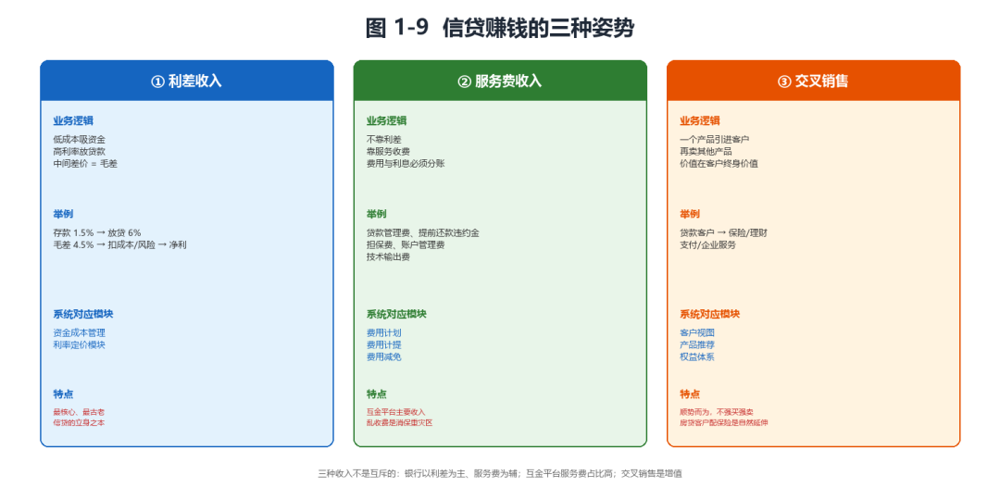
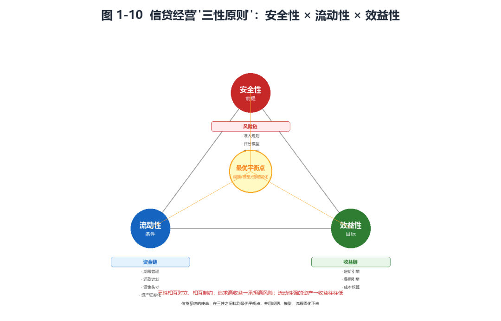
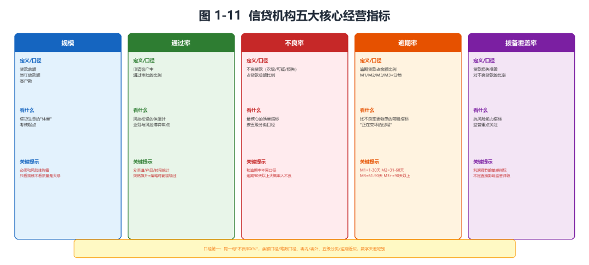
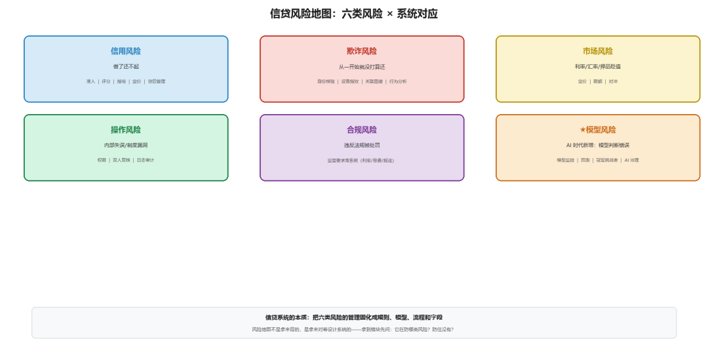

# 信贷业务的商业价值与风险

> 公众号：侃西东　·　发布日期：2026-09-18　·　[微信原文](https://mp.weixin.qq.com/s?__biz=MzIzNzQ5NjU5NQ==&mid=2247484209&idx=1&sn=62adfb586a7bed9cc314cbe51ff37a73&chksm=e8c6f34ddfb17a5b037607d3b9d3f76470764e7a3e2c7e1afc08dee03f7676d27f9c7bb1b42e)

---

## 三、信贷业务的商业价值与风险

### （一）信贷赚钱的三种姿势

信贷这门生意靠什么赚钱？信贷经营讲"三性原则"，那是经营准则；这一节我讲赚钱的姿势。归纳起来无非三种。

第一种，利差收入。这是最核心、最古老的一种：以较低成本吸收资金，以较高利率放出贷款，中间的差价就是利差。系统里对应资金成本管理和利率定价两个模块。

第二种，服务费收入。不靠利差，靠服务收费：贷款管理费、提前还款违约金、担保费、账户管理费、技术输出费。系统里对应费用计划、费用计提、费用减免。费用和利息在系统里必须分开建账。

第三种，交叉销售。通过一个金融产品把客户引进来，再卖给他其他产品，价值在客户终身价值（见图1-9）。这里要给交叉销售泼一盆冷水：它是"顺势而为"，不是"强买强卖"。

**图1-9信贷赚钱的三种姿势**

（二）信贷经营的三性原则

信贷的经营原则总结起来就是"三性"：安全性、流动性、效益性。这三句话，值得每个做信贷系统的程序员刻在工位上。

安全性是前提，指避免信贷资金遭受风险造成损失，核心是识别和防范客户风险、内部风险和经营环境风险。

流动性是条件，指能按预定期限回收信贷资金，或能在无损状态下迅速变现，核心是保证客户随时提款的能力和资金的高效运用。

效益性是目标，指追求最佳效益、强调盈利性，核心是"开源节流"：提利率、增规模、减损失、降成本、降费用。系统自动化建设本身就是降低经营费用的手段。

三性之间的关系：安全性是前提，流动性是条件，效益性是目标。三性往往相互对立、相互制约，追求高收益就要承担高风险，流动性强的资产收益往往低。

这里我给程序员补一句翻译。三性不是一个口号，它在系统里处处可见：安全性落为"风险链"，流动性落为"资金链"，效益性落为"收益链"（见图1-10）。你设计任何一个信贷模块，都可以问一句：这个模块是在保安全、保流动，还是增效益？答得上来，模块的定位就清楚了。

**图1-10信贷经营"三性原则"：安全性×流动性×效益性**

（三）五大核心经营指标

讲信贷的生意，就绕不开经营指标。这些指标不光是管理层看的数字，更是系统要准确计算、实时监控的对象。我挑五个最核心的讲。

第一个，规模。贷款余额、当年放款额、客户数，是信贷生意的"体量"，必须和风险挂钩看。

第二个，通过率。申请客户中通过审批的比例，是风控松紧的体温计，也是业务与风控博弈的焦点，系统里要分渠道、分产品、分时段精确统计。

第三个，不良率。五级分类中次级、可疑、损失三类贷款占贷款总额的比例，是最核心的质量指标。注意不良率和逾期率口径不同。

第四个，逾期率。逾期贷款占余额比例，按M1（1-30天）、M2（31-60天）、M3（61-90天）、M3+（90天以上）分档，是比不良率更敏感的前瞻指标。

第五个，拨备覆盖率。贷款损失准备对不良贷款的比率，衡量抗风险能力，是监管重点关注的利润调节敏感指标。

讲完这五个指标，我插一句题外话：指标是信贷机构的"体检报告"，但光看指标不看口径，等于看着一份说不清单位的化验单（见图1-11）。

**图1-11信贷机构五大核心经营指标**

为了让你对口径的影响有体感，我举个数字例子。假设某机构贷款余额100亿，其中逾期30天以上的有3亿，逾期90天以上的有1.5亿，按五级分类划入不良的有2亿。那么：按"逾期30天以上"口径，逾期率是3%；按"逾期90天以上"口径，逾期率是1.5%；不良率（不良/余额）是2%。三个数都"对"，但含义完全不同。如果监管或管理层要求"不良率控制在2%以内"，你用哪个口径算？口径不清，绩效考核和风险判断全都会乱套。这也是为什么我反复强调：口径，是信贷指标的命根子。

### （四）风险地图：信贷这门生意，怕什么

信贷生意赚钱的前提，是管住风险。我按信贷业务的风险分类框架，结合AI时代的增量，把信贷风险画成一张地图。为什么要单独讲一张风险地图？因为对程序员来说，风险不是抽象的名词，而是系统里一个又一个的模块、规则和字段，你把风险地图记熟了，系统里每一个"为什么要有这个模块"的问题就都有了答案。反过来，一个不知道自己在防什么风险的程序员，写出来的系统一定到处是漏洞。下面我把六类风险逐一摊开。

**图1-12信贷风险地图：六类风险×系统对应**

信用风险是信贷最本质的风险（借款人无力还款或不愿还款导致的损失），对应前面说的"客户风险"。它有个特点：要"靠评估来管"，因为借钱的时候，没人知道借款人将来还不还得起。于是有了各种评估方法："10-80-10法则"，客群里大概10%是优质客户、10%是高风险客户、中间80%是普通客户；还有"6C法"（品德、能力、资本、担保、环境、事业连续性）、"5W法"（借款人、用途、期限、担保物、如何还款）。这些方法看着老派，其实是几代信贷人用真金白银换来的经验框架，你会在第九章看到，它们和现代评分卡、机器学习模型一脉相承：6C的"品德"对应征信记录，5W的"用途"对应资金流向监控。业务的直觉和模型的逻辑，从来不是两套东西。

欺诈风险（借款人用虚假信息、伪造资料、冒用身份骗贷）和信用风险是两回事，信用风险是“借了还不起”，欺诈风险是“从一开始就没打算还”。欺诈风险在AI时代也在进化，Deepfake人脸、AI生成的假证件假流水、机器批量进件，让反欺诈变成了一场“用AI对抗AI”的攻防战。第十章会专门展开讲。

市场风险（利率、汇率、资产价格波动带来的损失）主要来自利率风险和汇率风险（跨境业务），也来自抵押物贬值。你可能觉得市场风险离信贷系统很远，错了，一笔浮动的贷款利率调整、一批押品价格下跌引发的补足要求，都是系统要处理的事。你去看信贷系统领域模型里的“押品评估、押品重估、抵押物预警、押品不足值”这些对象，就是市场风险在系统里的落点。

操作风险，内部流程失误、系统缺陷、人员差错造成的损失。前面讲的"内部风险"就是这一类，经验不足、无意疏忽、制度漏洞，甚至贪污舞弊。操作风险在系统里的对应物是权限管理、双人复核、日志审计、流程控制。这也是为什么信贷系统里到处是"审贷分离""岗位互斥""操作留痕"。你可能觉得这些是"流程上的事"，不是"技术上的事"，错了，审贷分离要在系统里落地，就得把调查、审查、审批的权限在代码层面隔离开，同一个人不能既录资料又批贷款；岗位互斥要在系统里落地，就得在角色权限模型里配"互斥角色"；操作留痕要在系统里落地，就得有完整的操作日志和审计追踪。制度不落到系统里，就是一张废纸。这些在信贷系统的领域模型里都有对应的对象：角色互斥、岗位互斥、操作日志、日志分类、日志权限管理、日志归档。

合规风险，违反法律法规、监管规定导致的处罚和损失。信贷是强监管行业，合规风险是悬在头上的剑。管合规风险靠的是把监管要求落进系统：利率上限、息费透明、数据合规、报送准确。第三章会专门讲"监管红线如何变成系统功能"，这里先给你一个结论：合规不是法务部门的活，是系统的一部分。监管要求你不暴力催收，系统里就要有催收话术审核、频控限制；监管要求息费透明，系统里就要有明示年化利率的展示组件；监管要求数据合规，系统里就要有授权管理、加密脱敏。把监管要求落成字段和规则，是信贷系统工程师的基本功。

★模型风险，AI时代新增的一类。模型判断错误导致的损失，评分卡失灵、策略过期、大模型幻觉。模型风险在传统银行时代也存在，但AI时代被放大了：当决策越来越依赖模型，模型的错误就越来越致命。管模型风险靠的是模型监控、回测、冠军挑战者实验、AI治理。这里我要专门点一句：模型风险最隐蔽的地方在于，它不像欺诈那样"有坏人在对面"，而是"系统自己出了错还浑然不觉"，模型悄悄漂移了、策略悄悄过期了、大模型开始一本正经地胡说八道了，但业务还在照常跑，等到坏账浮出来，已经是几个月后的事。所以管模型风险，核心不是"建模型"，而是"盯模型"：持续监控模型表现、定期回测、有预警有处置。这正好是第十一章"模型评估与优化"要展开的内容。

把这六类风险摆在一起看，你会发现信贷系统的本质，就是把这六类风险的管理固化成规则、模型、流程和字段。风险地图不是拿来背的，是拿来对着设计系统的。这里我给你一个实用的小框架：拿到任何一个信贷模块，先问三个问题，这个模块在防哪类风险？防住没有、有没有盲区？风险发生了，有没有处置通道？三个问题答完，模块的完整性就检验得差不多了。比如放款模块，防的是操作风险（放错款、重复放款）和欺诈风险（盗用账户），防住的办法是幂等、双人复核、实名校验，出了错要有冲正和追回通道。你带着这套框架去看后面每一章的模块设计，会看得很清楚。
