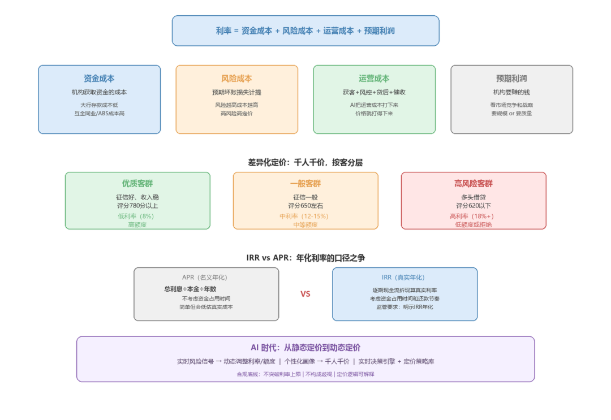

# 信贷产品的定价逻辑

> 公众号：侃西东　·　发布日期：2026-09-19　·　[微信原文](https://mp.weixin.qq.com/s?__biz=MzIzNzQ5NjU5NQ==&mid=2247484352&idx=1&sn=46f104cd16be6f3629e6eb73dd891857&chksm=e8c6f3bcdfb17aaa4b20720f7489e05f8e0655f23bb2e52866a2531834047fef74f15dc4a7c9)

---

## 四、信贷产品的定价逻辑

直接看图

图1-13 信贷产品的定价逻辑：从公式到动态

## （一）价格是怎么定出来的

信贷产品的"价格"就是利率（或费率）。价格不是拍脑袋定的，它必须覆盖四块成本，还得留出利润空间。这就是定价的基本公式：

利率 = 资金成本 + 风险成本 + 运营成本 + 预期利润

资金成本，是机构获取这笔钱的成本。大行吸收存款成本低，互金平台靠同业拆借、联合贷、ABS 获取资金成本高，这就是为什么同一类贷款，不同机构利率差很大。

风险成本，是为这笔贷款可能发生的损失计提的成本。风险越高，风险成本越高，利率就要相应提高。这就是"高风险高定价"的底层逻辑，不是惩罚借款人，而是让价格覆盖预期损失。

运营成本，是获客、风控、放款、贷后、催收整个链条花的钱。运营成本低，定价就可以更有竞争力。这也是 AI 能改变信贷竞争格局的地方，AI 把运营成本打下来，价格就打得下来。

预期利润，是机构要赚的钱。利润高低取决于市场竞争和机构战略，有的机构要规模，就压低利润换增长；有的机构要质量，就提高利润控风险。

利率定价的制约因素，正好对应这四块成本：国家金融政策的有关规定（比如禁止高利贷、利率司法保护上限）、贷款的风险（风险高则利率高）、同业竞争（定价要有竞争力）、与客户的关系（考虑长期合作和综合效益）、金融机构的资金筹集成本。你看，这就是上面那个公式的另一种说法。

我举个具体的数字例子，让你对这个公式有体感。假设某机构放一笔消费贷，资金成本 4%（从市场融钱要付的利息），风险成本 3%（预期这 100 块钱里会有 3 块钱坏账，要摊到利率里覆盖），运营成本 2%（获客、风控、贷后、催收整个链条摊到每笔贷款上），预期利润 1%。那么这产品的定价底线就是 4%+3%+2%+1%=10%。低于 10% 放贷，要么亏本，要么是在烧钱换规模。你现在就能理解为什么互金平台的利率普遍比大行高，不是它们心黑，是资金成本高、获客成本高，公式算出来就是高。也能理解为什么 AI 降本那么重要，运营成本每降 1 个百分点，定价就能降 1 个百分点，在市场上就多一分竞争力。定价，是资金、风险、运营三本账合起来算的一本总账。

## （二）差异化定价与客群分层

信贷定价不是一价到底，而是千人千价、按客分层。客群分层的逻辑很简单：不同风险的人，风险成本不同，价格就该不同。银行把客户按评分分成若干档，优质客户给低利率、高额度，高风险客户给高利率、低额度甚至直接拒绝。这背后其实是上一节那个定价公式的延伸：定价 = 资金成本 + 风险成本 + 运营成本 + 预期利润，其中风险成本是随客群变化的，风险高的客群，风险成本高，价格自然高。客群分层就是把"风险成本"这个变量精细化：不再给所有人一个平均价，而是按风险档位给不同价，让价格精确反映每一类客群的真实成本。这样做的结果是双赢的：低风险客户得到便宜的价格，机构留住优质客户；高风险客户承担更高的价格，机构补偿风险损失。定价分层的本质，就是让"风险"和"价格"一一对应。

客群分层在系统里对应的是"定价策略"模块：按评分区间、按产品、按渠道、按担保方式配置利率参数。系统里有一套复杂的定价参数体系，基础利率、风险定价加点、渠道定价、客群折扣、活动优惠，层层叠加得出最终利率。程序员最容易踩的坑是"叠加顺序"，先加后减、先乘后加，结果完全不同，定价参数表里的优先级必须写得明明白白。

我再举一个差异化的例子。同一款消费贷产品，系统给两个客户报出完全不同的价格：客户甲，征信干净、收入稳定、评分 780，系统给年化 8%；客户乙，近期多头借贷、评分 620，系统给年化 18% 并调低额度。这不是"歧视"，是风险定价，甲的预期损失低，风险成本低，价格就低；乙的预期损失高，风险成本高，价格就高。如果系统给所有人都一个价，优质客户会被更便宜的产品抢走（逆向选择），高风险客户反而涌进来（道德风险），机构很快会被坏账拖垮。所以差异化定价不是商业技巧，是信贷生存的数学。系统要做的，就是把这个"按风险定价"的逻辑用规则和模型稳定地跑起来，并且保证：定价透明、无歧视、不突破利率上限。

## （三）IRR 与 APR：年化利率的口径之争

做信贷产品的人，一定要分清楚 IRR 和 APR 这两个年化利率口径。这一块在合规上极其重要，因为"明示年化利率"是监管的硬要求。

APR（年化利率）是"名义年化"，用总利息除以本金、再按年折算，不考虑资金占用时间。它的计算简单，但会低估真实成本，尤其对先息后本、随借随还这类还款方式，APR 严重失真。

IRR（内部收益率）是"真实年化"，把每一期现金流折现，算让现金流净现值等于零的利率。它考虑到了资金占用时间和还款节奏，是真实的资金使用成本。监管要求明示年化利率，用的就是 IRR 口径。

举个例子。一笔贷款 1 万元、12 期、手续费 1200 元一次性扣除。如果按 APR 算，年化可能是 12%；但如果按 IRR 算，因为本金逐月递减、手续费一次性扣除，真实年化可能接近 24% 甚至更高。这就是"息费分离、明示年化"要治理的问题，很多不规范的平台用 APR 口径把利率说得很好看，实际成本高得吓人。

系统里做利率展示、费用折算、还款计划试算，都必须用 IRR 口径，并且把"明示年化利率"写进每一个给客户看的页面。这不是产品经理的洁癖，是监管红线。我在互金平台见过因为利率口径不透明被监管点名整改的案例，原因就是系统里 IRR 算错了一个细节。这里多说一句"息费分离"：监管要求利息是利息、费用是费用，不能把利息藏在费用里、把费用算进利率里混着说。系统里的费项管理（贷款管理费、账户管理费、提前还款违约金、担保费）必须和利息分开建模、分开展示，费用也要折算成年化让客户看得懂。这背后是保护金融消费者权益的立法意图，不能让普通客户算不清自己到底要还多少钱。

★AI 时代的动态定价。传统定价是"入池时定一次、贷中基本不变"，AI 时代正在走向动态定价：基于实时风险信号（多头变化、行为异常、市场资金面）动态调整利率和额度；基于个性化画像给不同客户不同价格；基于供需实时竞价。动态定价的系统落地是"实时决策引擎 + 定价策略库"，每笔放款、每次调额，都实时算一次价格。但动态定价有个合规底线：利率不能突破监管上限，定价逻辑不能构成歧视，个性化定价要有可解释性。AI 可以让你给每个客户定一个更精准的价，但"为什么给他这个价"必须讲得清楚，否则监管一查，一句"模型算的"是过不了关的。这也是后面第十一章讲模型可解释性、第十五章讲 AI 合规的伏笔。

## （四）技术落点·等额本息公式推导与浮点精度陷阱

这一节给程序员一点实在的东西，等额本息的计算。等额本息，每月还款额固定，公式是：

月供 M = P × r × (1+r)^n / ((1+r)^n − 1)

其中 P 是本金，r 是月利率，n 是期数。这个公式的原理是：把 n 期现金流按利率 r 折现到放款时点，总和等于本金 P。推导也很简单：假设每月还 M，第 k 期末的 M 折现到放款时点是 M/(1+r)^k，n 期求和等于本金 P，即 P = M × [1−(1+r)^(−n)]/r，把 M 解出来就是上面那个公式。这里有个金融概念叫"货币时间价值"，今天的钱比明天的钱值钱，因为今天的钱能生息。等额本息、等额本金、先息后本，本质都是"货币时间价值"在不同还款节奏下的分配。理解了这一点，你再看各种还款计划，就不会被公式吓住。

推导过程不复杂，但实现时有几个坑必须注意。写到这里，我顺手把另外两种常见还款方式的公式也列出来，方便你对照：

等额本金：每月还本金固定（P/n），每月利息按剩余本金算（剩余本金 × 月利率），月供逐月递减。它的特点是总利息比等额本息少，因为本金还得快、占用时间短。

先息后本：每月只还利息（P × 月利率），到期一次性还本金。它的月供压力最小，但风险也最集中，到期那一笔本金如果还不上，就是一笔大逾期。

随借随还（按日计息）：利息 = 本金 × 日利率 × 实际占用天数，本金随时可还。它的复杂度在"按日计息、随时还款"带来的利息重算，哪天还、还多少，都要实时算清楚。

这三种方式各有各的计算内核和状态机。你写计息引擎时，不要想着"一个函数通吃"，而要按还款方式设计不同的计算组件，再统一收敛到"还款计划"这个标准输出上。后面第八章讲计息引擎时，会带你把这些组件的实现细节完整走一遍。

第一个坑，浮点精度。月利率如果是"年利率/12"算出来的，本身就是无限小数，乘以大本金再乘 240 期，浮点误差会被放大。笔误和四舍五入叠加，最后总和会差几分钱，账务上一分钱都不能差。工程上的做法是：金额用分（整数）存储，利率用高精度小数，每期计算按"最后一期倒挤"的方式保证总和精确等于本金加利息。

第二个坑，最后一期的倒挤。等额本息逐期计算时，由于四舍五入，前面每一期都可能有微小误差，如果不处理，最后一期的还款额会对不上。标准做法是：前面 n-1 期按公式计算并四舍五入，最后一期用"应还总额 − 已还总额"倒挤出来，保证分毫不差。

第三个坑，还款计划的校验。还款计划生成后必须校验：所有期数加起来等于合同金额；最后一期余额归零；利息总额等于合同利息；已还本金加未还本金等于放款本金。这四条校验，是还款计划模块的底线，任何一条不过，都不能放款。

我见过最典型的线上问题，就是等额本息在某个月利率调整后重算还款计划，因为浮点误差导致最后一期多出几块钱，客户投诉、对账不平、手工冲正，折腾一整天。所以做计息引擎，第一原则永远是：金额用分存，误差用倒挤平，结果用校验锁。
