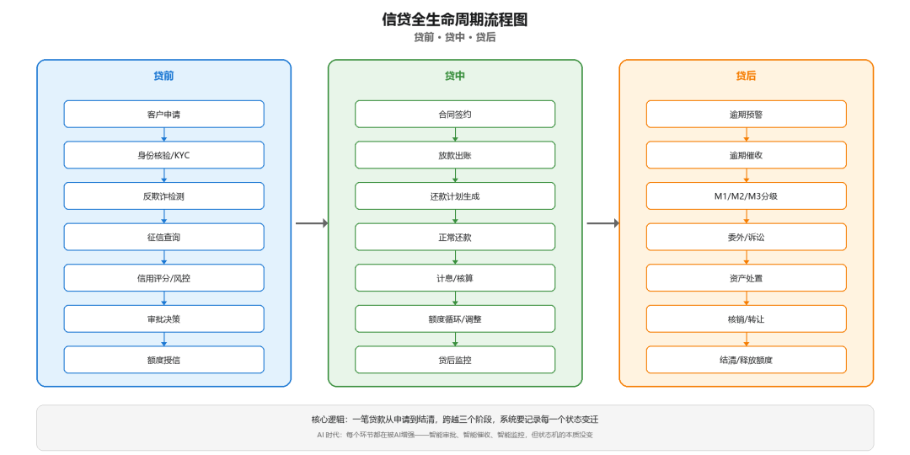
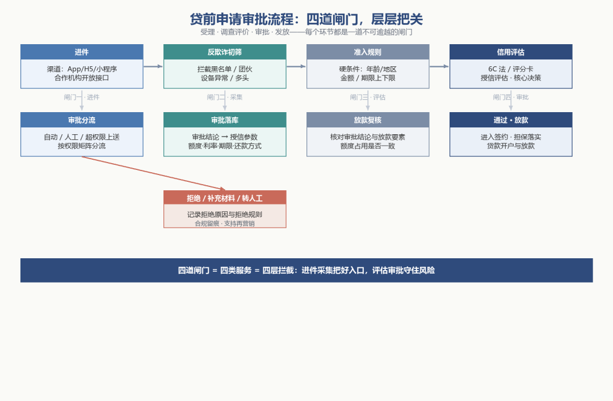

# 信贷申请与审批流程（贷前）

> 公众号：侃西东　·　发布日期：2026-09-23　·　[微信原文](https://mp.weixin.qq.com/s?__biz=MzIzNzQ5NjU5NQ==&mid=2247484450&idx=1&sn=87669633191def185c4eefdf699df456&chksm=e8c6f45edfb17d48e04128650002b4d6fdb57d3eb7646fe5c45832a9d12f3b6dc9309e78a1e8)

---

**图2-1信贷全生命周期流程图：贷前·贷中·贷后**

第一章讲了这门生意的全貌，资金、风险、收益的三角，以及决定系统形态的五个变量。这一章，我们往里面走一层，跟着一笔具体的贷款走完全程。一笔贷款的一生，从客户在手机银行点下"申请"开始，到最后一期本息还清、账销案存，短则数月，长则三十年。这段旅程在业务上被切分成贷前、贷中、贷后三个阶段，在系统里则体现为一连串环环相扣的状态迁移。本章要做的，就是把这条从申请到结清的路径完整走一遍，同时把每一站的系统落点讲清楚。

这一章我用状态机的视角来串全流程。一笔贷款在系统里不是静止的，而是在不同状态间流转：申请中、审批中、待放款、正常、逾期、结清、核销，每个状态的转换都有明确的触发条件和系统动作。你理解了状态机，就理解了信贷流程的骨架。后面的小节，我按贷前、贷中、贷后三个阶段展开，每个阶段讲清楚系统做什么、数据怎么流、哪里容易出问题。

这一章的内容是后面所有技术章节的基础。你只有先搞清楚一笔贷款在业务上怎么走，才能理解系统为什么要这么设计、数据为什么要这么组织。

## 一、信贷申请与审批流程（贷前）

贷前解决的是“能不能贷、贷给谁、怎么贷”的问题。在信贷业务的基本操作流程里，一笔贷款要经历受理、调查评价、审批、发放及贷后管理五大阶段，其中对客户的调查评价是信贷决策的基础和核心。我把贷前展开成四个动作（下图），对应系统里的四类服务，也对应着业务上不可逾越的四道闸门。

**图2-2贷前申请审批流程：四道闸门，层层把关**

### （一）营销与获客：客户从哪里来

前面讲了这么多流程，你可能会问：客户是怎么知道我们的贷款产品的？这就要从营销获客说起了。很多刚接触信贷的人觉得营销是业务部门的事，和系统没关系——其实不是，信贷的营销从系统设计开始就分成完全不一样的两条路，对应对公和零售两类业务。

零售信贷的营销是典型的ToC批量自动化逻辑。不管是互金平台，还是银行的消费贷、信用卡分期，营销目标是触达海量个人客户。系统里营销活动全是配置出来的：圈选什么客群、给什么利率优惠、发什么额度券，运营在后台点几下就配好了，客户在APP上点了广告、收到短信，点进来自动带渠道参数，进件时自动匹配对应的产品和利率。系统自动算每个渠道的转化率、通过率、坏账率，哪个渠道来的客户质量好，下次就多投。

对公信贷的营销完全是另一套逻辑。银行的对公客户是企业，一个对公客户经理手上管着几十上百家企业，不可能像零售那样批量发广告轰炸。对公营销系统本质是给客户经理当助手的工作台：系统把客户分层，哪些是重点合作的老客户，哪些很久没有业务往来了；主动给客户经理推商机提醒——哪笔贷款快到期了、哪家企业有新的融资需求、哪个产品适合推给这个客户。系统不直接触达企业，是帮客户经理把客户关系维护好，把合适的产品推给对的企业。

### （二）进件：一笔贷款从哪儿来

进件是贷款旅程的起点，意思是把客户的借款诉求以结构化数据的形式送进系统。传统银行时代，进件主要发生在柜面和客户经理的手工台账里。到了互联网金融时代，进件渠道变成了手机银行App、H5页面、小程序，以及合作机构通过开放接口（API）批量推送的业务。我在互金平台做消费信贷时，进件系统要同时吞吐App流量和合作方的API流量，两者在报文格式、数据完整性和时效要求上差异巨大，这直接决定了进件服务必须设计成可插拔的渠道适配层。

零售进件是用户线上填几页表单，对公进件则是客户经理线下收集企业财报、证照、贸易合同，资料厚得多。

渠道只是入口，进件真正要采集的是"客户是谁"。在信贷系统的数据模型里，客户信息被拆成基本信息、地址信息、联系人信息、资源信息、层级信息和关联人信息几类。基本信息解决"这个人是谁"，包括姓名、证件、年龄；地址和联系人解决"能不能找到他"；资源信息解决"他有什么"，比如公积金、社保、银行卡、征信等可用于评估的数据源；层级信息和关联人信息则解决"他和谁是一伙的"，用来识别集团客户、共同借款人和担保关系。这些信息并不是一次采集齐的。进件流程里，客户在进件阶段先提交核心要素，后续调查环节还要做客户信息补录，补录的内容可能包括关联人、申报信息、公积金、财务和征信。所以进件系统的数据模型要预留"草稿态"与"提交态"，给补录留出空间。

做对公进件的时候，系统要存的字段比零售多不少：除了通用的申请信息，还要录企业的统一社会信用代码、股权结构和关联关系、近三年财务报表、纳税和经营数据、抵质押物信息、贸易合同和交易对手信息。这些字段不是随便填的——股权关系是集团授信的基础，财务数据是风控模型的输入，贸易合同是受托支付的依据。

进件之后的下一道流程是反欺诈初筛。这一关做的是减法，先把明显不靠谱的请求挡在门外：命中黑名单的客户、被反欺诈模型判定为团伙作案或设备异常的请求、多头借贷特征明显的申请。信贷系统的风控管理模块专门划出了反欺诈模型和黑名单两块能力，和准入机制并列。反欺诈初筛不追求把每一个坏人识别出来，它的价值在于用最低的成本把最高发的风险挡在业务流程之外，避免后续调查、审批环节把宝贵的资源浪费在注定要拒绝的申请上。

### （三）准入规则与授信评估

过了反欺诈初筛，进件进入准入与评估流程。准入规则是一组"硬条件"，通常由产品定义：年龄在多少岁到多少岁之间、在哪些地区可售、对公还是个人、金额和期限的上下限。产品维度配置里就包括年龄、地区、机构、金额、期限这些项，这暗示了一个重要设计：准入规则不应该是散落在代码里的if-else，而应该是产品维度上的配置项，一个产品一套规则，新产品上线只需要配置而不是改代码。

硬条件通过后，进入真正的信用评估。不同机构、不同客群用不同的评估框架：传统银行和外资银行习惯用"6C"法（品德、能力、资本、担保、环境、事业连续性）；"5W"法回答借款人是谁、为什么借、何时还、拿什么担保、怎么还；"5P"法侧重个人、目的、偿还、保障、前景；做微型金融的团队则用CAMPARI。这些框架看似是业务人员的经验工具，实际上决定了系统里评级模型要采集哪些数据、评分卡要设哪些字段。我在外资行做对公授信时，信贷员的调查报告就是要回答"5P"的每个问题，数据底子全部来自评级系统和财报系统。

做对公信贷的准入和评估时，规则和零售差别很大：准入门槛除了常规的行业限制（高污染、高耗能行业不准入），还要看企业成立年限、实控人征信、对公流水连续性；评估不只是算个人信用分，要结合财报看企业的资产负债率、现金流能不能覆盖还本付息，还要判断行业周期和企业的上下游地位。产业金融的准入逻辑更特殊——先对核心企业做整体授信，上下游的供应商、经销商不需要从零开始评估，只要和核心企业有真实交易，就能跟着核心企业的额度走，大大简化了准入流程。

### （四）审批流：从自动审批到人工审批

评估结果出来后，贷款请求进入审批环节。审批在业务上遵循审贷分离制度：调查、审查、审批、经营管理四个环节的职责要分解到不同部门或岗位，实现前中后台分离、审批环节与营销发放环节分离。同时配以主责任人制度，调查主责任人对贷前调查的真实性负责，审查主责任人对合规合法性负责，审批主责任人负审批责任，经营主责任人负责贷后监管与本息收回。这套制度约束的不是效率，而是权力的制衡。系统实现审批流时，必须把"谁调查、谁审查、谁审批"记录在案，一个环节都不能少。

零售审批大部分靠模型自动跑、秒出结果，高风险或大额订单转人工复核；对公审批是模型初筛加多级人工签批，大项目还要上贷审会。

前面讲的审批流程是通用框架。如果你做的是对公信贷系统，还有几个环节的设计逻辑和零售有明显差异，设计的时候要特别注意：

第一是集团统一授信。零售也有个人额度授信，但对公是先给整个企业集团批一个总的授信额度——下面的子公司、不同产品（流动资金贷款、固定资产贷款、票据承兑）都在这个总额度里用。系统要管集团客户的股权关系、关联担保，不能让集团内部互相担保套出超额的贷款，这是对公风控的核心。

第二是受托支付。受托支付是场景和监管的要求，和金额大小没关系：线上商城分期、大家电分期这种小额消费贷，钱直接打给商户，本质也是受托支付；部分零售经营贷也会按要求走受托支付，但对公的固定资产贷款、大额项目贷款，必须按受托支付要求核贸易背景，钱不能直接打到企业自己的一般账户——比如企业申请贷款买设备，系统要把钱直接打给上游设备商；小额流动资金贷款、企业经营周转类贷款，在监管额度以下，是可以自主支付到企业账户、由企业自主安排用途的。这是监管的硬要求，防止企业把贷款拿去炒股、炒房，系统要对接贸易背景核验，把资金链路管住。

第三是项目融资的分笔提款。固定资产贷款、项目贷款不是一次把钱放完，是按项目进度分笔提——土建完成放一笔、设备到货放一笔，系统要校验每笔提款的条件是不是满足，进度是不是对，不能企业说提多少就提多少。

审批不是一刀切地交给机器或人，而是按权限矩阵分流。这套矩阵的要素包括：审批机构有审批权限，权限按审批金额上下限、币种、业务种类来界定；审批类型分单笔审批和单户审批；超过当前机构权限的申请要上送上级审批机构做超权限审批。这就是"贷款分级审批制"在系统里的样子。额度大的贷款由上级部门或人员审批，把责任和风险按金额梯度分摊下去。对权限不足的申请，审批流程里都有明确的"超权限审批"分支，把申请推给上级审批机构。

在审批流的具体形态上，行业走过了一条从纯人工到人机结合的路线。早期银行是全员人工审批，一个申请要经过客户经理调查、审查岗审查、审贷小组会议表决，慢但稳。到了互联网信贷时代，纯人工审批根本承接不住线上流量，于是出现了自动审批：满足准入条件、评分达到阈值、命中规则引擎通过条件的申请，系统直接给出审批结论。我在民营银行做线上信贷时，大部分小额申请走的是"自动审批+抽检复核"，只有金额大、风险高的申请才进入人工审批。这套"自动+人工+委员会"的分层设计，既是业务需要，也是系统审批流的骨架。

审批通过的产出，是一份包含明确结论的审批书或同贷书。按信贷审查的业务口径，审查结论要给出贷款业务的种类、币种、金额、期限、利率或费率、还款方式、担保方式和限制性条款。换句话说，审批环节不只是回答"贷不贷"，还要把"贷多少、什么价、怎么还、拿什么担保"一次性定下来，这些参数随后会成为授信额度和贷款合同的核心字段。

### （五）审批的落库：从审批书到授信参数

审批环节的产出，在系统里不是一个孤立的"审批结论"记录，而是一组会向下游传导的信贷参数。信贷产品的要素被组织成产品维度配置，审批通过后，这些要素被实例化到这笔具体业务上：费率（标准费率还是分群定价）、期限金额、放款方式、还款方式、提前还款规则。换句话说，审批结论是"产品模板+本次取值"的结合体，它既约束后续的签约，也约束放款和贷后。

这里我要提醒一个容易被忽略的环节：审批与放款之间的"复核"。在信贷系统的服务划分里，放款复核是和授信审批并列的贷前服务。审批通过不等于放款，放款前还有一道复核闸，核对审批结论与放款要素是否一致、额度是否足够、担保是否落实。这道复核是为了防止"审批是审批、放款是放款"两张皮：审批定了利率，放款时却按另一个利率放出去，这种事在系统割裂的机构里真实发生过。所以放款复核在流程上是独立节点，在数据上是审批结论与放款指令的强校验。

审批流还要考虑一个"人"的因素：审批权限的精细控制。信贷系统的权限模型把权限拆得很细：审批机构审批权限按审批金额上下限界定，审批人审批权限按业务种类、币种界定，角色之间有互斥关系，岗位之间有互斥关系，机构加用户的组合决定谁能批什么。这套权限模型，把"谁能批多大金额、什么币种、什么业务"全部参数化，是审批流引擎的配置基础。权限配置错了，轻则审批流走不下去，重则超权限放款，属于红线问题。

### （六）贷前的事后动作：拒绝与再营销

贷前流程不是只有"通过"一个出口。审批结果有通过、拒绝、补充材料、转人工等几种，其中"拒绝"在系统里也有讲究。直接拒绝的申请，要记录拒绝原因和拒绝规则，这既是审计需要，也是后续模型优化的原料。拒绝样本是风控模型训练的重要数据。被拒绝的客户，一部分会进入"再营销"名单，比如额度不足但资质尚可的客户，可以在补充资料或新产品上线后重新触达。客户来源分新老客户、二次营销客户，说明贷前系统要支持对客户的持续经营，而不是"批一次贷、老死不相往来"。

拒绝管理还涉及一个合规边界：监管要求金融机构对拒绝授信的申请在必要情况下进行说明，对自动审批的拒绝，更应能解释"为什么被拒"。这要求拒绝规则本身可解释。纯黑盒模型直接拒掉客户，客户投诉时无法解释，监管也会质疑。所以即使上了AI审批，也要保留规则层的解释能力，这就是为什么我在第二节强调"可复算的规则才能进规则引擎"，可解释性从贷前就开始了。
