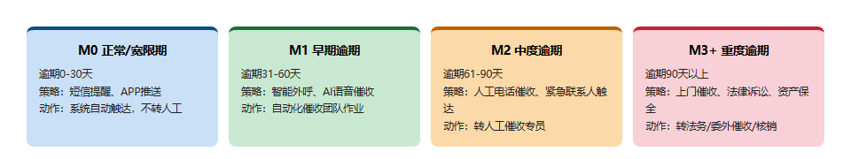
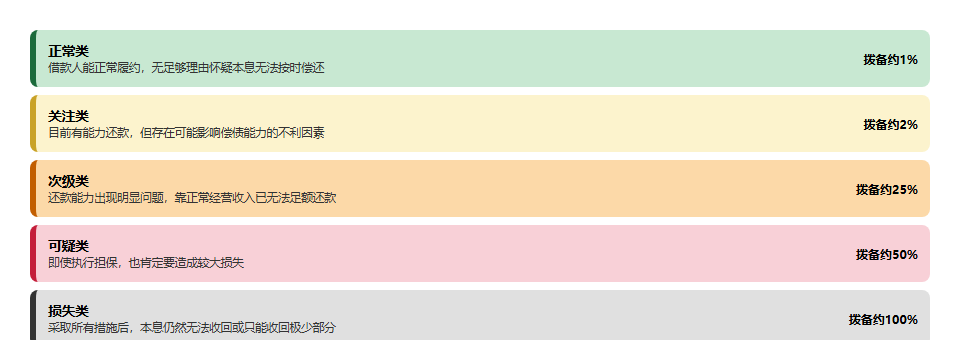
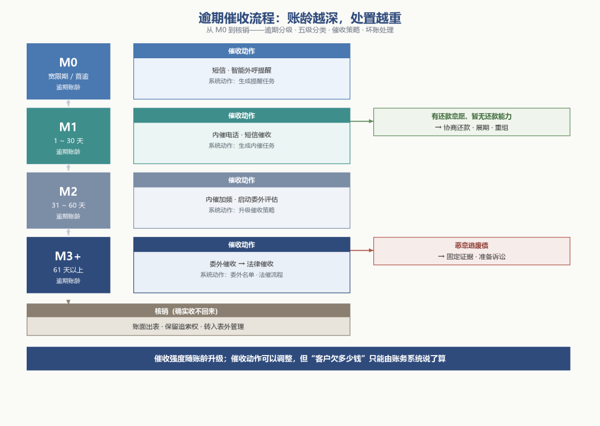
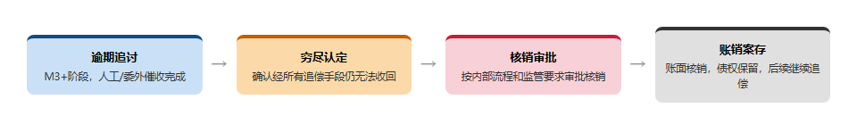
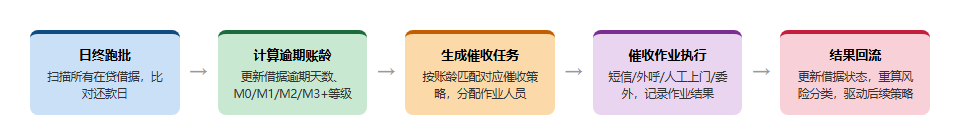
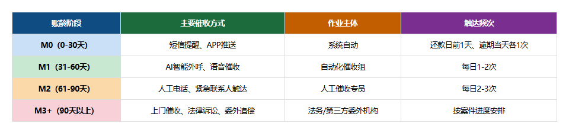

# 逾期与催收机制（贷后）

> 公众号：侃西东　·　发布日期：2026-09-26　·　[微信原文](https://mp.weixin.qq.com/s?__biz=MzIzNzQ5NjU5NQ==&mid=2247484481&idx=1&sn=18c95d9c9f67099184c8b1d32b194b08&chksm=e8c6f43ddfb17d2ba75d4e215f8c56315a665caa6c685dfe2fc147492bd4b4ebde55d2c1b594)

---

四、逾期与催收机制（贷后）

图2-14逾期账龄分级与催收策略对应关系

还款期里，总有客户不能按时还钱。逾期与催收是信贷机构最不愿意面对、却又不得不认真对待的环节。它是坏账的源头，也是信贷风险的最后一道防线。从业务上看，逾期管理要回答三个问题：什么时候算逾期、逾期多严重、怎么把钱收回来。从系统上看，这三个问题分别对应逾期分级、风险分类和催收作业。

### （一）逾期分级：从M0到M3+

逾期不是一个瞬间的二分状态，而是一个随时间加深的过程。业内用"账龄"来标记逾期的严重程度，最常见的记法是 M0、M1、M2、M3 一直到 M6、M7+。M0 通常指已到期未还但还在宽限期内或刚开始逾期，M1 指逾期 1 期（通常是 1~30 天），M2 指逾期 2 期（31~60 天），M3 指逾期 3 期（61~90 天），M3 以上逐级加深。不同机构的划分口径略有差异，但核心逻辑一致：逾期天数越多、账龄越深，回收率越低，处置策略越重。

零售贷后是系统自动盯还款行为；对公贷后是客户经理定期上门查企业经营情况，看现金流有没有变化。

逾期分级的系统实现，依赖一个每天自动跑的"逾期计算批处理"：每天日终，系统扫描所有在贷借据，比较当前日期与每期还款日，计算每期欠款的逾期天数，据此更新借据的逾期状态和逾期账龄。这个批处理是贷后系统的"心跳"，它驱动着后续所有的贷后动作。逾期状态变了，催收任务要生成，风险分类要重算，利息罚息要计提。我在民营银行做贷后系统时，逾期计算批处理的正确性直接决定第二天催收团队的工作清单，批处理一旦跑错，要么该催的客户没人催，要么不该催的客户被打扰，两头都是投诉。

图2-15信贷资产五级分类与拨备计提参考

从贷后管理的目标看，逾期账龄是"事实层"，风险分类则是"判断层"。按照监管要求，信贷资产要做五级分类：正常、关注、次级、可疑、损失。正常类指借款人能履行合同、没有足够理由怀疑本息不能按时足额偿还。关注类指尽管目前有能力偿还，但存在一些可能对偿还产生不利影响的因素；次级类指还款能力出现明显问题、依靠正常经营收入已无法足额偿还本息；可疑类指借款人无法足额偿还本息，即使执行担保也肯定要造成较大损失。损失类指在采取所有可能的措施后，本息仍然无法收回或只能收回极少部分。

五级分类不是信贷员拍脑袋定的，而是由一套分类规则驱动的：逾期天数、诉讼状态、担保状态、还款能力评估，多个信号共同决定分类结果。信贷系统的服务划分把五级分类列为贷中服务之一，说明分类要持续动态更新，而不是只在某个时点做一次。五级分类直接影响两个东西：一是拨备计提，不同分类的贷款要按不同比例计提贷款损失准备，损失类贷款几乎要全额计提。另一个重头是资产质量考核，不良率是银行经营的核心指标，次级、可疑、损失三类合称不良贷款。

对做系统的人来说，五级分类要小心一个概念：分类和账龄并不等同。逾期90 天以上通常要至少归为次级，但逾期 90 天以内的贷款也可能因为其他信号被下调到次级或可疑；反之，一笔逾期贷款通过重组恢复正常还款，分类也能上调。所以分类状态机是独立的，它有自己的一套状态和迁移规则，与逾期状态机、借据状态机并行存在、互相影响。

需要说明的是：五级分类是监管强制要求的法定口径，所有银行对外报送必须按这五类报；为了内部精细化管理，大行通常会在五级基础上再拆细成10~12级内部评级，正常类下面再分好几档，对应不同的审批权限和定价空间。系统设计上要同时支持这两套口径：对外监管报表走五级，内部审批和定价走细分的12级，两套口径之间有固定映射关系，不用互相冲突。

五级分类的口径和它在系统里的落地，值得单独展开。

做对公贷款的风险分类，不能只看逾期天数：企业财报恶化、行业政策突变、担保物贬值，即使没逾期，也会直接把分类从正常调到关注甚至次级；产业金融的风险分类更特殊，核心企业如果出现风险信号，整条供应链上所有依托它授信的上下游客户，分类都要同步下调，不是一笔一笔单独判断。

**表2-2五级分类与拨备计提参考**

| **分类** | **风险特征** | **拨备计提参考** |
| --- | --- | --- |
| 正常 | 能按时足额偿还本息 | 低 |
| 关注 | 存在可能影响偿还的不利因素 | 中低 |
| 次级 | 还款能力明显出现问题，正常经营收入不足以偿还 | 中高 |
| 可疑 | 无法足额偿还本息，执行担保也肯定造成较大损失 | 高 |
| 损失 | 采取一切措施后仍无法收回或只能收回极少部分 | 接近全额 |

表格里"拨备计提参考"是系统实现的落点：每期计提时，按借据当前分类查对应的计提比例，计算应计提拨备，与已计提数比较，差额入账。这个"计提—冲回"的循环每天都要跑，所以五级分类服务要每天更新分类结果，并把分类结果同步给财务系统和监管报送系统。我在做核心系统时，五级分类和拨备是监管检查的重灾区，口径必须和监管定义逐字对齐，任何自定义的"简化分类"都是在给自己埋雷。

### （三）催收策略：内催、委外与法催

确定逾期账龄和风险分类后，进入催收环节。催收按强度和渠道分成几个梯队：内催、委外催收、法催。

内催是机构自己的催收团队作业，适用于逾期早期。M1 阶段的客户多数只是暂时资金周转困难，内催通过电话、短信提醒就能收回可观的比例。M2、M3 阶段则引入委外催收，把催收任务外包给专业的催收公司，利用其更密集的作业能力和更成熟的催收话术。委外催收要解决系统层面的数据交接：委外名单的生成、催收结果的回传、佣金结算，每一环都要有据可查。法催是最后的手段，对逾期时间长、金额大、协商无果的客户，走诉讼、仲裁、强制执行程序，用法律手段处置抵押物或追偿。信贷系统里的资产保全服务，就是支撑法催和担保物处置的系统能力。

零售贷款的催收以短信、智能外呼为主，靠系统自动触达；对公贷款逾期了不是打电话提醒，是客户经理直接上门沟通，了解企业经营困难、协商调整还款计划；产业金融里如果上游供应商出现逾期，很多时候会通过核心企业协调还款，不是直接对小微企业硬催。

图2-16逾期催收流程：账龄越深，处置越重

催收作业本身对系统的依赖很强。贷后催收、催收预警、失联修复、智能外呼四个服务构成了催收作业的骨架：催收预警按逾期账龄和风险分类生成催收任务和优先级；失联修复利用多方数据更新客户联系方式，解决"找不到人"的问题；智能外呼用机器人外呼代替人工初筛，把接通率高、有意愿还款的客户转人工，把无效电话过滤掉。我常说，催收系统做得好不好，看它对"人、案、策"的管理：每一个逾期客户是"人"，每一笔逾期欠款是一个"案"，每一个案件配什么催收策略是"策"，三者之间的匹配和流转就是催收系统的主线。

催收过程中还要处理客户的还款意愿与还款能力。有些客户不是不想还，是实在没钱，这类客户可能转入协商还款、展期、重组；有些客户是恶意逃废债，这类客户要尽早固定证据、准备诉讼。判断客户属于哪种，既要看催收人员的沟通记录，也要看系统的客观数据。还款历史、资产状况、失联情况，这些数据要沉淀下来，成为后续催收策略和信用评估的输入。

### （四）核销与坏账处理

图2-17坏账核销全流程：账销案存

催收流程走到最后，一部分贷款确实收不回来了。这时进入核销环节：把确实无法收回的贷款从账面上核销掉，转入表外管理，同时保留追索权。核销不是放弃债权，而是会计处理上的"出表"，债权还在，后续如果追回，可以冲回。核销要经过严格的审批流程，要逐笔登记核销原因、催收记录、法律处置情况，形成完整的核销档案。资产保全服务和核销管理共同构成了信贷资产的"出口"，保证每一笔损失的认定都有据可查。

坏账处理的背后，是信贷业务与财务核算的紧密耦合。五级分类决定拨备计提，拨备计提影响利润，核销影响资产负债表。这套联动关系决定了信贷系统的账务设计从一开始就要考虑"资产质量账"：除了客户维度的贷款账，还要有资产质量维度的分类账、拨备账、核销账。很多信贷系统上线后才发现账务对不上，根源就是只做了业务账，没做资产质量账，等到要出监管报表时，数据东拼西凑、口径打架。这一节的结论是：贷后不是一个孤立的催收模块，它是连接业务系统、财务系统、监管报送系统的中枢，设计时就要把这三条线一起考虑。

### （五）逾期与催收的数据主线

图2-18逾期与催收的数据主线闭环

把逾期分级、五级分类、催收串成一条数据主线，贷后系统的结构就清楚了：还款计划是"计划层"，实际还款是"发生层"，逾期账龄是"差异层"，五级分类是"判断层"，催收任务是"行动层"。每一层都在回答贷后管理的一个问题，各层之间通过借据编号和期次关联。

这条主线还有一个重要的设计原则：催收动作不能改变账务事实。催收人员可以调整催收策略、协商还款方案，但"客户欠了多少钱"这个事实只能由账务系统说了算。催收系统和账务系统要严格分离：催收系统管"怎么催"，账务系统管"欠多少"，协商减免等涉及账务的调整，必须走账务系统的事务处理，催收系统只能提交申请、不能直接改账。这个边界一旦模糊，就会出现催收员为了业绩乱承诺减免、账务却对不上的乱象。

### （六）逾期账龄与催收策略的对照

图2-19逾期账龄与催收策略四维度对照

逾期账龄直接决定催收策略，两者之间的对应关系，是贷后运营最常用的配置表。不同机构的具体口径有差异，但整体逻辑一致：账龄越深，催收强度越高、处置手段越重、回收率越低。

**表2-3逾期账龄与催收策略对照**

| **账龄** | **逾期天数** | **主要策略** | **系统动作** |
| --- | --- | --- | --- |
| M0 | 宽限期/首逾 | 短信、智能外呼提醒 | 生成提醒任务 |
| M1 | 1~30天 | 内催电话、短信催收 | 生成内催任务 |
| M2 | 31~60天 | 内催加频、启动委外评估 | 升级催收策略 |
| M3+ | 61天以上 | 委外催收、法律催收 | 委外名单、法催流程 |

这张表在系统里对应一套"账龄驱动的策略路由"：逾期账龄变化时，系统自动调整该借据的催收策略和任务优先级。策略路由要可配置，因为监管对催收有严格规范（催收时间、催收频次、不得骚扰第三方等），策略配置必须内嵌合规约束。我在做催收系统时，把"账龄—策略—合规限制"做成一张可配置的策略表，运营调整策略不需要改代码，监管检查时也能快速解释每个策略的设定依据。

催收策略还要考虑一个现实的折中：催收成本与回收金额的平衡。M0 阶段的催收成本低、回收率高，值得投入；M6 以上的长账龄贷款，催收成本可能超过回收金额，这时候的策略就不是"不惜成本地催"，而是评估是否进入核销或资产处置。催收系统的价值，就是让每一分催收投入都花在回收概率最高的案件上。这也正是催收预警、失联修复、智能外呼这些系统能力存在的意义。

讲到这里，传统贷后流程就全部讲完了。但在AI时代，贷后其实是变化最大的一个环节——它早就不是"逾期了才打电话"的老样子了。

现在成熟的AI贷后，从放款那一刻就启动了：系统实时监测客户的还款行为、消费变化，自动预测这笔贷款未来的逾期概率，风险高的提前预警，不用等到逾期了再慌。真逾期了，AI先按客户画像和逾期阶段自动匹配催收策略，用智能外呼先触达，全程自动质检话术合不合规、有没有越界；到了不良处置阶段，AI会自动算抵押物的回收率、匹配最优处置路径，整个过程所有操作全程留痕，随时能查。

我在做贷后系统的时候最大的感受是：以前贷后是"出了问题再救火"，现在AI把贷后变成了"没出问题就提前预防、出了问题自动处理、全程合规兜底"——这部分技术细节，我们在后面第十五章讲AI工程落地的时候还会细讲，这里先给大家有个印象。
