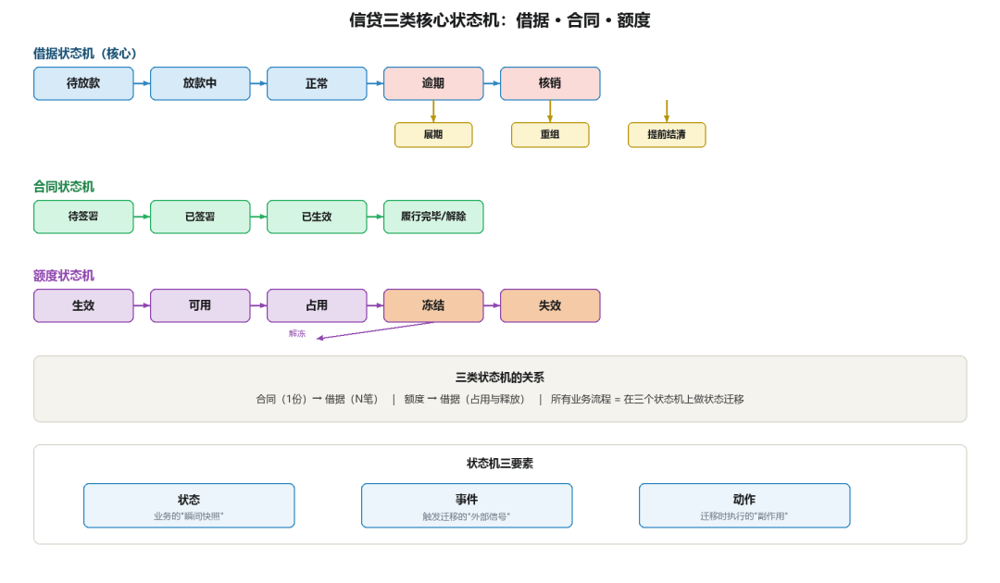
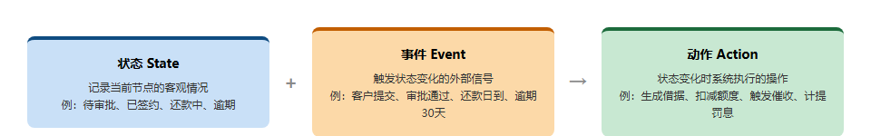
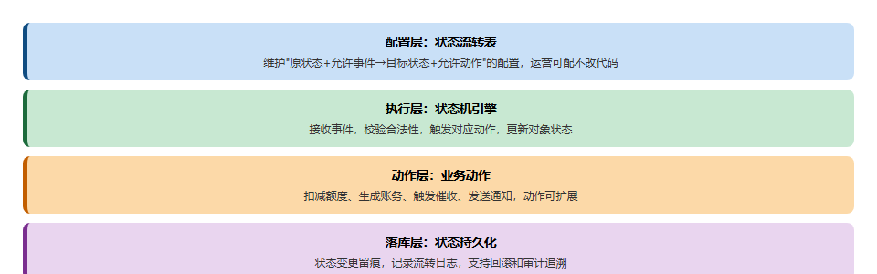
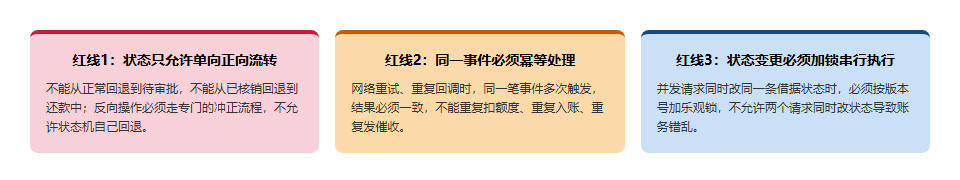
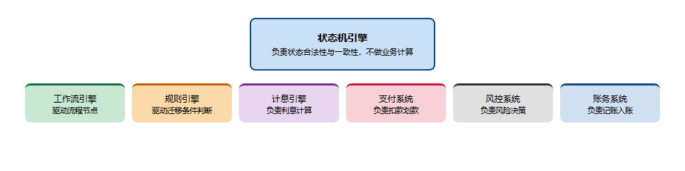

# 贷前贷中贷后全景图：信贷状态机视角

> 公众号：侃西东　·　发布日期：2026-09-27　·　[微信原文](https://mp.weixin.qq.com/s?__biz=MzIzNzQ5NjU5NQ==&mid=2247484503&idx=1&sn=edf3800dbcdd502dfcb49974b70cd942&chksm=e8c6f42bdfb17d3d10f57ae020510ae743ca82eec4880cf1a7964a487a357918025d1ad74f01)

---

五、贷前贷中贷后全景图：信贷状态机视角

图2-20信贷全生命周期状态机全景

前面四节把贷款的一生按业务环节走了一遍：贷前进件审批、风险评估定价、贷中签约放款、贷后还款催收。这一节要把视角从"流程"切换到"状态"，用状态机的眼光把整个信贷生命周期重新看一遍。我坚持认为，状态机视角是所有信贷系统设计的钥匙。流程是业务对外的样子，状态机是系统对内的骨架。流程可能因为机构、产品、渠道不同而千变万化，但状态机一旦设计稳定，就能以不变应万变。

### （一）为什么必须用状态机

图2-21为什么信贷系统必须用状态机

很多初学信贷系统的工程师会问：一笔贷款不就是一个字段加一个值吗，为什么要大动干戈搞状态机？这个问题的答案，藏在信贷业务的两个本质特征里。

一笔借据从生成到结清要经过十几种状态，业务又是天然异步长流程，系统必须明确记录"这笔业务进行到哪一步"；状态本身就是可观测、可审计的数据。

我在国有大行做核心系统时，审计要求每笔业务都能追溯状态变化；后来在一家外资银行做对公信贷系统，因为要同时满足全球总部和本地监管的双重留痕要求，状态迁移日志的粒度更细——连操作人、操作终端ID、审批人当时的权限校验记录都要全量留存，这也是我后来坚持状态机必须全量留痕的直接原因。

### （二）三类核心状态机：借据、合同、额度

信贷系统里最重要的是三类状态机：借据状态机、合同状态机、额度状态机。三者分别管理"一笔贷款的钱""一份合同的约""一个可用的额度"，既相互独立又彼此联动。

借据状态机是本章最核心的，借据是债权债务的最小单位，它的状态几乎覆盖贷款的全部生命周期：放款后进入正常，按期还款直到结清，逾期恶化可能核销，期间还可能经历展期、重组、提前结清等迁移。借据状态机的设计质量，直接决定整个贷后系统的复杂度。下面是借据状态机的核心状态与迁移：

图2-22信贷三类核心状态机：借据·合同·额度

图2-23借据核心状态迁移路径

| **状态** | **含义** | **主要迁入动作** | **主要迁出动作** |
| --- | --- | --- | --- |
| 待放款 | 已签约待放款 | 签约完成 | 放款成功→正常 |
| 正常 | 在贷且无逾期 | 放款成功、逾期结清 | 逾期→逾期；结清→已结清 |
| 逾期 | 存在欠款 | 还款日未足额还款 | 结清→正常；展期→展期 |
| 展期 | 期限已延长 | 展期审批通过 | 到期→正常；恶化→逾期 |
| 核销 | 已核销出表 | 核销审批通过 | 追回→已结清 |
| 已结清 | 贷款已结清 | 全部本息清偿 | 无 |

合同状态机的任务，是管理合同的签署与生效。合同从待签署、已签署、已生效，到履行完毕或解除、终止。合同状态机和借据状态机不是一一对应的：一份合同可以对应多笔借据（比如循环额度合同下多笔提款），合同已生效但某笔借据可能已结清。所以两者是"一对多"的关系，要分别管理、通过合同编号关联。

额度状态机管理额度的可用性。额度从生效开始，处于可用状态，占用后余额减少但仍可用，冻结后不可用，解冻后恢复可用，失效后永久不可用。额度状态机在下一节授信与额度管理里详细展开，这里先记住它的存在。额度、合同、借据三个状态机构成了信贷系统的主干，所有业务流程都是在这三个状态机上做状态迁移。

### （三）状态机的设计与流转：状态、事件、动作

图2-24信贷状态机三要素：状态·事件·动作

设计状态机有三个要素：状态、事件、动作。状态是业务的"瞬间快照"，事件是触发迁移的"外部信号"，动作是迁移发生时系统要执行的"副作用"。以借据从"正常"迁到"逾期"为例：状态是"正常"和"逾期"，事件是"还款日未足额还款"，动作是"生成逾期记录、计提罚息、触发催收任务"。把这三个要素拆清楚，状态机的实现就水到渠成了。

设计状态机时最容易犯的错误，是把业务动作和状态迁移混为一谈。比如"还款"不是一个状态，而是一个动作，还款动作成功后才触发"逾期 → 正常"的状态迁移；"放款"也不是状态，放款指令发出后借据进入"放款中"，资金确认到账后才迁到"正常"。把动作和状态分开，系统的职责就清晰了：动作层负责执行业务逻辑（算息、记账、发指令），状态层负责记录业务所处的位置。这也是为什么状态机框架通常只负责状态迁移，而把业务逻辑放在动作处理器里。

状态迁移的合法性要用"迁移表"显式定义，而不是散落在业务代码里。一个规范的状态机，应该把"从哪个状态 + 什么事件 → 迁到哪个状态 + 执行什么动作"集中维护，这样新增一个迁移只需要改配置，而不是在代码里到处找 if 分支。我见过最痛苦的状态机，是每个业务方法里都有一段手写的状态判断，十几个人维护三年之后，没人敢改，因为根本不知道改一处会影响多少条状态路径。集中管理的迁移表，是状态机长期可维护性的保障。

做状态机设计还有两个实战坑要避开：第一个是漏定义异常状态，很多人一开始只画了正常的状态流转路径，忘了"放款失败""抵押登记驳回""挂起待人工处理"这些异常分支，最后系统里出现大量卡在中间态的僵尸借据，没人知道该怎么处理；第二个是状态迁移不加校验，任何代码都能随便改借据状态，最后数据被改得一塌糊涂，对账的时候对不上。我在早期做系统时就踩过这两个坑：先把正常流程跑通就上线，结果一到真实环境，各种超时、驳回、人工挂起的情况全出来了，系统里堆了几百笔不知道该往哪迁的借据，最后花了半个月才把这些异常分支补全。从那以后，我设计状态机第一件事不是画正常流程，是先把所有可能的异常状态列出来。

### （四）状态机在代码中的实现

图2-25状态机工程实现四层架构

状态机的落地，有从简到繁的三条路线：枚举+ 条件判断、状态模式、状态表驱动。

状态机实现流程里，最简单的是枚举加条件判断。用枚举定义状态，在每个业务方法里用条件分支判断当前状态是否允许执行某操作。优点是直观、无框架依赖，适合状态少、迁移简单的场景；缺点是状态判断散落在业务代码里，状态多了之后容易失控。

再进一步是状态模式，把每个状态定义成一个类，状态相关的行为放在对应类里，状态迁移表现为状态对象之间的切换。状态模式的封装性好，但类数量随状态增长，对于有十几个状态的借据状态机，状态类会变得笨重。

工程上最常用的是状态表驱动。把状态迁移表作为配置（可以是数据库表，也可以是规则配置），状态机引擎读取配置执行迁移。状态表驱动的好处是迁移规则可视化、可审计、可动态调整。下面是借据状态迁移表的简化示意：

表2-4借据状态迁移配置表

| **当前状态** | **事件** | **目标状态** | **动作** |
| --- | --- | --- | --- |
| 待放款 | 放款成功 | 正常 | 生成还款计划、立账 |
| 正常 | 还款日未足额还款 | 逾期 | 生成逾期记录、计提罚息 |
| 逾期 | 足额还款 | 正常 | 核销欠款、解除逾期 |
| 逾期 | 展期审批通过 | 展期 | 重算还款计划 |
| 正常 | 全部清偿 | 已结清 | 结清账务、释放担保 |

图2-26借据核心状态迁移链路

状态表驱动还有一个附带收益：迁移本身可以被记录成日志，形成完整的状态变更轨迹，这正好呼应前面说的"可观测"和"可审计"。工程实现上，可以在状态机引擎里统一拦截迁移动作，把"从哪来、到哪去、谁触发、何时触发、业务流水号"写入状态迁移日志表，一劳永逸地解决审计追溯问题。

无论哪种实现方式，状态迁移的原子性、事件处理的幂等性、状态的可回滚性这三条工程红线必须守住，这是信贷系统资金不错、状态不乱的底线。

### （五）状态机的并发与幂等：三条红线

图2-27状态机并发与幂等三条工程红线

状态机落地后，真正的考验在并发。我在作者手记里讲的事故，本质就是状态机在并发下失守。这里把三条红线展开讲清楚。

### （六）状态机与业务系统的边界

图2-28状态机引擎与周边业务系统的职责边界

最后要明确状态机引擎在架构里的位置：它是业务系统的骨架服务，只管状态迁移的合法性和一致性，不算息、不扣款、不做风控评分；算息交给计息引擎，扣款交给支付通道，评分交给风控引擎。零售消费贷的状态机最简单，对公、产业金融、保理、融租的状态机复杂度会高一个量级，核心是多主体、跨节点的状态联动，这是做这类业务系统时最容易踩坑的地方。

信贷系统里，工作流引擎、规则引擎、统一调度等基础组件，其实都是在为状态机服务：工作流驱动流程节点，规则引擎驱动迁移条件，统一调度驱动批处理。理解了状态机是整个信贷系统的中枢，再去看系统架构图上那一堆服务和组件，它们的位置和职责就都说得通了。
