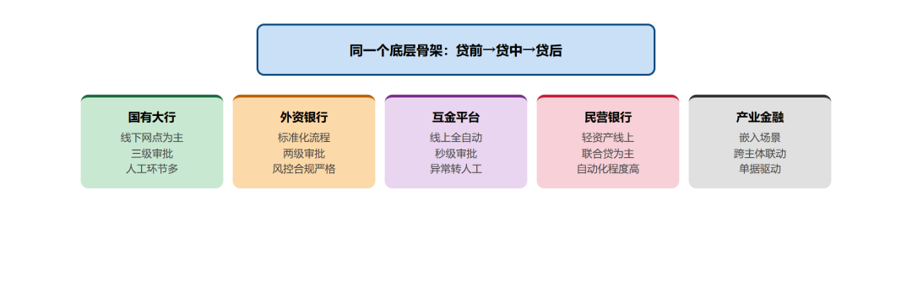
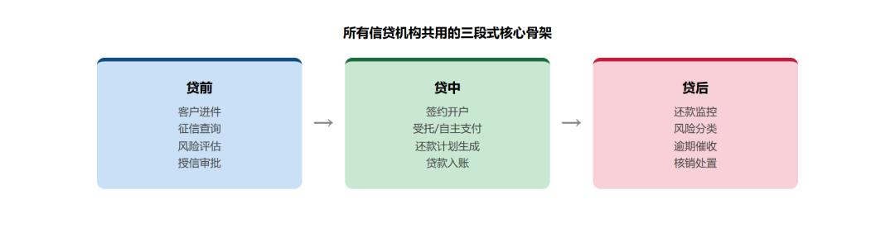
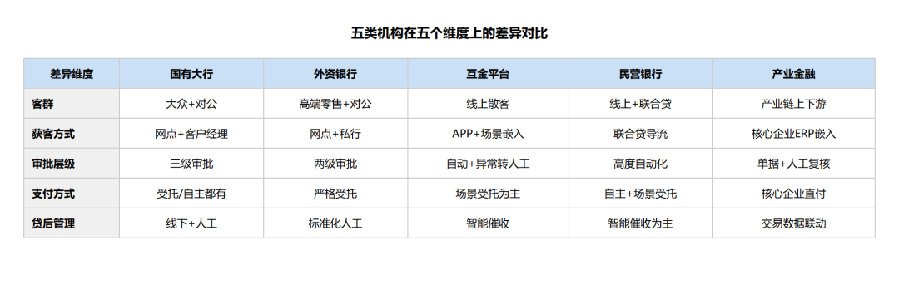
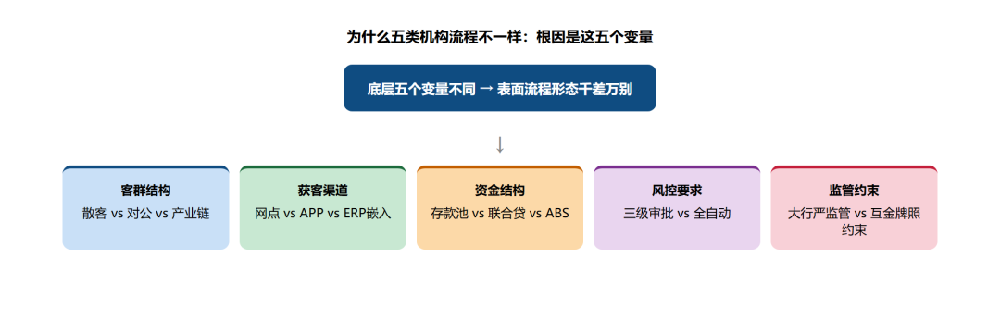
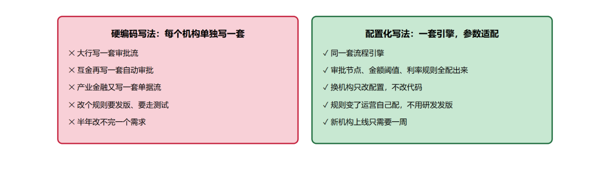
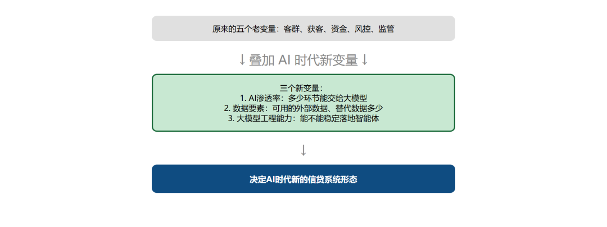

# 五个机构的信贷流程

> 公众号：侃西东　·　发布日期：2026-10-01　·　[微信原文](https://mp.weixin.qq.com/s?__biz=MzIzNzQ5NjU5NQ==&mid=2247484559&idx=1&sn=f54b275455fb6a095a9c9ec4fa93d870&chksm=e8c6f4f3dfb17de52f1f89ee9ff178a70fe1795d69d266b1b3e1f08d85b32fcc39f99520d2d7)

---

九、五个机构的信贷流程：长得不一样，骨头是一样的

图2-48五类机构信贷流程：表面形态不同，底层骨架一致

做这二十年信贷系统，我先后在国有大行、外资行、互金平台、民营银行、产业金融集团都待过，每次换机构做项目，刚接手都觉得"这怎么和以前做的完全不一样"，但做久了就会发现，表面上流程差得越多，底下真正撑着业务的骨架反而越像。

先说国有大行的对公贷款，流程是真的长：客户经理线下尽调、写报告，支行初审、分行复审、总行审批，一笔几百万的贷款走下来要一两周。系统是紧耦合的，改个额度规则要走严格的变更流程，因为服务的是大项目、大企业，稳比快重要。

外资行的做法是另一种感觉。流程规范到近乎刻板，合规要求比国有大行还严，每一步都要留痕，审批标准卡得很死，不会因为客户急就走绿色通道。系统设计上也是把合规要求刻进流程里，没有灵活操作的空间。

到了互金平台，整个节奏一下变了。没有线下网点，客户全是线上来的，从申请到放款全流程自动，几秒钟出结果。系统追求的是高并发、快响应，一天几十万笔申请，靠人工根本审不过来，全靠规则和模型自动跑。

民营银行，和互金的逻辑接近，但又有银行的牌照约束：线上获客、轻资产运营，因为不能跨区域展业，主要服务本地小微和个人客户，流程比大行短得多，但又要满足银行的监管要求。因为没有线下网点、自营获客成本高，民营银行大量做联合贷，和互联网平台、担保公司合作获客，很多风控规则是合作方和银行共同制定的，流程上要同时满足银行牌照监管和合作方的业务要求，比纯互金平台多了一层合作方协同。

到产业金融场景，又换了个场景。系统不是直接给C端用户用的，是嵌进核心企业的ERP里，给上下游的供应商、经销商做融资。围绕核心企业看交易数据，流程比纯零售重，比纯对公轻，是介于两者之间的形态。和纯对公贷款不一样的是，这里的客户是上下游供应商和经销商，核心企业不是借款人，而是合作方：订单、发票、应付账款这些关键数据是核心企业系统直接推送过来的，供应商不用自己上传一堆材料，成熟阶段系统直接和核心企业的ERP、财务系统对接做自动验真；早期项目也有通过线下对数、ODS数据同步来做贸易背景核验的，这是一个从浅到深的对接过程，发展方向是最终嵌进核心企业的业务流程里。

讲到这里你可能会问，这一路听下来，从国有大行的复杂流程到互金平台的30秒自动放款，流程差距这么大，那做系统的时候到底该按谁的来？

我的体会是，不用慌。不管这些机构的流程外表差多远，真正撑着信贷业务的那套骨架从来没变过，变的只是每一步怎么做、做的快慢。

## （一）哪里一样：三段式骨架没变

图2-49所有信贷机构共用的三段式核心骨架

不管是国有大行、外资行、互金平台、民营银行还是产业金融集团，信贷流程的核心骨架都是三段：贷前看能不能贷，贷中放了钱怎么管，贷后还不上怎么办。状态机的本质也没变：申请→审批→放款→正常→逾期→结清，这个状态流转，哪家都一样。

这就是为什么我在第一章说，信贷业务的本质是一样的，系统只是把机构的禀赋固化成软件。流程也是这个道理，骨架不变，变的是每一步的做法和快慢。

### （二）哪里不一样：五个维度拉开了差距

图2-50五类机构在五个核心维度上的差异对比

我把五个机构的差异拆成五个维度，你一看就懂：

五个机构在审批速度、人工占比、单据复杂度、风控介入位置、合规严格程度五个维度上差异明显，直接看图即可理解核心区别。

### （三）为什么会不一样：还是那五个变量

图2-51五类机构流程差异的根因：五个底层变量决定形态

为什么这些流程能差这么多？绕回第一章讲的那五个变量就全通了：客群是谁、钱从哪来、风控怎么做、合规管多严、技术底座到了哪一步。

国有大行的客户是大众，钱多（存款），所以流程可以慢一点，人工可以多一点，因为要服务好大众客户，不能出错。互金平台的客户是线上用户，钱是同业拆借和联合贷，所以必须快，必须全自动，不然成本兜不住。产业金融的客户是核心企业上下游，钱是集团资金，所以必须核贸易背景，必须控制资金闭环，不然容易出现虚假融资。

这也是我做了这么多项目最深的体会：接手一个新机构的信贷系统，别上来就改流程，先把这五个变量摸清楚——客户是谁、钱从哪来、风险怎么控、合规要什么、技术能力到哪，变量定了，流程该长什么样自然就清楚了，根本不用照抄别家的方案。

### （四）程序员怎么衔接：别写死，要配置化

图2-52硬编码vs配置化：程序员怎么衔接五类机构差异

我做了这么多年信贷系统，最深的体会是：好的信贷系统，流程不是写死在代码里的，是配置出来的。

什么意思？比如同样是"审批"这个环节，国有大行的大额对公贷款要走网点→支行→分行的多级审批，但他们现在的线上消费贷、小微线上贷也已经做了自动审批；外资行的常规业务是客户经理→信审经理两级审批，大额项目也要上报总行；互金平台大部分业务自动审批，高风险、大额订单还是转人工；民营银行主力是线上自动审批，特殊业务也保留人工复核；产业金融标准化的供应链融资可以自动验真自动审批，复杂的贸易背景还是要人工复核。不同产品、不同风险等级的业务，审批层级完全不一样，如果把审批流程写死在代码里，换个产品、换个机构都得重写。哪怕是同一家银行，10万以下的线上消费贷系统自动审批，100万的经营贷要支行客户经理复核，1000万的对公项目贷款要分行甚至总行审批，审批节点是跟着额度、产品、客户风险等级走的，不是按机构写死的。

正确的做法是把流程做成可配置的：流程节点可配，每个节点的处理人可配，每个节点的处理规则可配，每个节点的耗时阈值可配。这样，不同机构的流程差异，就是不同的配置，不是不同的代码。

我最早在国有大行参与新一代信贷系统建设时，就开始把原来写死在代码里的审批流程拆成可配置的流程节点，那时候还没有现在的低代码概念，但核心思路就是别写死。后来到了互金平台，这套配置化思路被做到了极致：一个流程引擎，上面挂不同的流程模板。消费贷用这个模板，经营贷用那个模板，新上线一个产品，配一套流程模板就够了，不用改代码。这也是为什么互联网公司迭代快，因为流程是配置化的，不是硬编码的。

### （五）AI时代的新变量

图2-53 AI时代新增的三个系统形态决定变量

到了AI时代，又多了一个新变量：AI能替代多少人工。以前流程里必须有人做的环节，现在AI能做多少，直接决定了流程能缩到多短。

比如以前贷前要人工调查，现在AI可以自动查征信、自动查多头、自动评分，人工只做复核。以前贷后要人工催收，现在AI外呼可以覆盖70%的逾期案件。这些变化带来的最直接效果是人效的提升：以前一个信审员一天审几十笔单子，大部分时间花在核对材料、录信息这些重复劳动上，现在AI把这些活干了，一个信审员能管以前十倍的业务量，工作内容也从"对着单子做判断"变成"处理AI拿不准的异常件、监控模型的表现"。组织结构也跟着变了：以前按流程拆成进件部、审批部、贷后部，一层一层审核，现在大量重复节点被AI替代，组织结构扁了很多，原来做重复审批的岗位大幅缩减，新增了模型运营、AI训练数据标注这些新岗位，人从流程的节点里抽出来，去做更需要经验判断的事。

所以程序员看信贷流程，别只看表面的步骤多少，要看背后的变量是什么，哪些是必须人做的，哪些是AI可以替代的，哪些是合规要求必须留的。想明白这些，流程怎么设计就清楚了。

## 本章小结

第一句话：信贷流程的本质是状态机。贷前、贷中、贷后不是三个割裂的阶段，是同一笔业务在一组状态里流转；状态定义不清、迁移不合法，后面所有的系统设计都会塌。

第二句话：流程的要害在衔接。进件和审批之间、放款和记账之间、还款和报送之间，每一处衔接都是风险点，幂等、对账、留痕，都是为衔接而生的。

第三句话：AI 重塑了流程，但没有改变流程的骨架。智能审批、自动尽调、实时预警的结论，最终都要落回额度状态机和借据状态机；骨架稳，AI 才挂得住。

到这里，第二章可以收尾了。你手里的钥匙已经齐了：业务的流程、系统的状态机、数据的额度账务。不过，动手拆系统之前，我们得先过一道“合规关”，下一章，先把监管的线画清楚；本章埋下的每一条状态迁移规则，都会在后面架构、账务、风控各章找到它的系统落点。

***【作者手记】一个状态字段引发的生产事故***

讲完AI 流程，回到一个我答应过要详细复盘的事故。它发生在我做信贷系统早期，代价是一笔重复放款和一笔重复代扣，几乎踩中了本章讲的所有坑：状态覆盖、幂等缺失、并发控制。

事故的起因是一笔放款请求。放款接口收到请求后，先查借据状态、校验是否允许放款，再扣减额度、生成借据、向资金方发放款指令。问题出在校验和执行的窗口期：两个放款请求同时到达，都查到"待放款"状态，都通过校验，各自执行了放款，同一笔贷款被放了两笔。

复盘根因有三层：第一，状态判断与状态更新不是原子操作，校验之后状态被另一请求改掉；第二，缺少幂等，放款请求没有全局唯一流水号，资金方无法判断两笔指令是不是同一笔业务；第三，额度扣减没有并发控制，两个请求各读各扣，额度被扣了两次。

修复也三层对治：状态迁移必须原子，"校验状态＋执行动作＋更新状态"放进同一事务或分布式锁；请求必须幂等，每个请求带全局唯一流水号，重复请求直接返回第一次结果；额度用"先扣后查"的强一致方式，行锁或乐观锁，扣减成功才继续。

这个事故从此改变了我写信贷代码的习惯：凡涉及资金、状态、额度的代码，先问三个问题，这个操作幂等吗？并发下状态会被覆盖吗？失败后怎么回滚？这就是本章反复强调的原子性、幂等性、可回滚性。AI 时代的流程重塑再热闹，这三条底线都不会变，因为它们守住的不是效率，是钱不会错。

这张表的核心判断是：智能体在信贷流程里的定位是"辅助提效"，不是"替代决策"，越靠近资金和风险的环节，人工兜底越严格。

往根上归类，这五类机构的流程其实就分两大流派：零售ToC和对公ToB。零售追求快、批量，系统设计往自动化、规模化上靠；对公追求准、可控，系统设计往严谨、风控、合规上靠。但你仔细拆就会发现，不管是秒批秒放的消费贷，还是要尽调、受托支付的对公贷款，背后的状态机、额度管理、账务核算这些核心骨架是一模一样的——这也是我为什么说"信贷系统换了无数种产品形态，内核从来没变过"。
