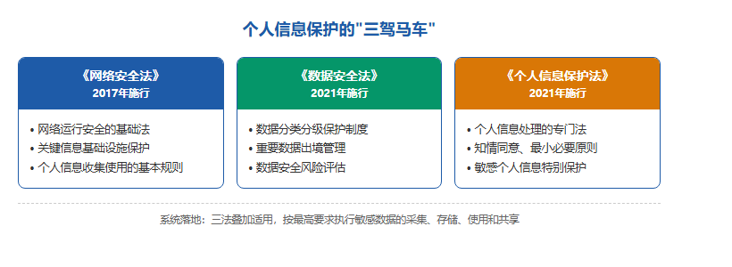
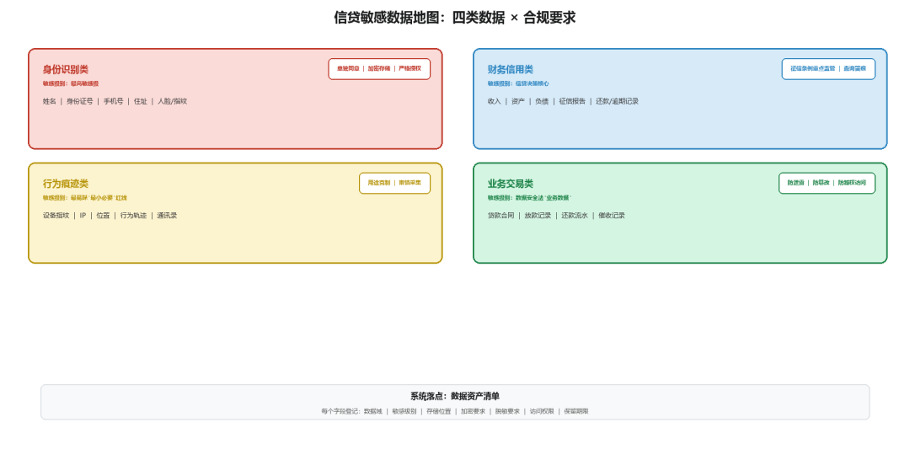
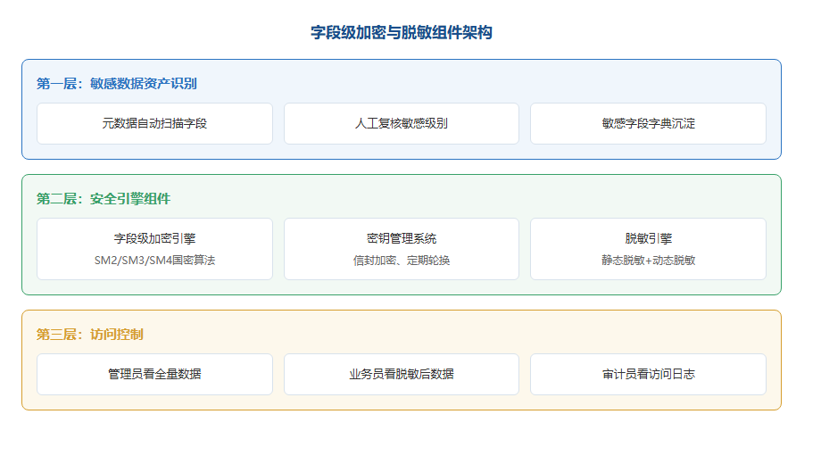

# 数据隐私与安全：数据是你的护城河，也是你的定时炸弹

> 公众号：侃西东　·　发布日期：2026-10-06　·　[微信原文](https://mp.weixin.qq.com/s?__biz=MzIzNzQ5NjU5NQ==&mid=2247484664&idx=1&sn=0c195d3df076fd1ed4b9d96b5e3abd4f&chksm=e8c6f484dfb17d92601846f0abbf71a90fcff938946fcf0a2bed5a411f77fb88b90b405f65d1)

---

二、数据隐私与安全：数据是你的护城河，也是你的定时炸弹

干信贷的天天跟数据打交道：客户申请要交身份证、收入证明、家庭住址，我们要查征信、拉流水、刷脸核验，贷后还要盯着钱往哪走。这堆敏感数据，既是你吃饭的本钱，也是监管盯得最紧的雷区。一旦数据漏了，客户不信你了，罚单也来了，品牌好几年都缓不过来。这节就把数据合规这点事说透。

### （一）**个人信息保护的"三驾马车"

**图3-7 个人信息保护的"三驾马车"：三部核心法律定位**

信贷系统数据合规主要受三部法律约束，我称之为"三驾马车"。

《个人信息保护法》（个保法，2021年11月1日施行）。这是我国第一部专门针对个人信息保护的法律，对信贷系统的冲击是结构性的。它确立了几条做系统必须遵守的原则：告知同意（处理个人信息要取得个人的同意，向第三方提供、处理敏感个人信息要"单独同意"）、最小必要（只处理与处理目的直接相关的个人信息）、目的限制（收集信息要有明确、合理的目的，不能超目的使用）、公开透明（处理规则要向个人告知）、可删除权（处理目的已实现或个人撤回同意等情形下，个人有权请求删除）。还规定了敏感个人信息（生物识别、特定身份、医疗健康、金融账户、行踪轨迹等）的更高保护要求，处理敏感个人信息需要"单独同意"并具有特定目的和充分必要性。对信贷系统来说，人脸识别、身份证号、征信报告、交易流水，几乎全是敏感或高价值信息，整个数据层都要按这个标准设计。

《数据安全法》（2021年9月1日施行）。这部法管的是"数据"这个对象本身的安全。它提出了数据分类分级制度，国家建立数据分类分级保护制度，对重要数据、核心数据实行更严格的管理。对信贷机构来说，就是要把自己掌握的数据分门别类、确定级别，不同级别的数据用不同强度的保护措施。它还规定了数据安全审查、数据交易管理、重要数据出境安全管理等要求。对做系统的人，数据安全法最直接的落点就是"数据资产盘点 + 分类分级表 + 分级保护策略"。

《征信业管理条例》（2013年3月15日施行）。前面说过，它管征信这个特定领域。对信贷系统最直接的三条：一是查询授权，查询个人征信报告必须取得信息主体本人的书面同意（含电子授权），授权要留痕；二是信息报送，机构向征信机构报送逾期等不良信息，要事先告知信息主体本人；三是异议处理，信息主体认为征信信息有误，有权向征信机构或信息提供者提出异议，收到异议后要在规定期限内核查处理。这三条直接对应系统的征信授权模块、报送模块、异议处理模块，后面讲监管报送的时候会展开。

### （二）个保法、GDPR、CCPA：三套尺子怎么对

做跨机构、做助贷、做对外资行对接的程序员，一定会遇到一个问题：数据合规的标准，国内一套（个保法）、欧盟一套（GDPR）、美国加州一套（CCPA），我该听谁的？答案是：业务场景覆盖哪里，就听哪里的；涉及跨境传输，要同时满足两端。我在这二十年里，在外资行经历过欧盟标准的严苛，在国内经历过监管趋严的演进，把三套尺子放在一起对比，能帮你快速定位差异：

**表3-1个保法、GDPR与CCPA数据合规对比**

| **对比维度** | **个保法（中国）** | **GDPR（欧盟）** | **CCPA（美国加州）** |
| --- | --- | --- | --- |
| 适用主体 | 在中国境内处理个人信息的组织 | 在欧盟设有机构，或向欧盟境内个人提供产品或服务 | 面向加州居民开展业务，且达到收入、数据规模门槛的机构 |
| 同意机制 | 一般信息同意即可，敏感信息须单独同意 | 须明确同意（opt-in），可随时撤回 | 告知加选择退出（opt-out），无须事先同意 |
| 敏感信息 | 单设敏感个人信息类别，从严保护 | 特殊类别数据原则上禁止处理 | 对敏感个人信息披露与使用设限 |
| 跨境传输 | 安全评估、标准合同、认证等途径 | 充分性认定、标准合同条款、约束性公司规则 | 无专门出境许可，但限制出售数据 |
| 违规处罚 | 情节严重最高五千万元或上一年度营业额5% | 最高2000 万欧元或全球年营业额 4%（取高者） | 每次违规最高7500 美元（故意违规） |
| 监管思路 | 以“告知—同意”为主线，兼顾发展与安全 | 个人权利优先，处罚最重 | 市场驱动，重在告知与选择 |

这张表的核心是三套尺子的"性格差异"：GDPR 最严，强调个人权利优先；个保法吸收 GDPR 理念并结合中国实践做了细化；CCPA 是市场驱动型，核心是告知和选择退出。做信贷系统，默认按最严标准设计是成本最低的选择，合规只有一次改造成本，按宽松标准做，将来业务扩展或监管升级时重建数据层代价更大。

还有一个绕不开的话题是数据出境。跨境经营的机构、对接境外服务商的团队，都要面对"数据能不能出境、怎么出境"的问题。个保法和数据安全法对个人信息和重要数据出境设置了门槛：出境要满足法定条件，比如通过安全评估、签订标准合同、取得保护认证等。对信贷系统来说，最现实的影响是：客户的征信数据、交易数据、身份数据，原则上"能不出境就不出境"，境内机构的数据处理尽量留在境内，确需出境的走合规通道。我在外资行做全球系统时，数据出境是合规部门一票否决的关卡，任何数据要跨地域传输，都要先过数据出境评估。做系统的同学要记住：数据流设计的第一个问题，不是"怎么传"，而是"能不能传、该不该传"。把数据出境当成"默认可以"，是所有跨境数据事故的共同起点。

### （三）信贷场景的敏感数据地图

要把数据合规落进系统，第一步是"盘点"，你得先知道手里有哪些数据、分别是什么级别。我把信贷系统里的数据画一张"敏感数据地图"：

**图3-8 信贷敏感数据地图：四类数据 × 合规要求**

数据分类分级在系统里的落点，是一张"数据资产清单"：每个数据字段登记它的数据域、敏感级别、存储位置、加密要求、脱敏要求、访问权限、保留期限。这张表是数据合规系统的"字典"，后面所有加密、脱敏、权限、日志功能都以它为依据。做对公和产业金融的还要多标一层：企业财报、纳税数据、海关报关单、核心企业ERP里的交易流水，这些不是普通客户信息，是商业秘密级的数据，保护级别要再提一档。尤其是供应链金融场景，数据是链上核心企业、上下游小微企业、资金方多方共享的，谁能看哪些字段、数据能不能传给资金方、对外提供时有没有拿到企业授权，这些都要在数据资产表里写清楚，比纯零售的权限规则复杂得多。我在做信贷中台时，最痛苦也最值钱的一步，就是把全机构几百张表、几千个字段从元数据平台导出来，先靠工具按字段名自动初筛打标签，再由业务、安全、数据owner一起逐个复核修正，把敏感级别、加密要求全部沉淀在数据字典里。没有这张统一的元数据字典，后面所有合规功能都是无根之木。

### （四）**技术落点·字段级加密与脱敏组件

**图3-9 字段级加密与脱敏组件三层架构**

数据合规的技术落点，主要围绕"加密、脱敏、留痕"三件事。

字段级加密与密钥管理。信贷系统的加密不能是"整库加密"这种一刀切，性能受不了，而且不是所有字段都需要。正确的做法是字段级加密：只对敏感字段加密，比如身份证号、手机号、银行卡号、住址。技术上有两个层次：一是应用层加密，应用在写库前先加密，读出来解密，数据库里存的是密文；二是数据库透明加密（TDE），数据库层面做，应用无感。对信贷场景，关键敏感字段建议用应用层加密，因为要支持脱敏展示、密文检索等复杂需求。

密钥管理是加密的灵魂。所有密钥集中放在KMS（密钥管理系统）里统一管：密钥生成、轮换、吊销、审计。行业标准做法是"信封加密"，用数据密钥（DEK）加密实际字段，用主密钥（KEK）加密数据密钥，主密钥放在 KMS 或 HSM（硬件安全模块）里。这样即使数据库泄露，没有密钥也解不开。密钥要定期轮换，轮换时旧密钥要保留一段时间（因为历史数据还是用旧密钥加密的），还要有"密钥遗失应急预案"。现在信创和《密码法》要求下，金融行业作为关键信息基础设施，新上线的核心系统、和监管对接的对外接口，敏感数据加密要优先采用国密算法（SM2非对称、SM3摘要、SM4对称），存量系统按信创节奏逐步替换，这是现在银行、持牌机构做数据安全规划的明确方向。
不同机构节奏差得很多：大行新改造的核心、对外监管接口早就换完国密了，存量系统按三年规划分批换；外资行国内分支的全球系统还是用国际算法，只把和国内监管对接的出口单独做了国密适配；互金平台原来大多用AES，这两年过等保的时候新系统开始接国密加密机；民营银行是新建系统，从设计阶段就把国密纳进去了，落地反而比老行快；产业金融跟着合作银行的要求走，先把对外资金链路的加密做扎实就行。我在银行做核心系统改造时，密钥管理这块是安全部门一票否决的关卡，密钥泄露等于整个数据库裸奔。

脱敏组件。脱敏分两种：静态脱敏（把生产库拷贝到测试/开发环境前，把敏感字段替换成假数据）和动态脱敏（在查询结果返回时，根据访问者权限实时打码）。动态脱敏是信贷系统的标配：柜员看客户信息，身份证号只显示前六后四；风控人员看全量；测试人员只能看脱敏数据。脱敏规则要配置化，哪个角色、看哪个字段、看到什么程度，全在配置里，改权限不需要改代码。这里要特别提醒：脱敏不是加密，脱敏后的数据不可逆，如果某个环节真的需要明文（比如调用征信接口），必须走授权和留痕流程，不能为了省事直接绕过脱敏。

访问日志与留痕。个保法要求处理个人信息要留痕、可审计。系统里所有对敏感数据的访问，都要记日志：谁、在什么时间、从哪个系统、以什么业务理由、访问了哪个客户的哪些字段。这个日志要能支撑审计和投诉核查，客户投诉"你们怎么知道我的位置"，你能翻出日志说"您在申请贷款时授权了位置信息，用于反欺诈评估，访问人是风控系统，时间是X月X日"。我在互金平台做消费金融时，敏感数据访问日志是风控和安全部门的"双保险"：风控靠它排查内部数据泄露，安全靠它应对监管检查。日志保留期也要合规，个保法等对日志保留有要求，而且太短查不到问题、太长也是负担，一般按监管要求和机构内控确定（常见的是 3 到 5 年）。

把加密、脱敏、留痕三件事做完，数据合规这一节的系统骨架就立起来了。但我要再强调一句：数据合规不是"上线前做一次"，而是"持续治理"，数据资产清单要随业务更新，密钥要定期轮换，日志要定期审计，监管要求变了要重新评估。很多机构数据出事，不是因为没做加密，是因为"做了加密就不管了"，密钥三年没轮换、脱敏规则两年没更新，等于形同虚设。
