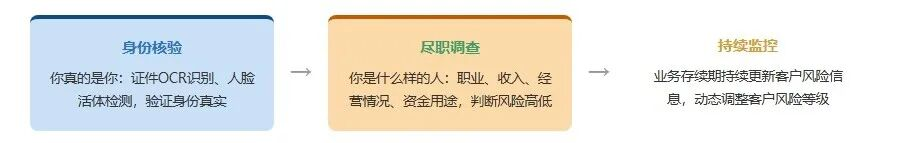
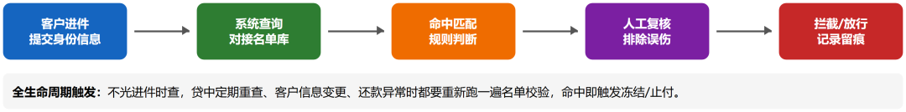
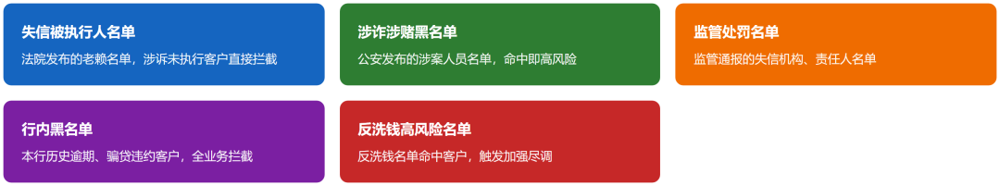
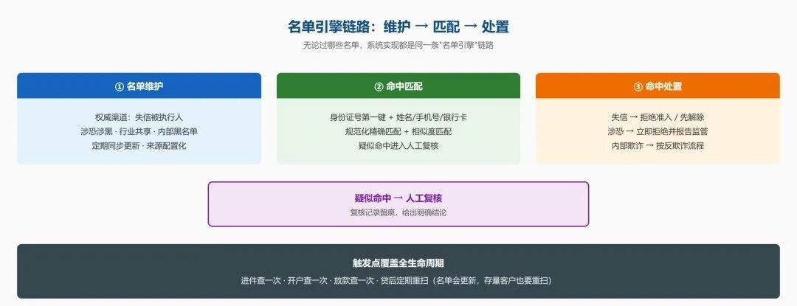
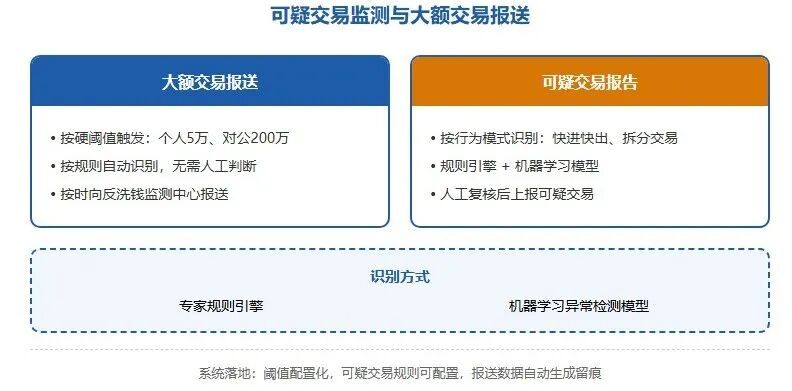

# 反欺诈与反洗钱（AML / KYC）：守住进门的和流出去的钱

> 公众号：侃西东　·　发布日期：2026-10-08　·　[微信原文](https://mp.weixin.qq.com/s?__biz=MzIzNzQ5NjU5NQ==&mid=2247484674&idx=1&sn=3d82ba7e10e08e0f4e7d63ab8c739258&chksm=e8c6f57edfb17c686c89663365de80c73a7b3be229df09f0fb6958585fa0c708116c8b69d1a4)

---

三、反欺诈与反洗钱（**AML / KYC）：守住进门的和流出去的钱**

这节讲两件经常被搞混的事：反欺诈和反洗钱。我一句话给你划清：反欺诈防的是"坏人装成好人来骗你钱"，反洗钱防的是"坏人借你的通道洗黑钱"。一个盯着进门的人是不是本人、资料是不是假的，一个盯着进出的钱干不干净、来路正不正。系统里是两套模块，但底层都是KYC，得共用一套客户身份底子。

### （一）**KYC：客户身份识别的三层含义

**图3-10 KYC客户身份识别三层递进结构**

KYC（Know Your Customer，了解你的客户）是一切金融合规的地基。它有三层含义，一层比一层深。

第一层：身份核验，"你真的是你"。开户、放款之前，要确认客户身份真实。线上场景靠AI核身（人脸识别、活体检测、证件OCR），线下场景靠现场核验。我在第二章讲过AI核身是线上信贷"信任链"的起点，这里从合规角度再强调：身份核验不是风控的加分项，是监管的强制项，反洗钱法要求不得为身份不明的客户提供服务或交易。

第二层：尽职调查，"你是个什么样的人"。光验证身份还不够，要了解客户的职业、收入、经营情况、资金用途，判断他的风险高低。新修订的《反洗钱法》（2025年1月1日施行）把原来的"客户身份识别制度"升级为"客户尽职调查制度"（CDD），要求金融机构按照风险为本的原则，在建立业务关系、办理规定金额以上的一次性业务、怀疑涉及洗钱、或对已有身份资料的真实性存疑等情形下，开展客户尽职调查。这个"风险为本"（risk-based）是关键词，不是所有客户都用同一套最严标准，而是根据客户风险高低采取不同强度的调查：高风险客户做强化尽职调查（Enhanced Due Diligence），低风险客户做简化处理。这在系统里就是一套"客户风险等级"字段 + 按等级触发的差异化尽调流程。

第三层：受益所有人识别，"你背后的人是谁"。对企业客户，要穿透识别实际控制人和受益所有人，防止用空壳公司、代持结构洗钱。这是反洗钱合规在系统里最麻烦的一块：要维护企业的股权结构、关联关系、实际受益人，而且股权结构会变，要定期更新。对公集团客户还要把上下子公司、关联方的额度打通统一管控，防止在不同子公司分头多头授信——我在国有大行做集团客户时，受益所有人识别和集团客户统一授信经常是同一个数据源的两面，都是为了看穿"谁在背后"。

### （二）**名单校验：把不该做生意的人挡在门外

**图3-11 名单校验完整链路与全生命周期触发**

反洗钱和反恐怖融资有一项硬性要求：名单校验。机构要在业务关键节点，把客户信息与各类"风险名单"做比对，命中名单的要拒绝交易、报告监管。这一节聚焦国内信贷场景：做国内客户，首先要过的是国内这套名单体系；跨境业务才会叠加国际制裁名单，这个我放到本节最后简单提一下。

国内客户要过哪些名单？国内信贷业务最常见的风险名单，主要有五类：

**图3-12 国内信贷常见五类风险名单**

第一类，失信被执行人名单。这是对信贷业务影响最直接的一张名单，最高人民法院公布的失信被执行人（俗称"老赖"），是贷前准入的硬校验项。客户一旦被列入失信名单，原则上不能再给他放款，或必须从严审批。这张名单有公开的查询渠道，机构系统可以实时或批量校验，命中即拦截或转人工。 第二类，反洗钱与涉恐名单。在人民银行为首的反洗钱监管体系下，金融机构要对照监管机构下发的涉恐融资名单、制裁名单做校验，并配合中国反洗钱监测分析中心的工作。这类名单命中是"零容忍"，直接拒绝并报告，没有商量余地。

第三类，涉黑涉恶、电信网络诈骗等专项风险名单。公安等部门和行业组织会下发涉黑涉恶人员名单、电信网络诈骗涉案账户与人员名单。这类名单对信贷的意义在于：电诈涉案人员往往是"洗钱工具人"，其账户和贷款资金都可能被利用，命中要从严处置、及时报告。

第四类，行业与监管联合惩戒名单。税务、市场监管等部门推送的联合惩戒名单（如税收违法黑名单、严重违法失信企业名单），以及监管机构针对特定领域下发的名单。做企业信贷时，企业及其实际控制人是否在联合惩戒名单上，是授信准入的重要参考。

第五类，机构内部黑名单。机构自己积累的风险名单，有过骗贷行为的欺诈名单、严重逾期名单、恶意投诉名单等。这类名单不来自外部监管，而是机构风控的"私有记忆"，是反欺诈和贷后管理的重要输入。

名单引擎的链路。无论过哪些名单，系统实现都是同一条"名单引擎"链路：

**图3-13 名单引擎链路：名单维护、命中匹配、命中处置与疑似复核**

三步各有技术要点：名单维护要“权威来源 + 配置化更新”；命中匹配以身份证号为核心键，难点是模糊匹配，同音字、生僻字、录入误差，要做规范化精确匹配 + 编辑距离相似度，疑似命中进人工复核；命中处置按名单类型区分，失信命中直接拒绝或要求先解除，涉恐涉黑命中立即拒绝并报告监管，内部欺诈命中走反欺诈流程，疑似命中复核后留痕。

名单校验的触发点要覆盖全生命周期：进件时查一次、开户时查一次、放款时查一次、贷后定期重扫（因为名单会更新，今天不在名单上的客户，明天可能就上榜了，存量客户也要定期重扫）。我做民营银行线上信贷时，失信名单校验是自动审批流程里的一个硬节点，这一关不过，后面评分模型分数再高也放不出去。

境外客户简单提一句。如果业务涉及境外，外籍借款人、跨境融资、外资企业客户，就要在国内名单之外，叠加国际制裁名单：联合国安理会制裁名单、美国OFAC 的 SDN 名单、欧盟制裁名单等。这类名单多为外文、多语言，匹配更难（涉及音译、别名），通常由专业名单服务商提供数据。我在外资行做全球系统时，名单是全球统一的，任何一个分支机构的新客户都要过同一套全球名单；但对国内机构来说，本土名单体系是主体，跨境场景才需要接国际名单，先把国内这套名单做扎实，比盲目堆一堆国际名单重要得多。

### （三）**可疑交易监测与大额交易报送

**图3-14 大额交易报送与可疑交易报告对比**

反洗钱监管对金融机构的日常要求，集中在两件事：大额交易报送和可疑交易报告。

大额交易报送：客户交易达到规定金额，金融机构要按规定向反洗钱监测中心报送。根据《金融机构大额交易和可疑交易报告管理办法》（2017年7月1日起实施），几个最常用的标准是：当日单笔或累计人民币 5 万元以上（含 5 万元）的现金收支要报送（这一标准是从原来的 20 万元下调来的）；非自然人客户银行账户与其他账户之间当日单笔或累计人民币 200 万元以上的转账要报送；跨境交易另有标准。这是一个"触发即报"的规则，系统里就是一个"大额交易监测规则"，按客户、按账户、按交易维度扫描，命中就生成报送记录。这里特别提醒一句：大额交易的标准是监管参数，历史上就从20万调到5万，以后还可能调，这正是规则配置化原则的典型场景，绝不能把5万写死在代码里。

可疑交易报告：不是看单笔金额，而是看"行为模式"。比如：客户短期内频繁大额取现、资金快进快出与经营规模明显不符、一笔钱拆成多笔规避报告、交易对手频繁变更、与高风险地区有大额往来。识别可疑交易有两类方法：规则引擎（专家写的可疑模式规则，如"短期内分散转入集中转出"）和机器学习模型（从海量交易中学习异常模式）。可疑交易识别出来后，要生成可疑交易报告（STR），提交给反洗钱监测中心，并按规定记录、保存交易资料。

新反洗钱法还特别强调一点：金融机构要关注和评估新技术、新产品、新业务带来的洗钱风险，这直接关系到AI 时代的信贷系统。你用大模型做智能获客、用算法做信用评估、用新的支付通道放款，都要评估这些新东西会不会被洗钱分子利用。我把这条理解为：反洗钱合规不是"做完就交差"的静态系统，而是要和业务创新赛跑的动态系统。这也是为什么我一直强调规则引擎化、不写死代码，新业务上线，先过一遍洗钱风险评估，把新的可疑模式配进规则引擎，而不是改代码。

### （四）反欺诈与反洗钱的系统协同反欺诈与反洗钱的系统协同

前面我说反欺诈和反洗钱是两套系统，但它们在工程上高度协同共用同一套客户身份基础（KYC），共用同一套名单引擎，共用同一套交易监测平台。好的设计是搭一个"统一风控合规底座"：底层是客户身份与名单主数据，中间是规则引擎和模型引擎，上层分别长出反欺诈、反洗钱、反恐融资、合规审查这些应用。这样既能避免重复建设，也能保证口径一致，同一笔交易，反欺诈模型看到的是"有没有欺诈"，反洗钱模型看到的是"是不是洗钱"，两个判断在同一个数据底座上，互不打架。

我在产业金融做供应链金融时，对反洗钱有一个更深的体会：产业金融的钱流更隐蔽、更容易被利用。一笔"贸易融资"背后是真实的交易，还是伪造的交易用来转移资金？系统要核验"四流合一"——合同流、发票流、物流、资金流的一致性，这既是业务风控，也是反洗钱合规要求。所以反洗钱不是只属于"大银行"的事，任何做信贷的机构都要认真对待，规模越小、客户越下沉，越容易被洗钱分子盯上。
