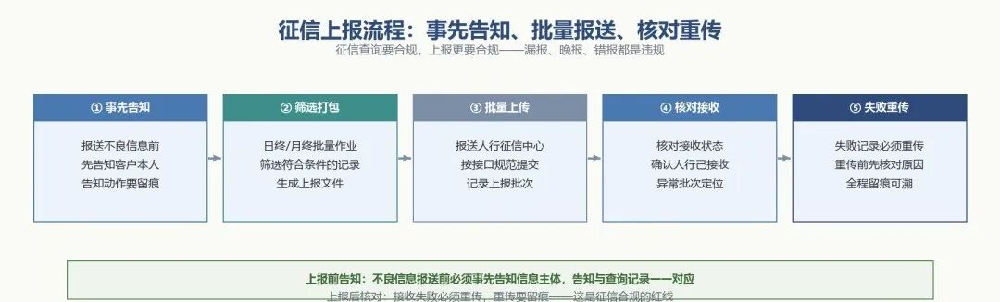
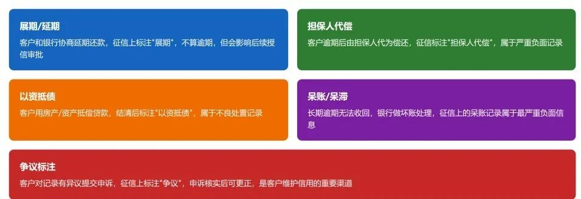

# 监管报送与征信：让监管看得见你的每一笔业务

> 公众号：侃西东　·　发布日期：2026-10-09　·　[微信原文](https://mp.weixin.qq.com/s?__biz=MzIzNzQ5NjU5NQ==&mid=2247484691&idx=1&sn=cf4967bf6dce7a3c82c96ea3d3a1a20b&chksm=e8c6f56fdfb17c79b1b79c52253e8a73a5b651b8d708bf6519bf4555c4438f08839fa53802a5)

---

四、监管报送与征信：让监管看得见你的每一笔业务

信贷是强监管行业，监管要"看得见"你。看得见的方式，就是报送，你定期把业务数据、风险数据、客户数据报给监管机构和征信机构。这一节讲两个"报送"：征信报送和监管报送。它们对系统工程师来说，是同一类工程问题：口径要准、时效要保、错了要能重报。

一线硬要求：每次查询客户征信，必须提前取得客户书面授权，电子授权也要留痕；查询次数和查询用途要和业务场景匹配，“硬查询”太多会直接影响客户后续贷款审批，这个是客户经理和风控岗每天都要碰的红线。

### （一）征信：查询、上报、异议的三段闭环

征信是信贷系统的"血管"，前面讲过，这里把征信业务的三个动作讲清楚，它们构成一个完整闭环。

查询。贷前要查客户征信，但查询必须合规：要取得客户授权、要留痕（谁查的、何时查的、以什么理由查的）、要控制查询频率。这里我要特别提醒一个行业里踩过的坑：征信查询次数本身会影响客户征信，短期内被多家机构频繁查询，会留下"多头借贷"信号，客户后续申请贷款可能被拒。所以查询管理有两个层面：对外，每次查询要合规授权留痕；对内，要控制"为查询而查询"（比如营销场景不该查征信就不查），避免无谓地消耗客户的查询记录。我在民营银行做线上信贷时，把"征信查询授权"做成进件流程里的一个强制节点，不授权就不往下走，而且授权记录要能追溯到具体客户、具体时间、具体查询用途。

上报。机构要把客户的信贷信息（包括不良信息）上报给人行征信中心。按《征信业管理条例》，报送不良信息（逾期、违约等）要事先告知信息主体本人。所以系统里要有"上报前告知"的流程和留痕。上报本身是批量作业：日终/月终把符合条件的信贷记录打包上传，上传后要核对接收状态，失败的要重报。

**图3-15 征信上报流程：事先告知、批量报送、核对重传**

特殊交易：上报里最需要"翻译"的一类信息。前面说上报的是信贷记录，但信贷记录远不止"正常还款"和"逾期"两种状态。客户在贷款存续期间发生的一些"非常规"操作，申请了展期、贷款被担保人代还、用房产抵了债、重新做了债务重组，这些都要作为特殊交易信息上报征信。征信中心对"特殊交易信息记录"的官方定义是：在信贷业务过程中发生的展期（延期）、担保人代还、以资抵债等方面的有关信息。说白了，特殊交易就是记录"这笔贷款在还款过程中走了非常规路径"。它是征信报告里审批人员重点审阅的板块之一，因为它比普通逾期更能说明客户的真实还款状况。

特殊交易有哪些类型？个人信用报告里的特殊交易类型，常见的主要有这几类：

**图3-16 个人信用报告常见特殊交易类型**

展期（延期）。借款人在原定还款日之前，和放贷机构协商把还款日往后推，并重新确定每月还款额。这是最"温和"的特殊交易，它本身不记逾期，但会留下"展期"记录。要特别提醒：展期在征信上虽然没有逾期记录，但绝大多数放贷机构都会把它当作"还款能力不足"的信号，后续审批可能因此被扣分、加价甚至拒贷。所以系统里做展期时，要清醒地知道它会在征信上留痕，不是一笔"内部操作"。

担保人代还（代偿）。借款人还不上钱，由担保人（保证人、担保公司或保险公司）按合同约定代为偿还。这类记录一出现，基本等于向所有金融机构宣告"借款人自身的还款能力已经出了问题"，它比普通逾期严重得多，是银行审批时高度警惕的重大负面信号。

以资抵债。借款人用房产、车辆等资产折价抵偿所欠债务。这通常是借款人资金链断裂、没有其他还款途径时的最后手段，同样属于重大负面信号。

债务重组。借款人和放贷机构重新协商还款方案，比如本金重新分期、减免部分利息、重新约定还款计划。重组说明原还款计划已经走不通了，是明显的负面信号。

提前还款。这个相对特殊：常规提前还款一般不上报为特殊交易，只有协商减免结清、部分提前还款改变原还款计划等特殊情形才需要上报，且这类记录通常没有负面影响，甚至在很多机构看来是正面的（说明客户有还款能力、资金宽裕）。做系统时要特别注意：提前还款和展期在征信上的"待遇"完全不同，上报类型绝不能搞混。

其他。包括协商还款、协议减免结清等"非常规操作"，统一归入"其他"类。

特殊交易在征信报告里长什么样？给读者一个直观的样例（银行版个人信用报告"特殊交易"栏的展示格式）：

**表3-2征信报告特殊交易展示样例**

| **特殊交易** **2019年12月20日发生展期，展期后到期日2020年12月20日，展期金额：100,000元** **2020年5月18日发生担保人代还，代还金额：36,500元** **2022年3月10日发生提前还款，结清日期：2022年3月10日** |
| --- |

（注：以上为示意样例，各字段的展示顺序与措辞以征信中心实际报告为准，不同机构报送的字段可能略有差异。）

对做系统的启示。特殊交易是征信上报里最容易出歧义的一类信息，至少有三点要写进系统设计。一是上报要与业务流程联动，客户办理展期、重组、代偿、抵债、提前结清，都要在业务流程里自动标记"是否触发特殊交易上报"，不能等月底人工补报，否则漏报就是合规隐患；二是类型映射要准确，内部业务类型（展期、重组、代偿等）与征信特殊交易类型之间要维护一张映射表，类型报错了比不报还麻烦，因为客户一旦据此产生异议，处理成本极高；三是留痕与异议预案，特殊交易上报后，客户看到产生异议的概率很高，系统要能追溯这笔特殊交易是从哪笔业务、哪个环节产生的，异议来时能快速核查、快速答复。

异议处理。客户发现征信报告里的信息有误，提出异议后，征信机构和信息提供者要在规定期限内核查处理（一般要在收到异议之日起20日内核查和处理，书面答复）。这条对系统的要求是：异议受理、核查、修正、答复的全程要有工单和时限管理，客户说"我这笔逾期不是我的"，你得能翻出这笔逾期的原始记录、还款流水，核查到底是不是报错了，报错了要能发起修正重报。我在银行做征信相关系统时，异议处理是最考验"数据可追溯"的场景，每一笔上报数据都要能回溯到源头业务流水，否则异议一来，你根本说不清这笔数据是怎么来的。

断直连趋势。第一章讲参与者时我提过"征信断直连"，监管推动信贷机构不再直接连第三方大数据公司拿原始数据，而是通过持牌征信机构。这个政策对系统的影响是：数据接入层要做成"合规可插拔"的，接口层标准化，今天接这家、明天换那家，切换不改业务逻辑。这一条再次印证我开篇说的"合规参数化"：数据合规不是静态的，是动态的政策跟随。

### （二）监管报送体系：EAST、1104和"一表通"

**图3-17 EAST、1104与"一表通"监管报送体系**

EAST（监管标准化数据）。金融监管总局的监管标准化数据报送系统，要求银行把业务明细数据按标准化的表结构报上去。EAST 的特点是"细"，不是汇总数，而是逐笔明细：个人信贷借据表、对公信贷借据表、客户关系信息表、表外授信业务表……监管拿到明细数据，可以做任意维度的分析、比对、检查。EAST 的数据质量问题是要被处罚的：2020年5月，原银保监会因 EAST 数据质量及报送存在违法违规行为，对六家大型银行和两家股份制银行公开处罚，合计金额达 1770 万元。这给所有做报送系统的团队敲了警钟，报送数据不是"差不多就行"，是"错一笔就是罚单"。

1104 报表。原银保监会的非现场监管报表体系，以统计报表形式采集银行的基础财务、资本充足、信用风险、流动性风险、市场风险等监管指标。1104 的特点是"全"，覆盖机构的资产负债、损益、资本、风险全景。1104 和 EAST 有一个常见问题：同一个指标，两边报出来的数对不上（比如不良贷款余额，EAST 按借据明细算，1104 按统计口径算，两个口径不一致）。监管检查时"EAST 与 1104 数据存在偏差"是被罚的高频理由。所以做报送系统，一个核心工程就是口径对齐，同一个业务事实，在不同报送体系里要能解释清楚为什么数字不同，或者干脆做成"一个数据源、多口径映射"。

"一表通"趋势。监管报送正在演进。业内讨论的"一表通"思路是：把多个报送体系合并为"一张表"，银行端聚焦明细数据的加工，监管端通过金融专网按日取数，全程留痕，支持监管按需调用。这对银行报送系统的意义是：从"按报表被动填报"走向"按明细主动供给"，报送不再是月底导几张表，而是把明细数据治理好、持续供给。谁的数据治理做得早、做得干净，谁在"一表通"时代就越从容。

除了这三套，信贷机构还面对一堆专业报送，我把信贷场景里最常见的几种点一下：利率报备，贷款产品的利率定价情况要向人民银行报备，利率调整要同步报备，这和前面讲的"利率红线参数化"是同一个数据源的两面，系统里利率变了要能自动生成报备记录；征信报送，把信贷记录（含不良信息）报给人行征信中心，前面讲征信时说过；反洗钱报送，大额和可疑交易，第三节讲过；授信集中度与大额风险暴露报送，监管要盯着"你对单一客户/单一集团/单一行业的敞口有多大"，防止风险过度集中；对公和产业金融还要额外报项目融资敞口、核心企业供应链的总授信额度，防止对单一核心企业的上下游风险过度集中。这和第一章讲的统一授信、授信集中度管理是同一件事的报送侧；房地产贷款集中度报送，监管对房地产贷款占比有集中度管理要求，房地产相关产品的余额要单独统计上报。

把这些放一起，你就能理解为什么我在第一章说"报送是信贷系统里最不能出错的模块之一"，它不是一个报表模块，是一整个"监管数据治理体系"。

### （三）技术落点·报送系统的工程实现

**图3-18 报送系统工程实现：调度、核对、重报**

批处理调度。报送是典型的批量作业：日终跑汇总、月末跑报表、季末报监管。一个可靠的报送系统要有调度中心：定义每个报送任务的触发时间、依赖关系、执行顺序，失败自动重试、重试上限、失败告警。调度还要考虑"报送窗口"，监管有报送截止时间，系统要留足余量，不能在截止前两小时才开始跑。我在大行做报送系统时，最怕的就是"月底最后一天，报送任务跑到一半挂了"，所以报送任务必须断点续跑、失败重试、重跑幂等。

口径核对。报送数据必须"先对账、后报送"，报送前，系统要自动做多口径核对：报送表的数和业务系统的数对得上吗？EAST 和 1104 的数对得上吗？本月和上月的数衔接得上吗？对不上的，先冻结报送，等差异查清。这里就要用到我反复强调的"口径字典"，每个报送指标都有明确的定义、公式、数据来源、计算时点，核对逻辑就是拿口径字典去逐项验证。报送系统的价值，一半在"报得出去"，一半在"报之前发现不对"。

重报机制。报送数据错了，不能改不了了之，要有重报通道。重报不是"把正确的重新传一遍"那么简单，监管要看到"改前"和"改后"的差异，要能追溯为什么改。所以重报要留痕：原始报送版本、修正版本、差异说明、审批记录。好的报送系统会维护"报送版本链"，每个报送周期一个版本，修正生成新版本，监管检查时能完整还原报送历史。

把这三件事做完，报送系统的骨架就立起来了。但我要强调一句灵魂话：报送系统的根，不在报送模块本身，而在全系统的数据质量。如果业务系统里"借据金额""逾期天数""五级分类"这些字段本身就不准，报送模块再努力也是"垃圾进、垃圾出"。所以报送合规的前置条件，是全系统的数据治理，主数据要准、口径要统一、状态要可信。这也是为什么这一章放在第三章、而不是放在"报送模块"那一章，因为合规是整个系统的属性，不是某个模块的功能。
