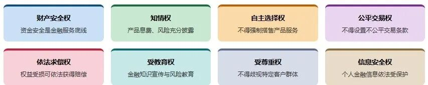
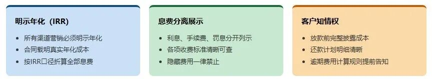
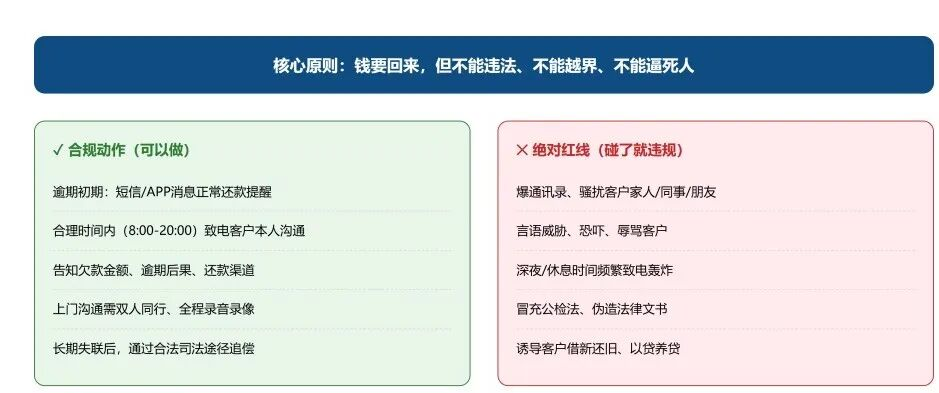
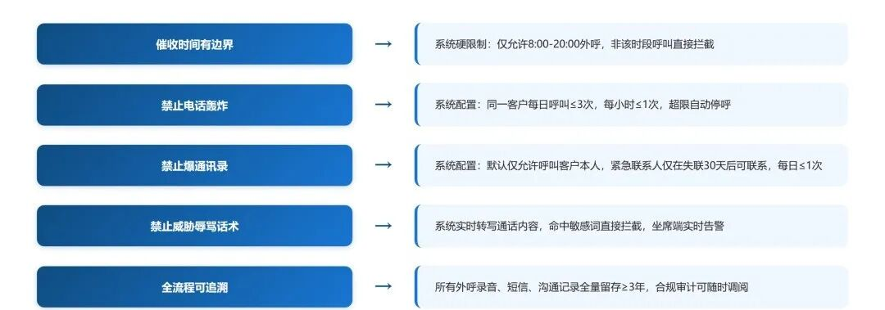
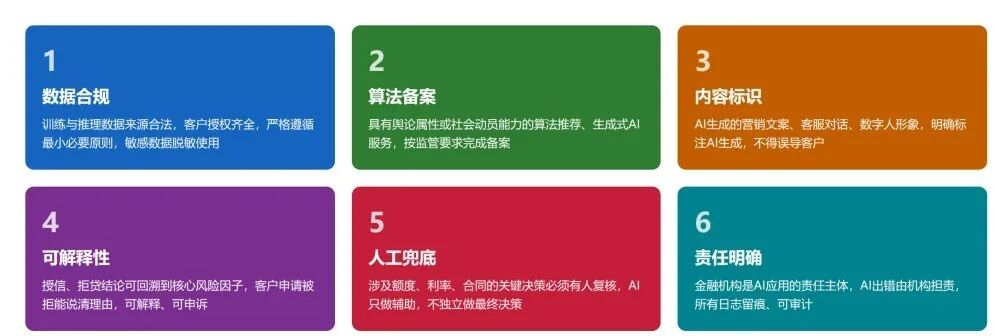

# 消费者权益保护（消保）：客户不是韭菜，是监管眼里的"弱势方"

> 公众号：侃西东　·　发布日期：2026-10-10　·　[微信原文](https://mp.weixin.qq.com/s?__biz=MzIzNzQ5NjU5NQ==&mid=2247484692&idx=1&sn=22d20d49d3497380986a3c97f516095f&chksm=e8c6f568dfb17c7ec0de3311a369be4441998120ce844744218541b39834129838baa4edbd53)

---

五、消费者权益保护（消保）：客户不是韭菜，是监管眼里的**"弱势方"**

消费者权益保护（以下简称"消保"）是最近几年信贷监管的重心。监管的底层逻辑很朴素：金融机构和借款人在信息、专业能力上严重不对等，客户是"弱势方"，监管必须替客户盯着你。这一节讲五件事：金融消费者的八项权利、适当性管理、息费透明、催收合规、投诉处理。

### （一）金融消费者的八项权利：消保的地基

**图3-19 金融消费者八项权利体系**

财产安全权，保障客户资金安全，不得挪用、侵占客户资金。这直接呼应第一章讲的"资金闭环"：客户的钱必须有清晰的归属和去向，系统要防挪用、防占用。

知情权，客户有权了解产品的真实情况，机构要真实、准确、完整地披露信息，不得虚假宣传、隐瞒风险。这对应息费透明、风险揭示、合同条款展示。

自主选择权，客户有权自主选择产品和服务，不得强制搭售、捆绑销售、设置不合理条件。第一章讲交叉销售时我强调过"默认勾选"是红线，就是这条权利的系统落点。

公平交易权，不得设置不公平、不合理的交易条件，不得加重客户责任。对应合同条款的合规审查、格式条款的提示说明。

依法求偿权，客户权益受损时有依法获得赔偿的权利。对应投诉处理和纠纷化解机制。

受教育权，客户有权获得金融知识教育。对应金融知识普及、风险提示教育。

受尊重权，不得因客户性别、年龄、民族、地域、残障等差异区别对待。这条和第三章第六节的"算法歧视"直接呼应，AI 时代的差异化服务，绝不能踩到受尊重权的红线。

信息安全权，客户个人信息受保护，机构要依法合规收集使用个人信息。对应整个第二节"数据隐私与安全"。

我建议做信贷系统的同学把这张表贴在工位旁边：它既是消保法规的浓缩，也是一张"消保功能需求清单"。客户投诉、监管检查、产品评审，最后都能归到这八项权利上，系统里少做了哪一项，就可能在哪个环节被投诉、被处罚。下面四节，就是这八项权利在信贷场景里最重要的四个落点。

### （二）适当性管理：别把不适合的产品卖给客户

适当性管理（KYC 的另一面，叫 KYP，Know Your Product）要求：把合适的产品卖给合适的人。具体到信贷场景，就是产品风险特征要和客户的风险承受能力、还款能力匹配。监管机构 2023 年3月1日施行的《银行保险机构消费者权益保护管理办法》，对适当性管理提出了明确要求。

适当性在系统里的落点，是一套"客户-产品匹配校验"：客户的风险测评结果（年龄、收入、负债、风险偏好）、产品的风险等级，两个维度要在进件、签约环节做匹配校验，不匹配的要拦截或要求书面确认。信贷场景里还有几个特别要做的校验：年龄上限（监管和机构内控对高龄借款人有限制）、收入与负债比（防止过度授信）、贷款用途合规（不能贷消费贷去炒股炒房）。我在民营银行做线上信贷时，适当性校验是"自动审批"的一部分，评分过了、匹配不过，照样拒。适当性不是"多一道手续"，它是防止"过度借贷"的第一道闸。

2026年3月金融监管总局和人民银行刚发布《个人贷款业务明示综合融资成本规定》，把之前散落在各个文件里的息费透明要求统一成了硬标准：不管是利息、手续费、担保费、保险费，所有和这笔贷款相关的成本，必须合并折算成年化综合融资成本，在营销页面、合同首页、放款确认页三个位置强制展示，不允许只展示日利率、月利率来诱导客户。这是现在个贷业务合规检查的头号重点，系统里做产品的时候必须把这个口径做成可配置的硬校验，不能靠业务人员自觉。

### （三）息费透明：每一分钱都要让客户看得懂

**图3-20 信贷息费透明展示要求**

一是"息费分离"的展示。利息是利息、费用是费用，不能把利息藏进费用里、把费用包装成利率。系统里的费项管理（贷款管理费、账户管理费、提前还款违约金、担保费）必须和利息分开建模、分开记账、分开展示。我在第一章就立过规矩：每一笔费用都要能回答三个问题，为什么收（依据）、怎么算（公式）、客户知不知情（披露）。答不上来的费用，早晚是投诉和处罚的雷。

二是"综合息费展示"的组件。消保监管越来越强调，不仅利率要明示，客户承担的各项费用也要折算成年化水平展示（金融监管总局的相关监管要求延续了央行第3号公告的口径）。这就回到我第一节讲的"统一年化计算组件"，把利息、费用、罚息都纳入，按 IRR 口径折算，给客户一个"真实成本"的数字。我在互金平台见过太多"页面展示 0.6% 月利率、实际年化 20%+"的案例被监管点名，根子就是展示口径不统一。一个组件、一个口径、一个出口，是息费透明的工程纪律。

### （四）催收合规：钱要回来，但不能把人逼死

图3-21 催收合规边界：能做与不能碰的红线

催收是消保投诉的重灾区，也是监管整治的重点。2024年5月中国互联网金融协会发布《互联网金融贷后催收业务指引》后，2026年1月中国银行业协会正式发布《金融机构个人消费类贷款催收工作指引》，把催收时间、频次、联系对象的量化标准进一步细化到银行和持牌机构，行业催收规则正式统一。我把催收合规的核心要求，翻译成系统里必须落地的规则：

**图3-22 催收合规要求到系统规则的落地映射**

频次限制。催收频次要控制在合理必要范围，同一金融机构及其合作催收机构对单一债务人，电话催收每日合计一般不超过3次。系统里要有"催收频控"：按客户维度累计当日通话次数，超限就拦截。频控不只在人工催收，智能外呼同样适用，机器人也不能不受限制地打。同时催收时段有硬要求：每日22:00至次日8:00不得对债务人进行催收，系统必须按时段自动停止外呼任务，没有例外。

对象限制。不得向无关第三方催收，不得骚扰债务人的亲属、朋友、同事（仅在无法联系到债务人本人等特定情形下才可与联系人联系，且联系人明确拒绝后不得再联系）。系统里催收对象要有"可联系名单"的管控，只有客户本人和经过允许的联系人可以进入外呼名单，第三方号码要过滤。

身份与话术限制。催收人员首次联系时要表明所代表的机构身份，不得隐瞒身份、不得假冒党政机关和企事业单位、不得使用威胁恐吓侮辱等不当话术。系统里要有"催收话术库"和"话术审核"，标准话术入库、审核后才能用，违规话术关键词要能拦截。

把这些规则放进系统，就是一套"催收合规引擎"：催收时段配置、频控计数器、可联系名单、话术库与敏感词拦截，全部参数化。我在做催收系统时反复强调一句话：催收系统的目标不是"多收钱"，是"在合规的边界内收钱"。合规边界一旦破了，一笔催收收入可能换来一张比它大得多的罚单。

这里还要特别说一句AI 催收。第二章讲过智能外呼在催收里的价值，它把高重复的初筛工作接过去了。但请记住：AI 催收和人工催收，守的是同一条合规边界。智能外呼同样要遵守禁催时段、频次上限、对象限制，而且因为它是机器，更容易被投诉"骚扰"，机器人打电话给第三方、深夜还在打，客户的体感比人工更差。所以 AI 催收的合规要求不是更松，而是更严：外呼任务调度要过同一个"催收合规引擎"的时段和频次校验，外呼名单要过"可联系名单"过滤，外呼话术要经过审核，每一通外呼的录音、结果、是否合规执行都要留痕。我在民营银行做智能外呼时，合规团队盯得最紧的就是"机器有没有骚扰人"，因为机器不会累，更容易失控，合规必须靠系统硬约束。

### （五）投诉处理与监管联动

**图3-23 客户投诉处理与监管联动闭环流程**

消保的最后一道闭环是投诉处理。客户投诉（打客服电话、打12378银行保险消费者投诉维权热线、向监管机构投诉）要能被受理、被处理、被反馈。系统里对应"投诉工单系统"：投诉受理（渠道、时间、内容）、派单（到责任部门/责任产品）、处理（调查、核实、答复）、办结（结果、时限）、统计分析（投诉热点、趋势、产品分布）。

投诉处理有明确时限要求，超时要被追责。所以投诉工单系统要有"时限管理"：受理、处理、答复每个环节都有时限字段，超时自动升级告警。投诉数据本身是金矿：投诉热点往往暴露产品设计或系统实现的问题（比如"利率看不明白"投诉多，说明展示组件有问题；"催收太频繁"投诉多，说明频控失效）。我在做消保相关系统时，每周看一次投诉聚类分析，比看一百页监管文件更能发现系统该改什么。

监管联动这一块，还有一层是"监管检查配合"：监管来检查，要能快速提供数据，客户投诉处理记录、适当性评估记录、息费披露版本、催收记录。这些都依赖前面讲的"留痕可溯"。合规检查不是靠嘴说"我们很合规"，是靠系统能立刻吐出证据。
