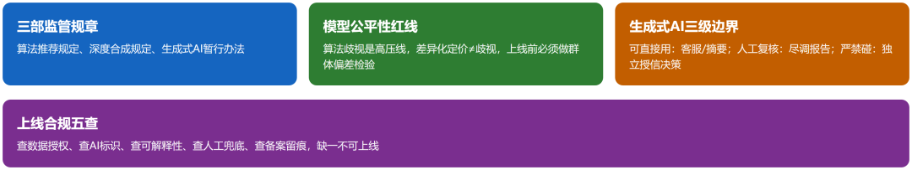
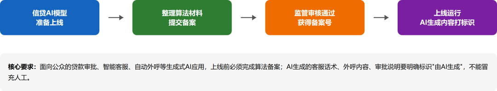
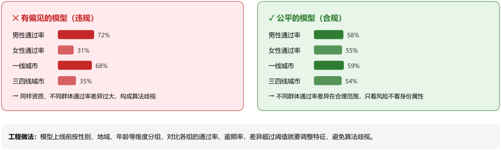
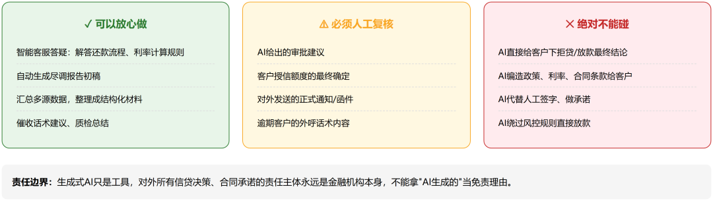
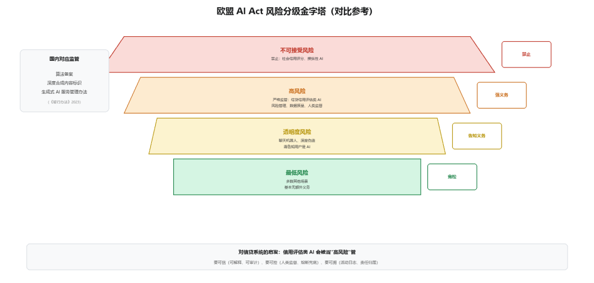
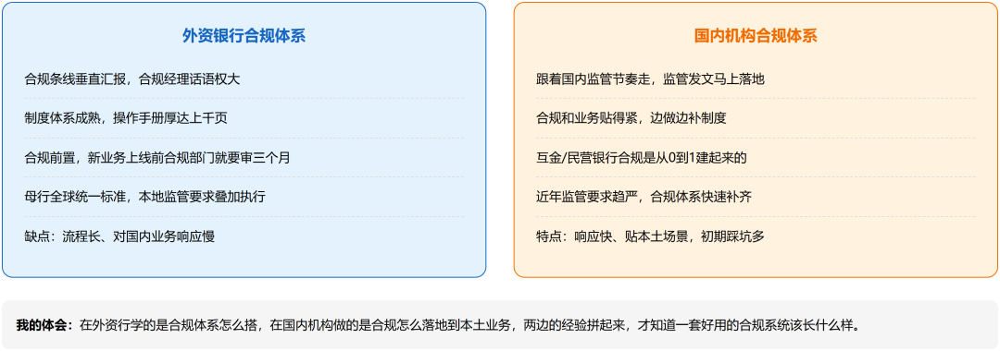

# AI 治理与算法合规：AI 时代新增的合规维度

> 公众号：侃西东　·　发布日期：2026-10-11　·　[微信原文](https://mp.weixin.qq.com/s?__biz=MzIzNzQ5NjU5NQ==&mid=2247484693&idx=1&sn=01a887edc8d426a5e209599dcf887458&chksm=e8c6f569dfb17c7f611cf1cf4c4a5b5eb3e0ee6259586437233e2ad32ed18d18c6272d8f49e5)

---

六**治理与算法合规：AI时代新增的合规维度**

**图3-24 AI信贷系统合规六大底线**

这一章讲到这里，前面五节都是"传统合规"，这些规则在银行信息化时代就存在，我们只是把监管要求落成了系统功能。但 AI 时代的到来，给信贷合规增加了一个全新的维度：当决策、营销、客服、报告都开始由 AI 承担，监管的红线也画到了算法和模型头上。这一节，是本书在合规问题上和其他信贷书最大的不同，因为大多数讲信贷合规的书，写到消保就结束了，而 AI 治理是这本书"AI 时代"定位的核心增量。

### （一）算法备案与内容标识：AI不是"法外之地"

**图3-25 AI算法备案与内容标识流程**

中国对AI 的监管，已经搭起了一套框架。做信贷系统的程序员，至少要知道三部规章：

《互联网信息服务算法推荐管理规定》（2022年3月1日施行）。针对用算法做推荐、排序、推送的服务。它确立了算法备案制度，具有舆论属性或社会动员能力的算法推荐服务提供者要备案，还要求算法可解释、不得利用算法实施不正当竞争、不得侵害消费者权益。对信贷场景，智能营销、智能推荐用到的推荐算法，在适用范围内要合规。

《互联网信息服务深度合成管理规定》（2023年1月10日施行）。针对深度合成（AI 换脸、语音合成、生成虚拟人物等）服务。它要求深度合成服务提供者对生成的内容进行标识，让用户知道"这是 AI 生成/合成的"，不能以假乱真。这条对信贷系统的影响，主要在 AI 客服、智能外呼、AI 数字人，如果你的智能客服用了数字人形象、AI 语音，可能要按深度合成规则标识。

《生成式人工智能服务管理暂行办法》（2023年8月15日施行）。这是生成式 AI（大模型）的专门规章。核心要求包括：提供生成式 AI 服务要遵守法律法规、不得生成违法内容；要对生成内容进行标识；提供具有舆论属性或社会动员能力的服务要开展安全评估并履行算法备案手续；要采取有效措施防止未成年人沉迷；要建立健全投诉举报机制等。

把这三部规章合起来，AI 合规的骨架就是三件事：备案（算法备案、服务备案）、评估（安全评估）、标识（AI 生成内容标识）。这三件事，落到信贷系统的 AI 应用上，就是我在本节最后"AI 上线合规检查清单"里要展开的内容。这里先记住一个判断：AI 应用在金融场景里，从来不是"先上线、再合规"，而是"先合规、再上线"。

### （二）模型偏见与公平性：算法歧视是一条红线

**图3-26 算法偏见与模型公平性对比**

AI 信贷最大的合规风险之一，是算法歧视。当模型根据客户数据做授信决策、定价决策时，如果模型本身带有偏见（比如因为训练数据里历史客群分布不均，导致对某类客户系统性误判），就可能构成对特定群体的歧视，性别、年龄、地域、民族这些受法律保护的维度，绝不能成为模型差异化对待的依据。

这里要区分两个容易混淆的概念：风险定价（差异化定价）和算法歧视。我在第一章讲过，风险定价是合法的，风险高的客户价格高，这是风险成本的体现，不是歧视。但歧视是"与信用风险无关的因素"导致的系统性不公，比如模型发现"某地区客户逾期率高"，于是给这个地区的所有客户一律拒贷或加价，而实际是数据偏差造成的假象，这就可能构成地域歧视。判别标准是：你的差异化，能不能解释为真实的信用风险差异？能不能通过公平性检验？

算法歧视在系统里的落点是"模型公平性评估"：上线前，用统计方法检验模型对不同群体（分性别、年龄、地域等）的预测结果是否存在系统性偏差；上线后，持续监控模型在子群体上的表现漂移。检验的指标常见的有：不同群体的通过率差异、误拒率差异、预测分分布差异。发现偏差，要么调整训练数据、要么加公平性约束、要么人工复核。我在做风控模型时，团队有一条纪律：任何新模型上线，先过"公平性体检"，再谈效果。因为模型效果不好最多是亏钱，模型歧视被举报是监管事件。

### （三）生成式AI的红线：幻觉与责任边界

**图3-27 生成式AI在信贷中的三级边界：可用/复核/禁碰**

所以生成式AI 在信贷场景的红线，就两条：

第一条，AI只做"辅助"，不做"决策"。涉及资金、利率、额度、合同效力这些关键判断，AI可以给建议、给初稿、给摘要，但最终拍板必须是人，或者人的规则。AI生成的内容进入业务链路前，必须有人确认环节。我在第二章讲自动尽调时说过：AI生成的报告只能作为辅助判断，不能替代人的法律和合规责任，报告底稿、数据来源、模型版本都要留痕。

第二条，AI输出必须"可溯源、可校验"。AI告诉客户任何数字（利率、额度、费用），数字必须来自真实数据源，不能是模型自己"觉得"的。实现上，这叫"检索增强生成+数据校验"，AI生成答案前，先从权威知识库检索真实数据，答案里引用的每一个数字都要能对应到数据库里的真实记录；关键数字还要过一层"数据校验网关"，和业务系统实时核对。AI可以说"我不知道"，但不能"编一个数"。我在第一章就立过这条规矩：大模型会一本正经地胡说八道，这在信贷场景是致命的，它给客户的每一个利率、额度、产品建议，都必须是经过校验的真实数据。

责任边界上，监管和行业共识是：AI 是工具，使用者（金融机构）是责任主体。客户因为 AI 客服的错误建议受了损失，客户不会去找大模型公司，他找的是银行。所以金融机构要用 AI，就要为 AI 的行为兜底，这就回到了"人机协作 + 留痕可溯"：人确认、系统留痕、出了事能还原"AI 说了什么、谁确认的、依据是什么"。

### （四）欧盟AI Act与国内监管速览

做跨境业务、或者想前瞻布局AI 合规的团队，一定要关注欧盟《人工智能法》（AI Act），它是全球第一部全面的人工智能专门立法，2024年8月1日生效，分阶段实施。它的核心是风险分级：

- 不可接受风险：明确禁止（如社会信用评分、利用弱势群体弱点的操纵性 AI 等）；

- 高风险：严格监管，需要建立风险管理系统、高质量数据集、活动日志、详细文档、人类监督、稳健性准确性安全性保障。信贷场景明确在高风险之列，用于评估个人信用度或信用评分的 AI 系统（Annex III），被列为高风险。这意味着在欧洲开展个人信贷业务，信用评分 AI 要满足整套高风险义务；

- 透明度风险：如聊天机器人、深度伪造，要履行透明度义务（告知用户在与 AI 交互）；

- 最低风险：多数其他 AI，基本无额外义务。

AI Act 对做信贷系统的启发，不在于"要不要照搬欧盟规则"，而在于它的监管思路是趋势性的：信贷信用评估这种"影响个人重大权益的 AI 应用"，会被当作高风险严格管。国内虽然还没有一部统一的"AI 法"，但监管已经沿着同样的思路在走，算法备案、深度合成标识、生成式 AI 暂行办法、金融领域的 AI 应用规范，都是"风险分级 + 重点管控"的思路。

2026年6月金融监管总局发布《关于银行业保险业人工智能安全开发应用的指导意见》，把信贷审批、资金交易这类直接影响客户权益的AI应用明确列为高风险场景，同时要求客户身份证号、银行卡号等敏感个人信息不得用于大模型训练。至此，金融领域对AI的监管关注点已经非常清晰，可以概括为四个"要"：要可信（模型可解释、可审计、结果可复核）、要可控（有人的监督、有熔断兜底、有责任归属）、要公平（不得算法歧视、保护弱势群体）、要安全（训练和推理数据合规、模型防攻击防篡改）。监管推动的"数字金融"方向，本质不是鼓励"无限制地用 AI"，而是"在可信可控的前提下用好 AI"。我判断，信贷场景的 AI 应用，未来一定会被要求"更透明、更可解释、更可审计"。现在就把这些能力设计进系统，是成本最低的时机，等监管细则落地再补，就是动全身的手术了。

下面这张图是欧盟AI Act 的风险分级金字塔（对比参考），信贷信用评估类 AI 落在“高风险”（严格监管）一档。旁边标注国内对应物：算法备案、深度合成内容标识、生成式 AI 安全评估，都指向同一趋势：“影响个人重大权益的 AI 从严监管”。

**图3-28 欧盟 AI Act 风险分级金字塔（对比参考）**

### （五）技术落点·AI应用上线前的合规检查清单

最后，把AI 合规落成一张可执行的清单。我给团队定过一个规矩：任何 AI 应用要上线，先过这张"AI 合规五查"。

**清单3-1 AI应用上线合规检查清单（五查）**

| **检查项** | **检查内容** | **不通过的处理** |
| --- | --- | --- |
| 数据合规 | 训练/推理数据是否出域、是否有授权、是否含敏感信息 | 禁止上线，整改数据链路 |
| 内容标识 | 生成内容是否需标识“AI生成”、是否过安全护栏 | 禁止上线，补护栏 |
| 可解释性 | 决策能否解释、输出能否追溯模型版本/知识来源 | 禁止上线，补日志 |
| 责任归属 | 输出错误时责任边界是否明确（模型/人工/业务） | 禁止上线，明确兜底机制 |
| 备案留痕 | 是否需要算法备案、是否加生成内容标识 | 未完成备案不得上线 |

第一查：数据合规。AI 训练和推理用的数据从哪来？有没有客户授权？有没有超出授权范围使用？是否涉及敏感个人信息（客户对话记录、人脸、位置）？有没有做到"数据不出域"，训练数据不能出机构边界，推理时的实时数据不能进公共模型？这一查对应个保法、数安法和前面的数据合规体系。

第二查：内容标识。这个AI应用生成的内容，是否需要标识"AI生成"？智能客服的对话、AI生成的营销文案、数字人形象，按深度合成和生成式AI规章要求，该标识的要标识。客户有没有被告知"你在和机器人对话"？这既是透明度要求，也是降低客户误解导致纠纷的手段。

第三查：可解释性。AI的决策能不能解释？自动审批拒绝了客户，能不能说清"为什么拒"？评分模型的授信结论，能不能回溯到主要风险因子？前面第二章讲过"可复算的规则才能进规则引擎、才能被监管审计"，这里再强调一遍：监管和客户要的"解释"，系统必须给得出来。纯黑盒模型直接用于信贷决策，在合规上是走不通的。

第四查：责任归属。AI 出错，谁负责？AI 辅助的场景，人的确认环节在哪？AI 独立完成的场景，有没有设置兜底和熔断？这个 AI 应用如果产生了错误建议导致客户损失，责任链条是否清晰、是否能还原？责任归属不清的 AI 应用，不要上线。

第五查：备案留痕。需要备案的（算法推荐、生成式AI 服务、深度合成），备案做了没有？AI 的模型版本、数据版本、推理日志、人工确认记录，是否都留痕可溯？监管来查，能不能拿出完整证据链？

这五查合起来，就是一个"AI 应用合规网关"：任何一个 AI 功能上线，都要过这五关，每一关都有证据、有留痕。做这件事的意义，不只是应付监管，更是给 AI 自己留退路，当 AI 应用越来越多，靠"人肉背书"管不住，必须靠系统化的合规工程。这也是"AI 时代信贷系统"和传统信贷系统最本质的区别之一：传统系统把合规做在业务规则里，AI 系统要把合规做进模型治理里。

### （六）【作者手记】外资行与国内机构的合规体系差异

**图3-29 外资行与国内机构合规体系对比**

合规讲了很多，我用一段亲身经历收尾，我在外资行和国内机构之间切换时，感受最深的是那道“合规鸿沟”。

在外资行，合规是“全球标准”的：全球统一的客户尽职调查、制裁名单、报告口径，中国分支机构不是自己定规矩，而是“执行全球规矩的本地版本”。任何新业务都要先过全球合规审批，模型要过全球模型风险管理评审，数据要过全球隐私标准审查。流程慢，但严谨，它让一家几百年历史、几十个国家经营的银行，在统一坐标系里运转。它教会我一件事：合规的最高境界，是把“各地合规要求”抽象成一套统一的能力层，再按地区差异化配置，这就是全章强调的“合规参数化”在全球尺度上的版本。

回到国内机构，合规是“监管驱动”的：规则来自监管文件，节奏跟着监管检查走，重点跟着处罚走。好处是反应快、针对性强；不足是容易“打补丁”，今天补报送口径，明天补催收时段，补丁摞补丁，缺少统一架构。我在国内机构做的最有价值的事，往往不是写某个功能，而是把利率红线、催收规则、报送口径、数据分级统一成“合规参数中心”，让监管一变，改一处配置全系统生效。

两种风格没有谁绝对好：外资行稳，但可能和本地实践脱节；国内机构灵活，但容易碎片化。做系统的人，我建议取长补短：用外资行的“统一架构”思维搭合规底座，用国内机构的“监管响应”速度做规则更新。架构要稳得像外资行，响应要快得像本土机构，两者结合，才是 AI 时代信贷系统合规能力的最优解。

七、本章小结　把合规收进一个口袋

第一句话：合规是系统的一部分，不是法务的事。监管的每一个"应当""不得"，最终都要翻译成字段、规则、流程和日志。我给了你一条万能翻译链，"合规落地五步法"：找到依据→翻译规则→落成字段→固化流程→留痕可溯。

第二句话：合规的两大工程纪律。一是"合规参数化"，监管会变，规则要做成配置、引擎，不做成写死的代码；二是"留痕可溯"，合规的每一笔执行都要有日志、有证据，监管要什么，系统立刻给什么。

第三句话：信贷合规的六条线。法律法规，利率红线（LPR 四倍、明示年化）和合同证据链是底线；数据合规，个保法、数安法、征信条例，敏感数据加密、脱敏、留痕；反欺诈反洗钱，KYC 三层、名单校验、可疑交易监测；监管报送，EAST、1104、征信报送，口径准、时效保、错了能重报；消保，适当性、息费透明、催收合规、投诉处理；AI 治理，算法备案、内容标识、模型公平性、幻觉责任边界。

第四句话：合规是会变的，但方法论不变。利率上限会调、报送口径会改、催收规则会更新，但"找到依据、翻译规则、落成字段、固化流程、留痕可溯"这五步永远有效。

到这里，第三章结束了。下一章，我们要从"业务与合规"走进"系统本身"，把信贷系统的总体架构拆开，看看那些在合规约束下生长出来的模块，是怎么组织成一套完整系统的。合规是骨架，架构是肉身，骨架立住了，肉身才长得好。
