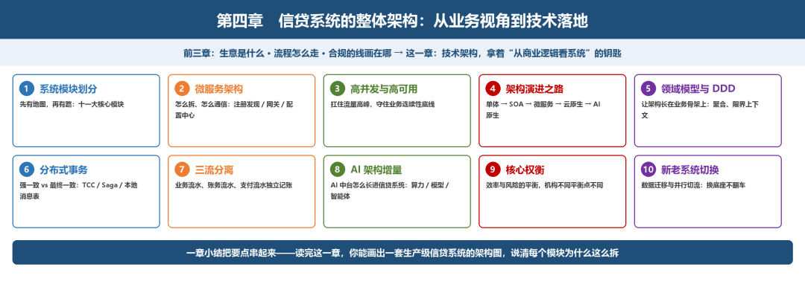
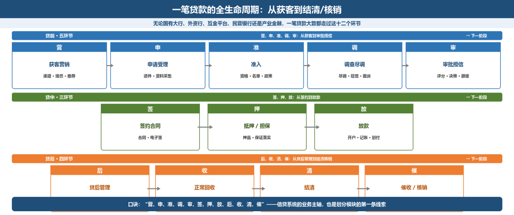
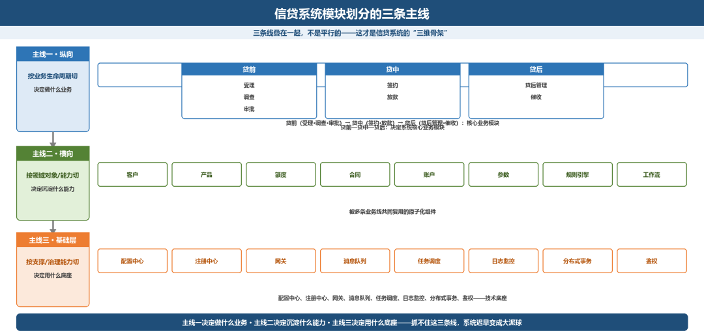
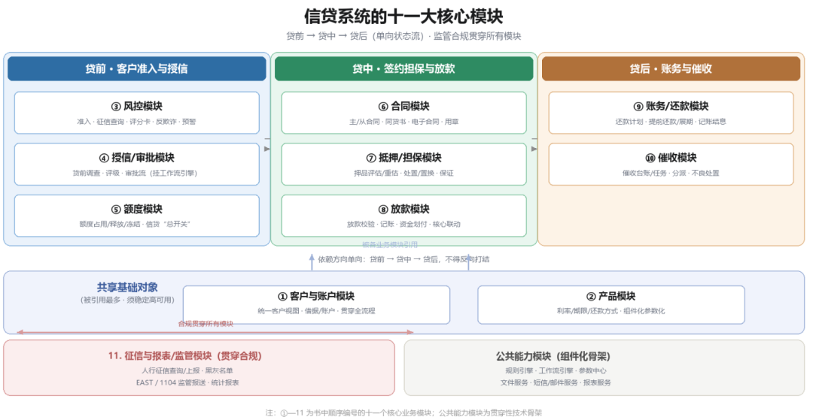
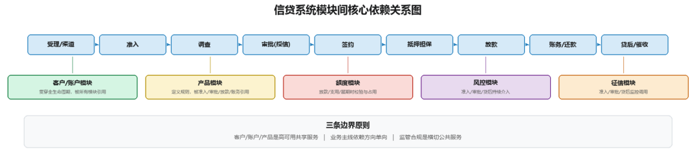
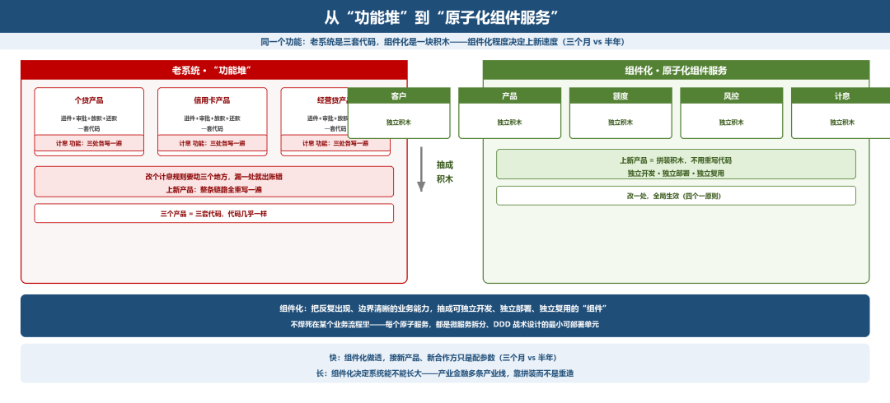
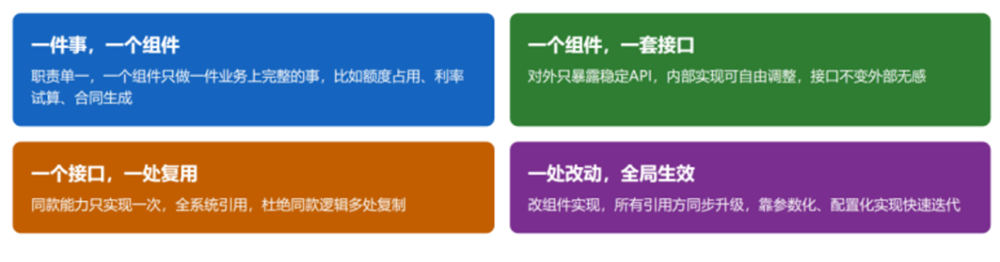

# 系统模块划分：先有地图，再有路

> 公众号：侃西东　·　发布日期：2026-10-12　·　[微信原文](https://mp.weixin.qq.com/s?__biz=MzIzNzQ5NjU5NQ==&mid=2247484858&idx=1&sn=937520c594fcca361b03a9df8cdf04a3&chksm=e8c6f5c6dfb17cd0bf8aca64f3d94667bad4df2f45dfd7da99de92bdeeb5fe97989779c1be21)

---

前三章我们站在业务视角，把信贷这门生意的底子打牢了：这门生意到底赚什么钱、一笔贷款从客户申请到结清要走哪些步骤、哪些红线是绝对不能碰的。从这一章开始，我们换一个视角

—从业务转到技术，看看这些跑了几十年的业务流程，在系统里到底是怎么落地的。前面我们攒的那把“从商业逻辑看系统”的钥匙，从这章开始，就要先打开信贷系统的整体架构这扇门，后面再依次钻进去看核心账务、会计引擎、风控模型这些最核心的部分。

在讲任何一行代码之前，我得先请你把镜头拉远。做信贷系统二十年，我见过太多团队一上来就写接口、建表、堆功能，结果半年后系统变成一团理不清的毛线球，改一个还款日逻辑要动五个模块，加一个新渠道要改十二处。问题的根子，不在代码写得糙，而在架构一开始就没想清楚。

架构是什么？架构不是一个漂亮的分层图，而是在系统还没写出来之前，你就已经把“它会长成什么样、遇到问题怎么扛、未来怎么变”都想明白了。这一章，我就是想带你把这些事情想明白。

我给自己定的目标是：不讲虚的。每个模块、每次拆分、每个一致性方案，我都会告诉你“为什么这样设计”“踩过什么坑”“换了五类机构会怎么选”。

这一章我按十节来讲：模块划分、微服务、高并发高可用、架构演进、DDD、分布式事务、三流分离、AI 中台增量、效率风险平衡、新老系统切换，一路讲到生产级系统怎么落，最后用一章小结把要点串起来。读完这一章，你应该能画出一套生产级信贷系统的架构图，并说清每个模块为什么这么拆。

**图4-1 第四章全章路线图：从业务视角到技术落地**

## 一、系统模块划分：先有地图，再有路

我刚入行在国有大行的时候，老主任第一天就跟我说：你别着急写代码，先把整个系统的图给我画出来，哪个模块管什么、模块之间怎么传数据，画不出来就别碰需求。那时候觉得老主任太较真，后来在不同机构做项目待久了才明白，做信贷系统最怕的就是没全景就扎进去写代码，最后模块之间职责重叠、数据不通，越做越乱。

### （一）先看业务，再看系统

很多讲架构的书喜欢直接从技术分层讲起。我不这么干。因为信贷系统的模块划分，源头不在技术，而在业务本身。你连信贷的全生命周期长什么样都没想清楚，就急着画微服务拓扑，那一定是空中楼阁。

我们先把镜头对准一笔贷款从生到死的全过程。无论国有大行、外资行、互金平台、民营银行，还是产业金融，一笔贷款大致都要走过下面这条生命周期：

**图4-2 一笔贷款的全生命周期：从获客到结清/核销**

你可以把这十二个环节记成一句话口诀：“营、申、准、调、审、签、押、放、后、收、清、催”。这是信贷系统的业务主轴，也是你划分模块的第一条也是最重要的一条线索。

我为什么反复强调“先看业务”？因为我在国有大行做 PLPM（个贷流程管理系统）时踩过一个很深的坑。当年项目组为了赶进度，把客户地址信息和贷款抵押的房屋地址信息放在同一张表里，都是“地址”嘛，看着很像，结果两张表的数据量都特别大，一张表塞了两类完全不同的业务语义，后面既难查询又难维护，成了全项目最让人头疼的一块。这个教训让我明白：你以为像的东西，业务上可能完全不是一回事；模块划分的前提，是先把业务语义分清楚。这正是后面第五节 DDD 里“限界上下文”要解决的事。

### （二）模块划分的三条主线

模块划分我归纳为三条主线（见图4-3）：纵向切业务生命周期、横向抽公共能力、底层垫技术底座，三条线是叠起来的，不是平行的。

我在不同机构做了二十年系统，见过太多模块划乱的项目：要么只切纵向业务、不抽公共能力，重复造轮子；要么光搞技术底座，业务模块堆成一团改不动。抓不住这三条线，系统迟早变成大泥球。

**图4-3 信贷系统模块划分的三条主线**

### （三）信贷系统的十一大核心模块

基于上面的三条主线，一套生产级信贷系统通常会划分为下面这十一个核心业务模块。我给你逐个过一遍它们“管什么、为什么存在”：

1. 客户与账户模块。管理个人/法人客户的基本信息、关联人、客户视图；以及贷款账户（借据）、存款/还款账户、虚拟账户。核心难点是“统一客户视图”，同一客户在存款、贷款、理财、信用卡多个系统里的信息要能关联起来。我在外资行做核心系统时对此感受极深：他们极其强调单一客户视图，一个客户在多少个系统里出现过、合计敞口多少，必须一眼看全。

2. 产品模块。定义贷款的“产品属性”：利率、期限、还款方式、准入规则、审批流程、担保方式、提前还款规则等。这是信贷系统组件化、参数化的典范，我在国有大行 PLPM 项目里最引以为傲的成果之一就是“产品信息组件化及参数化”，把产品要素和控制信息做成可动态配置，为快速产品创新提供了强支撑。后面“组件化”那一节我会专门展开。

3. 风控模块。准入（年龄、国籍、在途规则、黑灰名单）、征信查询、评分卡（硬政策、评分、拒绝）、反欺诈、风险预警、五级分类。风控是信贷系统的“大脑”，也是监管最关注的红线区域。

4. 授信/审批模块。贷前调查、评级、授信额度核定、审批流程（一级/二级/三级/终审）、审批树、审批人规则、审批时效。审批是信贷系统流程化最重的模块，通常要挂工作流引擎。

5. 额度模块。授信额度分类、额度查询、额度规则、客户授信管理、额度占用/释放/冻结。额度是信贷的“总开关”，放款、支用、展期都要在这里校验。

6. 合同模块。主合同、从合同、同贷书、特别签订条约、用章登记、办理公证、电子合同、一体化合同打印。

7. 抵押/担保模块。抵质押物信息、押品评估、重估、担保物预警、担保物处置、担保物置换、保证（阶段性/非阶段性）。这是信贷区别于普通消费贷的核心模块，抵押、质押、保证三类担保方式的管理极其繁琐。

8. 放款模块。放款校验、放款记账、贷款/额度处理、资金划付、与核心账务系统联动。放款是信贷系统的“资金出入口”，也是最讲幂等和最讲一致性的一环（第六节详述）。

9. 账务/还款模块。还款计划生成、正常还款、提前还款、展期、利率变更、还款方式变更、记账、结息。账务是信贷的“血液”，还款计划是最核心的数据之一。

10. 催收模块。催收台账、催收任务（短信、语音、机器人、委外、司法、诉讼）、催收分派、催收账户流水、违约账户管理、跨行不良客户。催收是信贷的“止血”环节，不良资产处置在这里。

11. 征信与报表/监管模块。人行征信查询与上报、黑灰名单、监管报送（EAST、1104 等）、各类统计报表。征信与监管报送是硬性合规要求，不是可选项，做错了要挨罚。

除了这十一个业务模块，还有一组“公共能力模块”贯穿始终：规则引擎、工作流引擎、参数中心、文件服务、短信/邮件服务、报表服务。它们就是“组件化”那一节要讲的骨架。

**图4-4 信贷系统的十一大核心模块全景图**

### （四）模块间依赖与边界

模块不是孤立堆在那的，它们之间有清晰的调用关系。我把信贷系统模块间的核心依赖关系画成一张图，你脑子里要有这张图：

**图4-5 信贷系统模块间核心依赖关系图**

顺着这张图，我做了二十年系统，总结出三条不能碰的边界原则，碰了就要出事故：

第一，公共对象必须稳。客户、产品、参数这三类对象，是全系统被引用最多的——任何一笔业务都要查客户、查产品。所以它们必须做成最稳定、最高可用的共享服务，接口不能随便改，一抖动全系统跟着抖。

第二，业务流的依赖方向必须单向。从获客到放款到贷后，是一笔贷款的状态往前走，后面的环节可以依赖前面的公共能力，但前面的环节不能反过来依赖后面业务模块的细节——比如审批流程里不能把核心逻辑藏在外部接口里，不然改个参数流程就卡死，依赖一旦打结，系统就彻底改不动了。我早年在老系统里就踩过这个坑：当时改了一个审批节点的路由参数，没做全量回归，结果所有卡在这个节点的审批流程全卡死了，正常业务完全走不动。最后实在没办法，紧急启用了台账审批的兜底功能，把卡住的单据先放出去放款，前后花了两三个小时把流程数据补齐，当天就把卡住的业务都处理完了。

第三，合规是横切所有模块的公共能力。征信上报、监管报送、留痕审计，不是某一个模块的事——客户进件要查征信、放款要留痕、还款要报送，每个交易动作都要考虑合规要求。所以合规能力不能焊死在某个业务模块里，要下沉成公共服务，所有模块统一调用。

### （五）组件化视角：从“功能堆”到“原子化组件服务”

讲完模块划分，我要给你上一道“主菜”，原子化、组件化。这是全章最重要的一根主线，也是我在 PLPM 项目里验证过、在后来五类机构反复坚持的方法论。

**图4-6 从“功能堆”到“原子化组件服务”**

老系统是什么样？上一个新产品，从进件、审批、放款到还款，整条链路全重写一遍，三个产品就是三套代码，最后光算利息这个功能，在个贷、信用卡、经营贷三个模块里各写了一遍，三个地方代码都差不多，改个计息规则要动三个地方，漏一个就出账错。

组件化是什么样？把反复用到的能力全做成独立积木，上新产品就是把这些积木拼起来，不用重写代码。

先问一个问题：为什么同样是做信贷，有的系统三个月能上一个新产品，有的系统要半年？差别往往不在人员多寡，而在系统的组件化程度。

什么叫组件化？我给它一个朴素的定义：把反复出现、边界清晰的业务能力，抽成可以独立开发、独立部署、独立复用的“组件”，而不是把它焊死在某个业务流程里。

我总结的落地原则就是四个一：职责单一、接口稳定、全系统只实现一次、改一处全局生效（见图4-7）。组件化做透了，后面接新产品、新合作方就只是配参数，不用重新写一遍流程。

**图4-7 组件化设计的“四个一”原则**

拿产品模块举个真实例子。在PLPM 里，我们把产品做成“基础产品 + 可售产品”两层：基础产品是一张“模板”，定义了产品有哪些属性（利率、期限、还款方式、准入规则）；可售产品是对模板的细化包装，把某个具体利率、期限定下来，面向客户销售。这样做的好处是：新增一个贷款产品，往往只是新增一条可售产品配置，代码一行都不用改。这就是组件化、参数化的价值，它让“产品创新”从“改代码”变成了“改配置”。

每一个原子服务，都是后面第二节微服务拆分、第五节DDD 战术设计的“最小可部署单元”。

组件化还有一个更深的用意：它决定了一个系统能不能长大。我在产业金融集团做产业金融时，平台要同时服务多条产业线、多种业务模式。如果不是靠组件化（客户、产品、额度、风控全部是独立组件，新业务来了拼装组合），根本不可能支撑那么快的业务扩张。组件化本质上是给系统预留了“拼装”的能力，未来的新业务，不是重新造，而是把已有组件重新编排。

这一节我们把“地图”画出来了：十一个核心业务模块 + 一组公共能力模块。接下来第二节，我们要回答一个关键问题：这张地图，用什么样的架构（单体还是微服务）来落地？而这，恰恰是无数信贷系统成败的分水岭。

#### 【作者手记·PLPM 的产品组件化】

在国有大行做PLPM 的两年，是我对“组件化”理解最深的一段。当年个贷业务分行差异极大，各个流程阶段顺序不一样，特别是对于公积金贷款流程模式需要和公积金中心联动，导致处理非常麻烦，有的分行要抵押，有的要保证，有的要阶段性担保。如果把每种情况都写死，系统会变成一团乱麻。

我们最后采用了“按渠道、机构、产品定制业务流程与参与规则”的组件化设计：流程是配置的、产品是配置的、参与规则也是配置的。红利立竿见影，分行上线新业务，往往只要配参数，不用改代码。回头看，那套“产品信息组件化及参数化”的思路，和后来的服务化、微服务化内核完全一致：把不变的（业务对象）沉淀下来，把变化的（规则与参数）配置起来。
