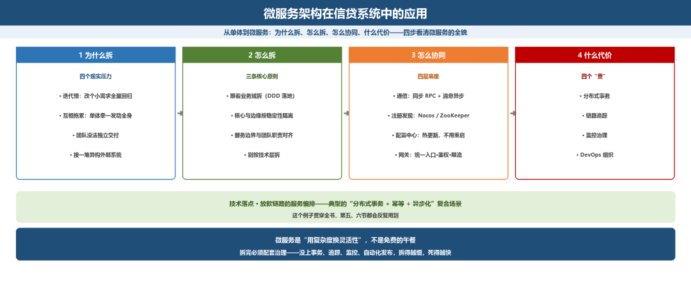
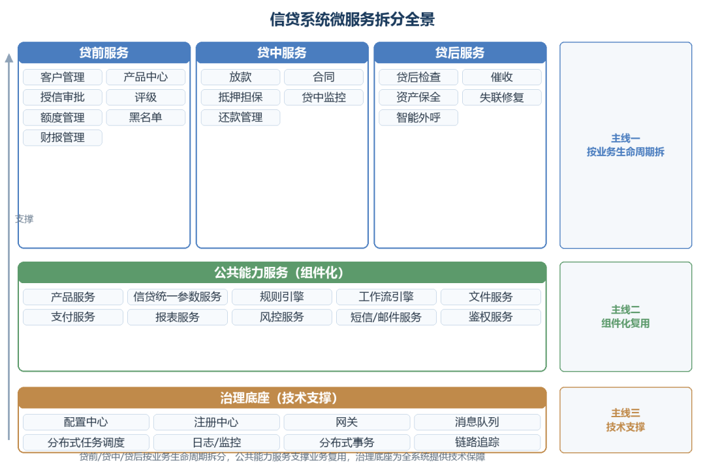
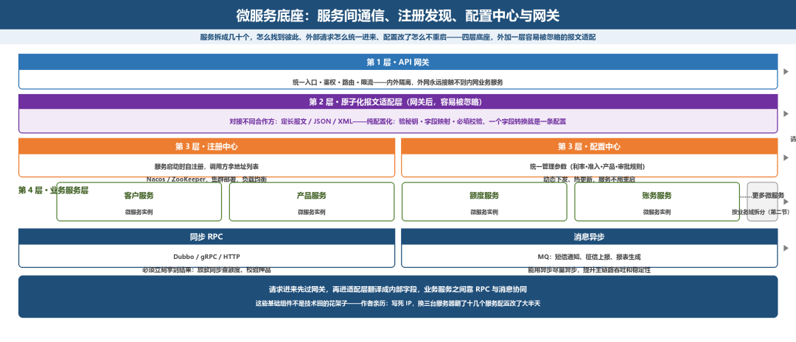
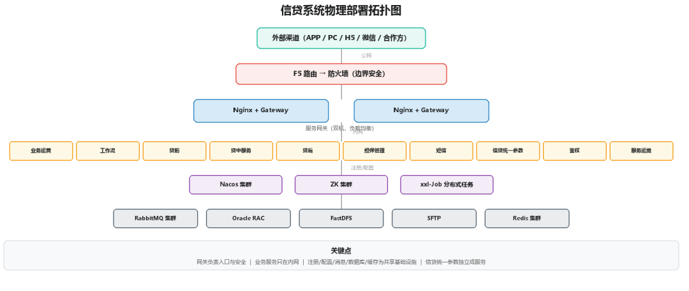
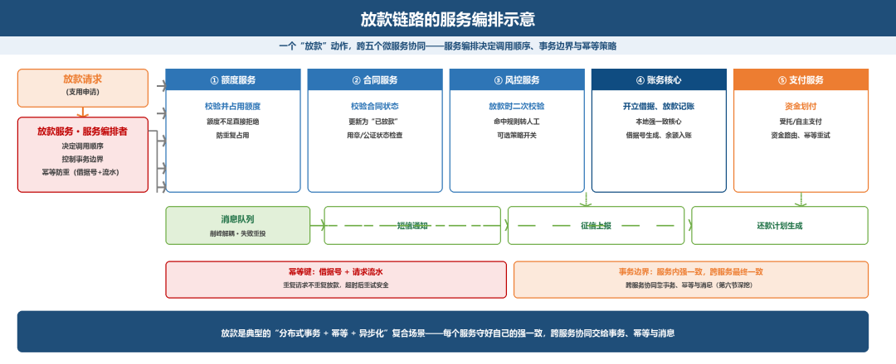

# 微服务架构在信贷系统中的应用

> 公众号：侃西东　·　发布日期：2026-10-13　·　[微信原文](https://mp.weixin.qq.com/s?__biz=MzIzNzQ5NjU5NQ==&mid=2247484863&idx=1&sn=e0f69a728014e4f3ab2fb69e0f739266&chksm=e8c6f5c3dfb17cd59cbcde4d2157ccc2091101478911b945a775754c2042af8f31d4d7bea971)

---

二、微服务架构在信贷系统中的应用

早年大行的老信贷系统是单体架构，所有功能打在一个包里，改个小需求要全量回归、排两周队上线，业务等不及。

我在互金平台做微服务拆分的时候，一开始追潮流拆得特别细，一口气拆了40多个小服务，结果放完款之后要跨五六个服务查数据，出一笔账不平要翻半天日志，后来又合并了十几个粒度太细的服务，才找到合适的拆分粒度，不是越细越好。

**图4-8 微服务架构在信贷系统中的应用：从单体到微服务的四步路线**

### （一）为什么信贷系统要微服务化

上一节画出了十一个模块。打成一个包还是拆开独立部署？

先讲清楚为什么今天的信贷系统普遍走向微服务。我归纳为四个现实压力（见图4-9），这四个压力把单体架构逼到了墙角：迭代慢、互相拖累、团队没法独立交付、接一堆异构外部系统。

**图4-9 信贷系统走向微服务的四个现实压力**

当然，我必须同时泼一盆冷水：微服务是要付代价的。它引入的分布式事务、链路追踪、监控复杂度，是单体时代没有的（微服务的代价、分布式事务，后面都会专门讲）。

### （二）服务拆分的原则

如果确定要微服务化，服务该怎么拆？我给出三条核心原则（见图4-10）：

跟着业务域拆、按稳定性把核心和边缘隔离、服务边界和团队职责对齐。别按技术层拆服务，那是拆了个寂寞。这三条原则，就是第五节DDD 限界上下文在工程上的落地，是同一件事的两面。

**图4-10 微服务拆分的三条核心原则**

结合这三条原则，我把信贷系统实际拆出来的服务画给你看（这和我当年在互金平台落地的高度一致）：

**图4-11 信贷系统微服务拆分全景**

你会发现，贷前、贷中、贷后是按业务生命周期（主线一）拆的，公共能力服务就是上一节讲的组件化（主线二），治理底座是技术支撑（主线三）。这三层，正好把第一节的三条主线落到了具体的服务上。

### （三）服务间通信、注册发现、配置中心与网关

服务拆成几十个之后，新问题马上就来——这么多服务，互相怎么找到对方？外部请求怎么统一进来？配置改了怎么不用逐个重启服务？这就需要注册发现、通信框架、配置中心、网关这四个基础组件，把微服务的底座撑起来。我按四个层次给你讲清楚：

第一层：服务间通信（RPC 与消息）。 服务间有两种主流通信方式：

同步RPC（如 Dubbo、gRPC、HTTP/OpenFeign）：调用方发起请求，等结果返回。适合“必须立刻拿到结果”的场景，比如放款时同步查额度、校验押品。

异步消息（消息队列，如RocketMQ、Kafka）：调用方把消息发出去就返回，不等结果，由消费者异步处理，适合“不要求立刻拿到结果”的场景，比如放款成功后的短信通知、征信上报、报表生成，这正是第三节“削峰填谷”和第七节“信息流分离”的技术基础。

我给的实战建议是：能用消息异步的尽量异步，必须同步的才用RPC。信贷系统里大量的动作（通知、上报、统计、批处理）其实都不需要即时响应，把它们异步化能显著提升主链路的吞吐和稳定性。

第二层：服务注册与发现。服务多了，调用方要知道“想调的服务现在跑在哪台机器上”。这就靠注册中心，我用的比较多的是 Nacos 和 ZooKeeper。服务启动时把自己注册进去，调用方从注册中心拿地址列表，配合负载均衡做调用。注册中心挂了服务就找不到彼此，所以它本身要集群部署。

第三层：配置中心。信贷系统的“参数”极其多（利率、准入规则、产品属性、审批规则），而且经常要动态调整。把配置散落在各服务里，改一次要发布一次，太痛苦。配置中心（如 Nacos Config、Apollo）统一管理配置，支持动态下发、热更新，配置改了，服务不用重启。这里我要特别强调：配置中心是信贷系统“组件化、参数化”的技术底座（呼应“组件化”那一节）。产品规则、定价规则、审批规则这些“变化的业务”，都要下沉到配置中心，用配置驱动，而不是写死在代码里。

第四层：网关。它负责统一入口、鉴权、路由、限流，天然形成了内外隔离，外网永远接触不到内网业务服务，下面的物理部署图里看得更清楚。

**图4-12 微服务架构的四层核心组件**

网关后面还要加一层容易被忽略的原子化报文适配层，我在不同机构做对接的时候都必做这层：对接的合作方太多——有的老系统出的是定长报文，有的是JSON，有的是XML，每个合作方的秘钥、字段名、格式都不一样。这层适配层是纯配置化的：验什么秘钥、哪个字段映射成内部的哪个字段、必填项校验什么规则，全部在配置里配，一个字段转换就是一条独立的配置项，不用改代码。新接一个合作方，只需要在这层加一套报文转换配置，业务服务完全不用动——它们只认内部统一的标准格式，不用关心外面进来的是谁的报文。

我把信贷系统的物理部署拓扑给你画出来（这是我在互金平台真实落地过的形态，你可以直接参考）：

**图4-13 信贷系统物理部署拓扑图**

这张图里几个关键点：网关负责入口与安全，业务服务只在内网，注册/配置中心、消息队列、数据库、缓存、文件存储是共享基础设施，分布式任务调度（xxl-Job）负责跑批。注意“信贷统一参数”被单独列为服务，这正是组件化思想在物理层的体现。

我刚拆微服务的时候图省事，服务之间直接写死对方IP，后来测试环境换了三台服务器，翻了十几个服务的配置改IP，折腾了大半天。从那之后我就知道，这些基础组件不是技术圈的花架子，是真能帮你少踩无数坑的工程底座。

### （四）微服务化的代价：没有免费的午餐

讲完微服务带来的灵活性，我必须把它的代价摊开，让你做决定前心里有数。微服务至少带来四个“贵”（见图 4-14）：分布式事务、链路追踪、监控治理、DevOps 组织，这四样一样都躲不开。

**图4-14 微服务架构的四个隐性成本**

我特别想提醒你一点：很多团队微服务化失败，不是技术不行，而是只拆了“服务”、没配套“治理”。拆完服务，既没上分布式事务方案，又没上链路追踪和监控，也没做自动化发布，那拆得越细，死得越快。微服务是一个体系，不是一套代码。

### （五）技术落点·放款链路的服务编排示意

以“放款”这个信贷最核心、也最复杂的动作为例，看微服务如何协同（这个例子贯穿全书，后面第五、六节都会反复用到）：

**图4-15 放款链路的服务编排示意**

放款链路就是典型的需要“分布式事务 + 幂等 + 异步化”结合的复合场景，这条链路的每一步怎么保证不出错，我们留到第六节深挖。
