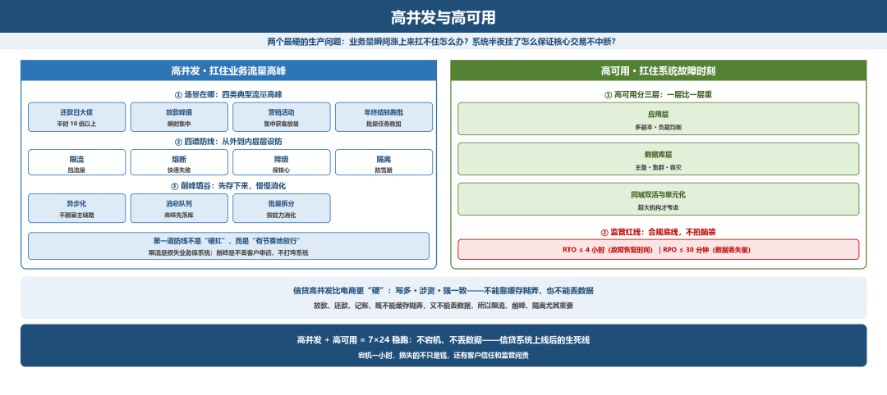
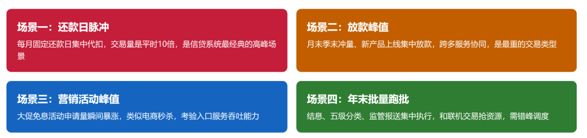
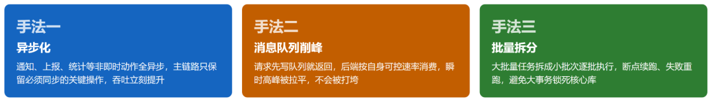
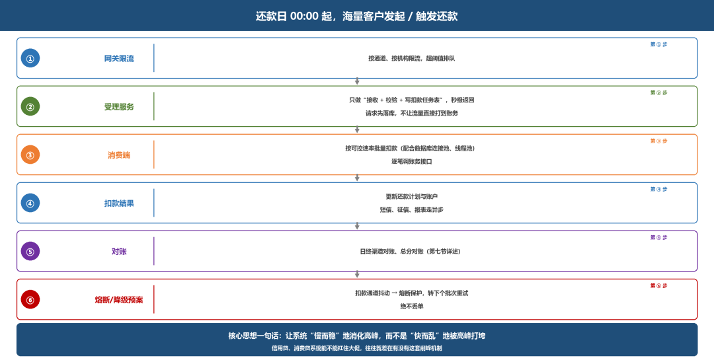
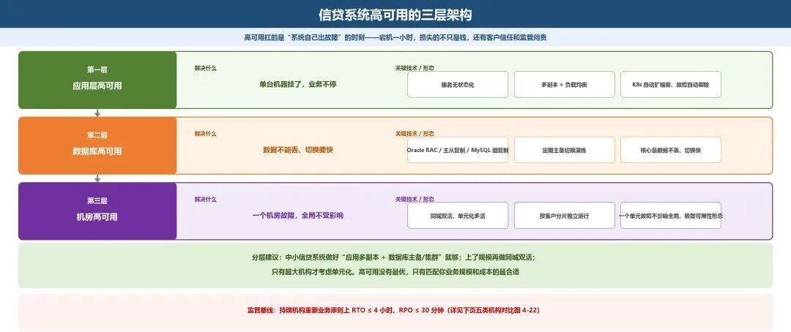
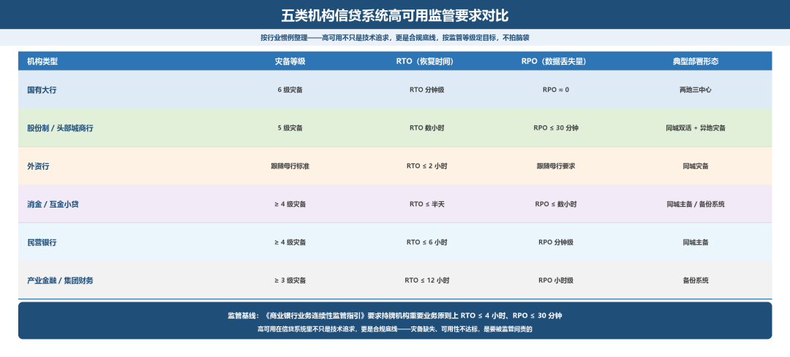

# 高并发与高可用

> 公众号：侃西东　·　发布日期：2026-10-14　·　[微信原文](https://mp.weixin.qq.com/s?__biz=MzIzNzQ5NjU5NQ==&mid=2247484875&idx=1&sn=f8055c8e2813270afbd2a955d41c2fda&chksm=e8c6f5b7dfb17ca1834039d878d89986eab933f7b58d4a631dd80bc37ee0f9fea19e401457ee)

---

三、高并发与高可用

上一节讲完微服务拆完之后的工程代价，这节我们就要直面两个生产环境最硬的问题：业务量瞬间涨上来，系统扛不住怎么办？系统半夜出故障挂了，怎么保证核心交易不中断？这就是高并发和高可用要解决的事，也是信贷系统上线之后能不能稳跑的生死线。

我在互金平台经历过好几次大促时点放款，平时一秒钟几十笔申请，零点一秒钟进来几千笔。靠什么扛住？就是下面要讲的削峰、限流、缓存这几招。

**图4-16 高并发与高可用：扛住流量高峰与系统故障的双轨设计**

### （一）信贷的高并发场景在哪里

很多人一听说“高并发”，第一反应是双十一电商。但我要告诉你，信贷系统也有自己的“双十一”，而且它的高并发特征和电商完全不同。搞清楚“在哪热、为什么热”，是设计高并发的第一步。

信贷系统的流量高峰，我总结为四类典型场景（见图4-17）：还款日大促（交易量是平时的十倍以上）、放款峰值、营销活动、年终，结转跑批，各有各的热点和堵点。

**图4-17 信贷系统四类典型流量高峰场景**

我特别想强调信贷和电商高并发的一个本质区别：电商的峰值是“读多写少、可缓存、可异步”；信贷的峰值往往“写多、涉资、强一致”。放款、还款、记账这些动作，既不能靠缓存糊弄过去，又不能丢了数据，所以信贷的高并发设计比电商更“硬”。这也是为什么下面讲的限流、削峰、隔离，在信贷系统里尤其重要，因为它的交易是不可丢失、不可出错、不可重复的。

### （二）限流、熔断、降级、隔离

这四个手段不是孤立的，是从外到内层层设防的四道防线（见图4-18）：限流挡流量、熔断快速失败、降级保核心、隔离防雪崩。

我在互金平台和民营银行做线上信贷时，把这四招练得炉火纯青——高并发的第一道防线，不是“硬扛”，而是“有节奏地放行”，这是每天都要调优的保命手段。

**图4-18 高并发防护的四件套：限流、熔断、降级、隔离**

### （三）削峰填谷：异步化、消息队列、批量拆分

这里我要先点透一个思路：限流是把挡不住的请求直接拒掉，本质是“损失业务保系统”；削峰填谷不一样，是把瞬间涌进来的高峰先存下来，系统按自己的处理能力慢慢消化，既不丢客户的申请，也不会把系统打垮，这才是比硬扛更聪明的做法。

具体手法见图4-19。我在互金做还款日大促时，这三招叠起来，10倍流量冲过来系统都能稳稳接住。

**图4-19 削峰填谷的三个核心手法**

我再用“还款日大促”把削峰填谷完整串一遍，让你有整体画面：

### （四）技术落点·还款日大促的削峰设计

还款日00:00 起，海量客户发起/触发还款

① 网关限流：按通道、按机构限流，超阈值排队

② 受理服务：只做“接收+校验+写扣款任务表”（秒级返回），请求先落库，不让流量直接打到账务。

③ 消费端：按可控速率（配合数据库连接池、线程池）批量扣款，逐笔调账务接口。

④ 扣款结果：更新还款计划/账户；短信、征信、报表走异步

⑤ 对账：日终渠道对账、总分对账（第七节详述）

⑥ 熔断/降级预案：扣款通道抖动→熔断保护，转下个批次重试，绝不丢单。

这套设计的核心思想就一句话：让系统“慢而稳”地消化高峰，而不是“快而乱”地被高峰打垮。 信用贷、消费贷系统能不能扛住大促，往往就差在有没有这套削峰机制。

**图4-20 还款日大促削峰设计全流程**

### （五）高可用：同城双活、多活与单元化

前面讲的高并发，是扛住业务流量的高峰；这节讲的高可用，是扛住系统自己出故障的时刻——两个加起来，系统才能7×24小时稳跑，不宕机、不丢数据，这是信贷系统的生命线。

宕机一小时，损失的不只是钱，还有客户信任和监管问责。高可用我按层次讲：

高可用分三层（见图4-21）：应用层、数据库层、同城双活与单元化，一层比一层重。

**图4-21 信贷系统高可用的三层架构**

我给你的分层建议是：中小信贷系统做好“应用多副本 + 数据库主备/集群”就够；上了规模再做同城双活；只有超大机构才考虑单元化。高可用没有最优，只有匹配你业务规模和成本的最合适。

#### 【监管红线提示·连续性要求】

做信贷系统高可用，我提醒你一条红线：根据《银行业信息系统灾难恢复管理规范》和《商业银行业务连续性监管指引》，持牌机构重要业务的RTO（故障恢复时间）原则上不得超过 4 小时，RPO（数据丢失量）不得超过 30 分钟。不同规模机构的灾备等级与 RTO/RPO 落地要求，我按行业惯例整理成一张对比图（见图 4-22），你直接对照自己机构的类型定建设目标。

**图4-22 五类机构信贷系统高可用监管要求对比**

高可用不只是技术追求，更是合规底线：可用性目标定多高、灾备做到哪一级，都要对照监管要求算出来，不能拍脑袋。
