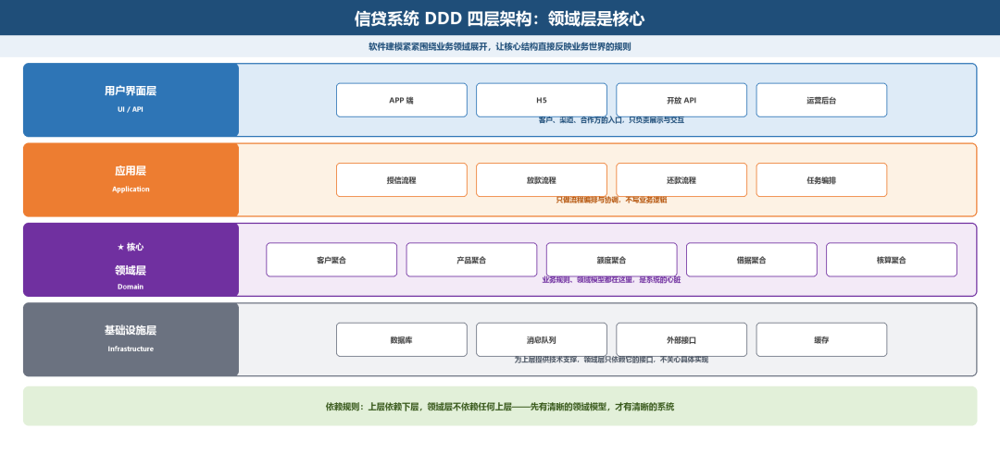
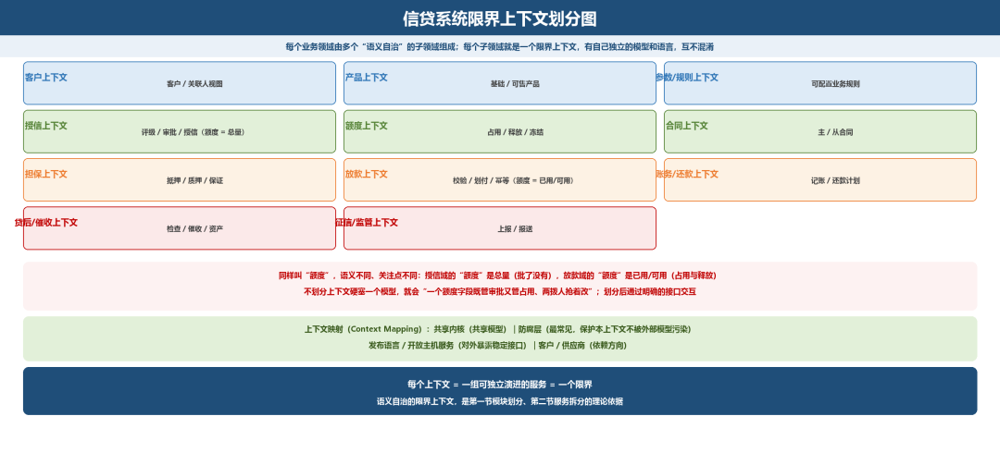
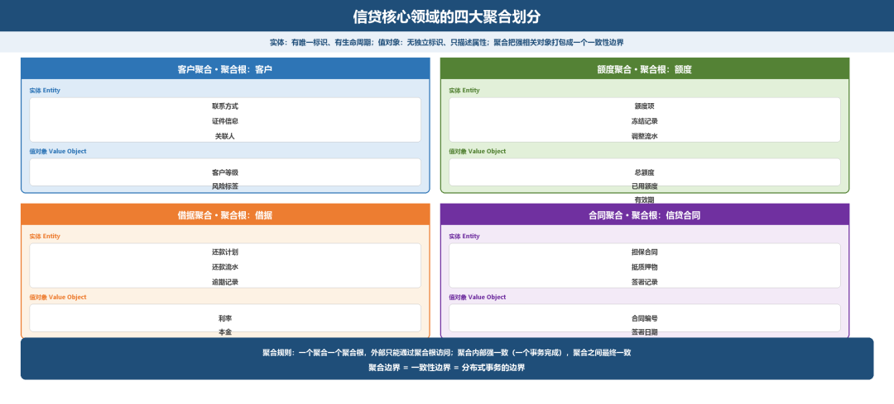
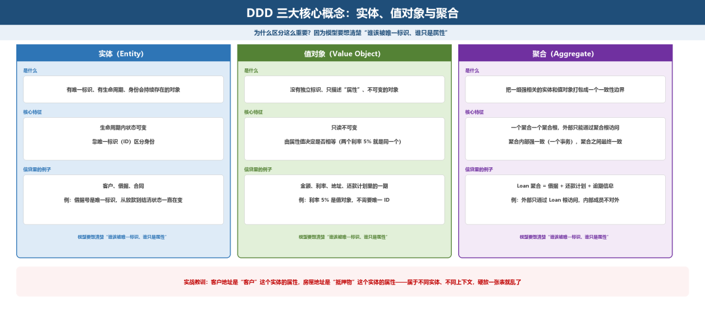
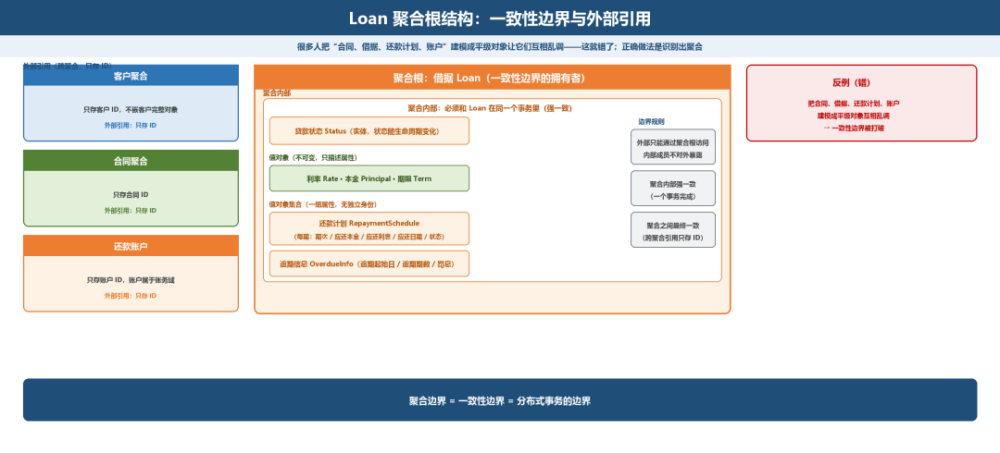
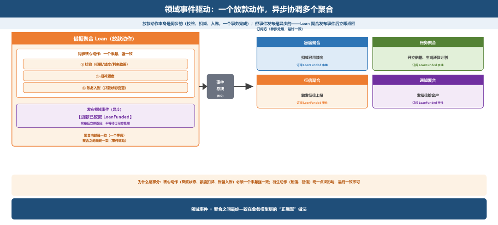
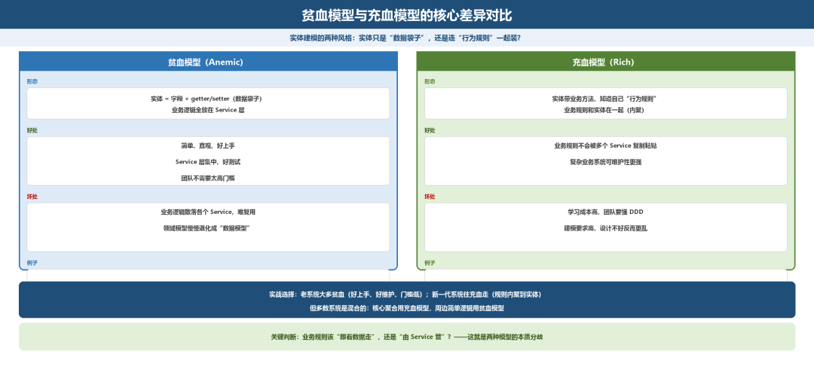
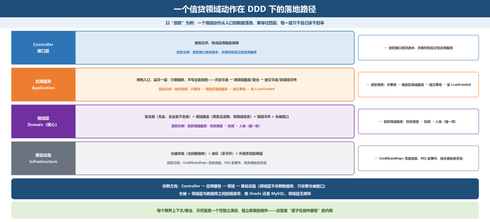

# 领域模型与DDD：让架构长在业务骨架上

> 公众号：侃西东　·　发布日期：2026-10-16　·　[微信原文](https://mp.weixin.qq.com/s?__biz=MzIzNzQ5NjU5NQ==&mid=2247484885&idx=1&sn=887a39a05df522e9d71815c275d24cc3&chksm=e8c6f5a9dfb17cbf0bd474fdd3148fba52e499a5b7c0732b39e7818360ca085f1b63b4123b40)

---

五、领域模型与**DDD：让架构长在业务骨架上**

如果这一章你只能精读一节，我建议你读这一节。因为前面讲的模块划分、微服务拆分，如果缺少一个“正确的骨架”来统领，很容易变成凭感觉切豆腐，而 DDD（领域驱动设计）就是那个告诉我们“沿着骨头的纹路切”的方法论。 我在前面反复强调的“原子化、组件化”，它的理论根基就在这里。

**图4-26 信贷系统DDD四层架构：领域层是核心**

### （一）什么是DDD，为什么信贷系统需要它

DDD 的全称是 Domain-Driven Design，领域驱动设计。它最早由 Eric Evans 提出，这些年被讲得很玄，但核心思想一句话就能讲清：软件建模要紧紧围绕业务领域展开，让软件的核心结构，直接反映业务世界的规则。我不打算把它讲成一套仪式，只讲对信贷系统最管用的那部分。

这句话听着抽象，但落到信贷系统再具体不过。我举一个例子你就懂了：

在信贷业务里，“一笔贷款”到底是什么？对一个粗心的建模者，它可能就是一个表里的“一行记录”。但懂业务的人知道，一笔贷款背后，是一套严密的对象体系：合同（双方的法律约定）、借据（具体的债权债务凭证）、额度（可以借多少的总闸门）、还款计划（未来每期还多少）、账户（资金往来的记录）、担保（用什么抵押）。它们之间有着极其复杂的约束关系，比如“放款必须在不超额度前提下”“借据余额必须和还款计划对得上”“担保不足要预警”。

DDD 要做的，就是把这一整套业务世界的规则，原原本本、有条有理地搬到软件模型里，让模型不是“数据库表的堆砌”，而是“业务规则的真实映射”。为什么信贷系统特别需要 DDD？因为信贷是规则最密集、状态最复杂、监管最严格的金融业务，合同、借据、额度、还款这些对象之间的复杂约束，如果没有一个清晰的领域模型来统领，系统很快就会在“改这里碰那里”中腐烂掉。

我在PLPM 项目里最大的教训，就是第一节提过的那次建模混乱——数据模型一旦复杂、不清晰，业务和系统都跟着遭殃。这个教训让我后来坚定地拥抱 DDD：先有清晰的领域模型，才有清晰的系统。

### （二）战略设计：限界上下文与上下文映射

DDD 分“战略设计”和“战术设计”两大部分。战略设计解决“系统的边界怎么划”，战术设计解决“边界内部的模型怎么写”。 先讲战略设计。

限界上下文（Bounded Context）是 DDD 最核心的概念：每个业务领域，都不是铁板一块，而是由多个“语义自治”的子领域组成的；每个子领域，就是一个“限界上下文”，有自己独立的模型和语言，互不混淆。

我拿“额度”和“额度使用”给你说明。在信贷系统里： - 授信域（批不批额度）里的“额度”，关心的是“这个客户总的可借额度是多少、批了没有”，一个“授信合同”。 - 放款域（用多少）里的“额度”，关心的是“这次放款有没有超过剩余可用额度”，一个“占用与释放”的账本。

同样叫“额度”，在授信域和放款域里语义不同、关注点不同。如果不做限界上下文划分，把它们硬塞进一个模型里，就会出现“一个额度字段既管审批又管占用、两拨人抢着改”的混乱。限界上下文就是告诉你要把它们分开，授信域维护额度的“总量”，放款域维护额度的“已用/可用”，两者通过明确的接口交互。

上下文映射（Context Mapping）解决“限界上下文之间怎么协作”。常见的映射关系有：共享内核（共享模型）、防腐层（保护本上下文不被外部模型污染）、发布语言/开放主机服务（对外暴露稳定接口）、客户/供应商等。信贷系统里最常见的是防腐层，信贷系统要接人行征信、反欺诈、支付、账户一堆外部系统，每个外部系统都有自己的模型，如果让它们直接污染信贷领域模型，模型就乱了。所以要建防腐层，把外部模型“翻译”成信贷内部的语言。

我直接给你一张信贷系统的限界上下文划分图（这是战略设计的核心产物，也是第一节模块划分、第二节服务拆分的理论依据）：

**图4-27 信贷系统限界上下文划分图**

这张图的重要性：它把第一节的十一个模块、第二节的服务拆分，和DDD 的限界上下文统一起来了，有了这张图，你就知道“什么该拆开”“为什么这么拆”：因为它们是语义自治的限界上下文。

### （三）信贷核心领域建模：实体、值对象与聚合

讲完战略设计，进入战术设计。战术设计先解决“一个对象怎么建模”。DDD 把业务对象分为实体（Entity）、值对象（Value Object），并用聚合（Aggregate）把它们组织起来。

**图4-28 信贷核心领域的四大聚合划分**

实体（Entity）：有唯一标识、有生命周期、身份会持续存在的对象。信贷里最典型的实体：合同（Contract），有合同编号，会经历“待签约→已签约→已放款→正常/逾期→结清→注销”的生命周期；借据（Loan/IOU），具体的债权债务凭证，有借据号，对应一笔具体的贷款金额；客户（Customer），有客户号，一生只此一个身份；额度（CreditLine）、账户（Account），都是有标识、有状态的实体。

值对象（Value Object）：没有独立标识、只描述“属性”、不可变的对象。 信贷里的典型值对象： - 还款计划中的“一期”（RepaymentPlanItem）：它本身没有独立身份，只是“某期该还多少本息”的一组属性（期次、应还本金、应还利息、应还日期、状态）。 - 利率（InterestRate）：一个“值”，描述了利息怎么算。 - 地址、期限、金额等描述性对象。

**图4-29 DDD三大核心概念：实体、值对象与聚合**

还是第一节那个PLPM 的教训：客户地址和房屋地址分属不同实体、不同上下文，硬放一起就乱了。

聚合（Aggregate）：把一组强相关的实体和值对象，打包成一个“一致性边界”。 聚合是 DDD 战术设计里最关键也最难的概念。核心规则是： - 一个聚合有一个聚合根（Aggregate Root），外部只能通过聚合根访问聚合内部； - 聚合内部要保证强一致性（一个事务内完成）； - 聚合之间只保证最终一致性（通过领域事件，下一小节讲）。

我拿信贷最核心的“贷款聚合”给你示范。很多人把“合同、借据、还款计划、账户”建模成平级的四个对象，让它们互相乱调，这就错了。正确做法是识别出聚合：

**图4-30 Loan聚合根结构：一致性边界与外部引用**

示例：一笔贷款（Loan Aggregate）。聚合根：借据（Loan），它是这笔贷款的核心，外部通过它来访问。聚合内部成员：还款计划（RepaymentPlan，值对象集合）、利率（值对象）、贷款状态（实体）。借据、还款计划、利率之间必须强一致，比如借据余额变了，还款计划必须同步，所以它们是一个聚合，一个事务内搞定。聚合外部：合同（Contract）、额度（CreditLine）、账户（Account）是另外的聚合。放款时，Loan 聚合和 CreditLine（额度）聚合、Account（账户）聚合之间通过领域事件/应用服务协调，最终一致。

这个划分的意义极其重大：它决定了“哪些数据必须一个事务保护、哪些可以最终一致”。 借据+还款计划必须一个事务（强一致）；借据和额度、借据和账户，可以最终一致（用第六节的分布式事务方案）。聚合边界 = 一致性边界 = 分布式事务的边界，这句话是 DDD 和分布式系统衔接的钥匙，也是第六节选型的前提。

### （四）聚合根与领域事件设计

聚合根（Aggregate Root）是聚合的“门面”和“监护人”。所有对聚合内部对象的访问，都必须经过聚合根；聚合根负责维护聚合内部的一致性不变量（invariant）。

拿额度聚合举例：额度（CreditLine）是聚合根，它维护着“已用额度 ≤ 总额度”这个不变量。任何要占用额度的操作，都必须通过 CreditLine 这个聚合根来做，聚合根内部校验“有没有额度可占”再决定是否占用。这样，额度的“总量—已用—可用”三者的约束，永远不会被外部破坏，这就是聚合根的守护价值。

领域事件（Domain Event）是 DDD 实现“聚合之间最终一致”的关键机制。领域事件描述的是“已经发生的有业务意义的事”，比如“贷款已放款”“额度已占用”“客户已逾期”。 当一个聚合发生状态变化时，它发布领域事件，其他聚合订阅事件并做出自己的反应。比如：

**图4-31 领域事件驱动：一个放款动作，异步协调多个聚合**

一个放款动作，通过领域事件把多个聚合“异步”地协调起来，每个聚合各自保证自己的强一致，聚合之间最终一致，这正是第二节的异步消息、第六节的最终一致在业务模型层的“正规军”做法：领域事件是信贷系统解耦的基石。

领域事件的设计要点我给你三条：

1.事件命名要业务化：用“过去时、业务语义”命名（“LoanDisbursed”贷款已放款），而不是技术化的“OrderCreated”这种含糊名字。

2.事件要携带必要上下文：事件里要带上接收方需要的业务数据（如借据号、金额、日期），让订阅方不必回查。

3.事件要有唯一标识和可追溯：每个事件有ID，能追溯到是哪笔业务触发的，这既是为了排查问题，也是监管留痕的需要。

### （五）贫血模型vs 充血模型之争

DDD 落地时，绕不开一个经典的“口水战”：贫血模型 vs 充血模型。我给你讲清楚，别被争论带偏。

**图4-32 贫血模型与充血模型的核心差异对比**

贫血模型（Anemic Model）：领域对象只放数据（属性 + getter/setter），业务逻辑全部放到Service 层。这是国内大多数团队（尤其是从“DAO + Service + Controller”三层架构成长起来的团队）的默认做法。它的优点是简单、容易上手、和数据库表天然对应；缺点是业务逻辑散落在 Service 里，领域对象退化成“数据容器”，业务规则没有内聚在它该在的地方，改一个“额度不能超”的规则，要翻遍所有调它的 Service。

充血模型（Rich Model）：领域对象里既放数据，也放与自身强相关的业务逻辑。比如“借据”这个领域对象，自己就知道“能否提前还款”“能否展期”“余额怎么算”。优点是业务规则内聚、符合 OO 思想、模型自洽；缺点是难落地、容易把领域对象写得太重、对团队建模能力要求高。

我的实战观点是：这不是二选一，而是“用对地方”。 我给你的经验法则：

聚合根要“充血”：聚合根（借据、额度、合同）要承载聚合内部的业务不变量，比如额度的“已用不能超总量”、借据的“状态机流转”，这些内聚在聚合根里，别的服务改不了。

跨聚合/跨上下文的编排逻辑放应用服务：那些“把几个聚合串起来的业务流程”（比如“放款流程”要串额度+借据+账户），放在应用服务（Application Service）里编排，不要塞进领域对象。

查询和展示逻辑放查询服务：报表、列表查询这类“读模型”，用 CQRS 思路单独建查询模型，不污染领域写模型。

一句话总结我的立场：让该内聚的业务规则内聚到领域对象（聚合根充血），让该编排的流程逻辑放到应用层，让查询逻辑独立出来。这样既避免了贫血模型“规则满天飞”，也避免了充血模型“对象臃肿难维护”。

### （六）战术设计落地：仓储、应用服务与领域服务

最后讲DDD 战术设计的落地四件套，让你知道“领域模型怎么和工程实现衔接”：

仓储（Repository）：管理聚合的生命周期（增删改查）。 仓储是“领域层”和“基础设施层（数据库）”之间的隔离带，领域层只依赖仓储接口，不关心数据库是 Oracle 还是 MySQL、表怎么设计。以额度聚合为例，CreditLineRepository.findById(额度id) 返回一个额度聚合，业务逻辑在领域层用，至于底层是查一张表还是几张表，仓储封装了。仓储让领域模型不被数据库绑架，是 DDD 落地的地基。

领域服务（Domain Service）：承载“不属于任何单个聚合、但属于领域”的流程逻辑。 比如“放款”这种跨多个聚合（额度+借据+账户）的领域操作，属于领域但横跨多个聚合，就放在领域服务里（注意它用的是领域语言，不含技术细节）。

应用服务（Application Service）：作为系统的“用例入口”，编排领域服务/聚合完成一个业务用例，并负责事务边界、权限、调用外部系统。 它是最薄的一层，只做“编排”和“协调”，不写业务规则。比如“放款用例”的应用服务：开启事务→调额度聚合占用→调借据聚合放款→发布领域事件→提交事务。

工厂（Factory）与规格（Specification）：工厂负责创建复杂聚合，规格把“查询/校验规则”封装成可复用的对象（比如“可用于放款的额度”这个规格）。

我给你把“一个信贷领域动作在 DDD 下如何跑”串成一张落地图，你可以对照你的工程来理解：

**图4-33 一个信贷领域动作在 DDD 下的落地路径**

这一套下来，你就得到了一份“既懂业务、又能落地”的领域模型，而它恰恰就是前面反复强调的“原子化组件服务”的内核，每个限界上下文/聚合，天然就是一个可以独立演进、独立部署的组件。

### （七）技术落点·信贷核心数据模型 ER 图与关键表

光讲概念不给货是耍流氓。最后我把信贷最核心的几个数据模型（对应上面几个关键聚合）落到表结构上，让你看到“领域模型 → 数据表”是怎么映射的。注意：这里我展示的是领域视角的表设计，真实的库表还受数据库约束、性能、历史包袱影响，但骨架是一致的。

**1.客户上下文：客户主表（示意）**

**表4-2 客户主表字段设计（示意）**

| **字段** | **类型** | **说明** |
| --- | --- | --- |
| customer_id | bigint PK | 客户号（唯一标识） |
| customer_type | char(2) | 个人/法人 |
| name | varchar | 姓名/名称 |
| id_type / id_no | varchar | 证件类型/证件号 |
| status | char(1) | 客户状态 |

**2.额度上下文：额度表（示意）**

**表4-3 额度表字段设计（示意）**

| **字段** | **类型** | **说明** |
| --- | --- | --- |
| credit_line_id | bigint PK | 额度ID（聚合根标识） |
| customer_id | bigint FK | 客户 |
| product_id | bigint | 关联产品 |
| total_limit | decimal | 授信总额度 |
| used_limit | decimal | 已用额度 |
| available_limit | decimal | 可用额度（可由总额-已用得出，或冗余字段） |
| start_date / end_date | date | 额度有效期 |
| status | char(1) | 有效/冻结/失效 |

**3.借据上下文：借据表（示意）**

**表4-4借据表字段设计（示意）**

| **字段** | **类型** | **说明** |
| --- | --- | --- |
| loan_id | bigint PK | 借据号（聚合根标识） |
| contract_id | bigint FK | 关联合同（另一聚合） |
| credit_line_id | bigint | 关联额度（另一聚合） |
| principal | decimal | 放款本金 |
| balance | decimal | 当前余额 |
| interest_rate | decimal | 利率（值对象） |
| loan_date | date | 放款日 |
| due_date | date | 到期日 |
| status | char(2) | 正常/逾期/结清/核销（状态机） |

**4.还款计划上下文：还款计划表（示意）**

**表4-5 还款计划表字段设计（示意）**

| **字段** | **类型** | **说明** |
| --- | --- | --- |
| plan_item_id | bigint PK | 期次标识 |
| loan_id | bigint FK | 所属借据 |
| period_no | int | 期次 |
| due_date | date | 应还日 |
| due_principal | decimal | 应还本金 |
| due_interest | decimal | 应还利息 |
| paid_amount | decimal | 已还金额 |
| status | char(1) | 未还/部分/已还 |

**5.账户上下文：账户表（示意）**

**表4-6账户表字段设计（示意）**

| **字段** | **类型** | **说明** |
| --- | --- | --- |
| account_id | bigint PK | 账户号 |
| loan_id | bigint FK | 关联借据 |
| account_type | char(2) | 贷款账户/还款账户 |
| balance | decimal | 账户余额 |
| currency | char(3) | 币种 |
