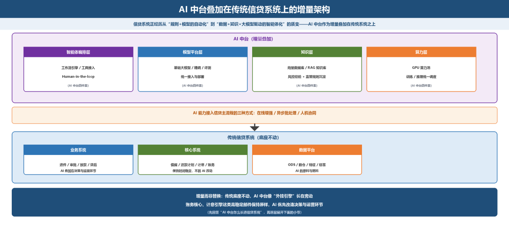
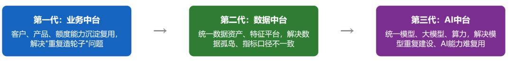
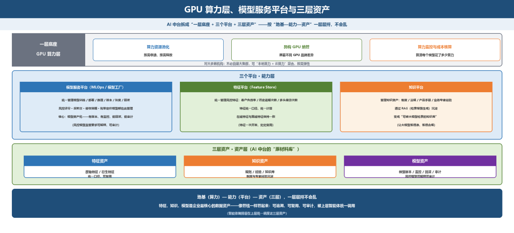
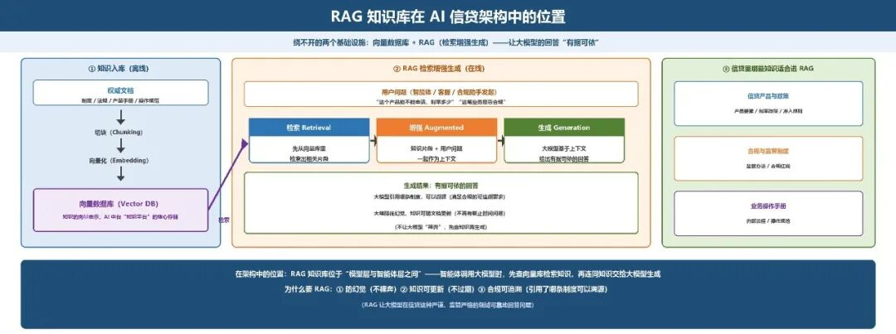
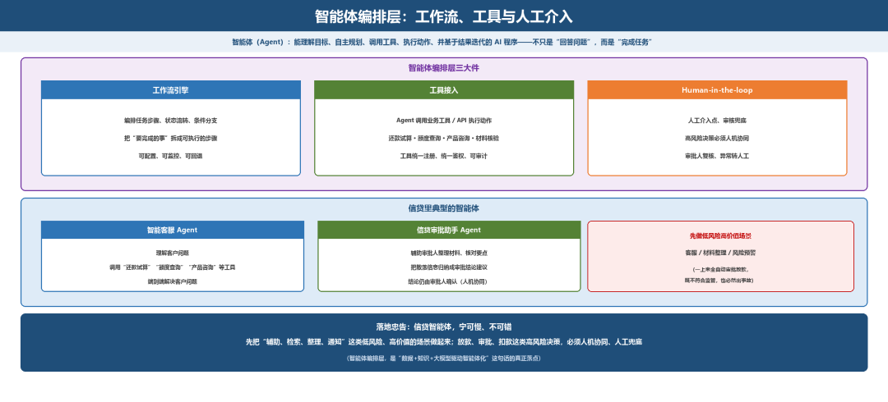
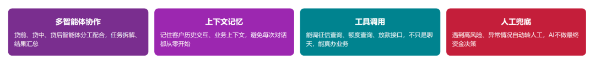
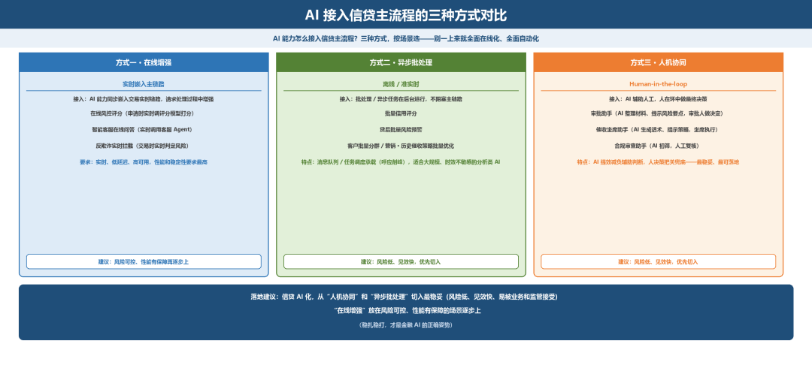
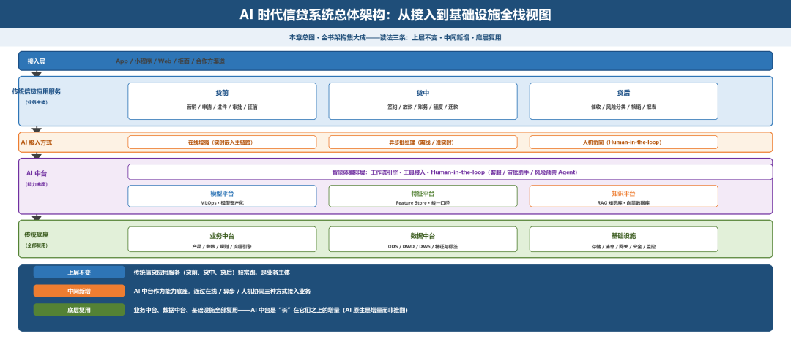
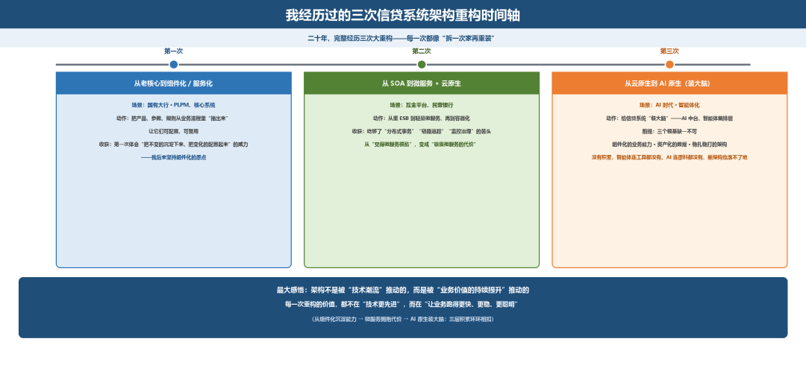

# AI 时代的架构增量：AI 中台怎么长进信贷系统

> 公众号：侃西东　·　发布日期：2026-10-19　·　[微信原文](https://mp.weixin.qq.com/s?__biz=MzIzNzQ5NjU5NQ==&mid=2247484894&idx=1&sn=22b4b6aba736d2af21218417c1667b89&chksm=e8c6f5a2dfb17cb4943dd53332d76cfac32e68654a7323754d622b46c59c454321651234e73f)

---

八、**AI 时代的架构增量：AI 中台怎么长进信贷系统**

讲完了传统架构的方方面面，我们把目光投向正在发生的未来，AI 原生时代。这一节是本章乃至全书的“时代增量”，也是我这二十年最兴奋的一段：因为信贷系统正在经历一场从“规则+模型的自动化”到“数据+知识+大模型驱动的智能体化”的质变。而这场质变，首先要从架构上回答一个问题：AI 中台，怎么长进信贷系统？

**图4-39 AI中台叠加在传统信贷系统上的增量架构**

### （一）从“业务中台 + 数据中台”到“AI 中台”

先讲清楚“中台”这个概念的演进脉络，你就知道 AI 中台为什么是“顺势而为”。

过去十年，银行和金融科技机构都在建设中台，大体经历了三代（见图4-40），现在正从业务中台、数据中台走向 AI 中台。

**图4-40 金融机构中台建设的三代演进**

我特别想强调一点：AI 中台不是凭空冒出来的，它是业务中台和数据中台的“自然进化”，正因为有了业务中台沉淀的能力、数据中台沉淀的数据，AI 才有“原料”去学习、去服务。所以你建设 AI 中台的前提，是先把业务中台和数据中台的基础打牢。没有高质量的数据资产，AI 就是“巧妇难为无米之炊”；没有组件化的业务能力，智能体也“无工具可调”。

### （二）GPU 算力层、模型服务平台与三层资产

AI 中台在架构上，我把它拆成“一层底座 + 三个平台 + 三层资产”，这也是我实际搭 AI 中台时理出来的框架，按“地基—能力—资产”一层层捋，不会乱。你按这个去搭：

**图4-41 GPU算力层、模型平台与三层资产结构**

一层底座：GPU 算力层。 AI 的一切建立在算力上。信贷系统要跑大模型推理、模型微调、机器学习训练，需要 GPU 算力池。算力层要解决三个问题：算力资源池化（按需申请、按需释放）、异构 GPU 纳管（屏蔽不同 GPU 品牌差异）、算力监控与成本核算（GPU 很贵，必须能算清每个模型花了多少算力）。对大多数机构，算力层不一定要自建大集群，可以“本地算力 + 云算力”混合，按需弹性。

三个平台：模型服务平台（MLOps/模型工厂），统一管理机器学习模型和大模型的训练、部署、推理、版本、灰度、回滚。信贷里的风控评分模型、反欺诈模型、催收策略模型、利率定价模型，都在这上面管理。核心是模型资产化，模型是资产，要有版本、有监控、能回滚、能审计（尤其风控模型，监管要求可解释、可审计）。特征平台（Feature Store），统一管理特征，比如“客户负债率”“历史逾期次数”“多头借贷次数”这些风控特征。特征要统一口径、统一计算、在线离线一致。知识平台，管理知识资产，制度、法规、产品手册、业务专家经验，通过 RAG（检索增强生成）沉淀成“可被大模型检索的知识库”。

三层资产：把上面这些沉淀为特征资产、知识资产、模型资产三层。它们就是AI 中台的“原材料库”，被上层智能体统一调用。我反复强调“资产”这个词，是因为：AI 时代，特征、知识、模型，是企业最核心的数据资产，必须像管钱一样管起来，可追溯、可复用、可审计。

### （三）向量数据库与RAG 知识库在架构中的位置

讲AI 中台，绕不开两个基础设施：向量数据库和 RAG（检索增强生成）。我讲清楚它们在信贷架构里的位置和作用。

**图4-42 RAG知识库在AI信贷架构中的位置**

为什么要RAG？ 大模型有“幻觉”问题（会一本正经地编造），而且知识有截止时间。要让大模型在信贷这种“严谨、监管严格”的领域可靠地回答问题，不能让它“裸奔”，得喂给它权威知识。RAG 的做法是：把制度、法规、产品手册等权威文档，切块、向量化后存进向量数据库；当模型要回答问题时，先从向量库里检索出相关片段，作为“上下文”喂给大模型，让它在权威知识的基础上作答。

向量数据库（Vector DB）存的就是这些“知识的向量表示”。信贷场景里，哪些知识适合进 RAG 知识库？我列几个典型： - 信贷产品与政策：产品要素、利率政策、准入规则（客服回答“这个产品能不能申请、利率多少”）。 - 合规与监管制度：监管办法、合规红线（合规助手检索“这笔业务是否合规”）。 - 业务操作手册：内部流程、操作规范（新员工问答、审批助手检索）。 - 客户协议与条款：合同模板、条款解释（智能客服解释合同条款）。

在架构中的位置，RAG 知识库是 AI 中台“知识平台”的核心存储，位于模型层与智能体层之间：智能体调用大模型时，先查向量库检索知识，再连同知识一起交给大模型生成。它让大模型的回答“有据可依”，大幅降低幻觉、满足合规的可追溯要求（回答引用了哪条制度，可以溯源）。

给你一个落地提醒：信贷的RAG 知识库，知识的准确性和更新机制至关重要，制度变了必须能及时更新、且能追溯引用来源，否则“一本正经地引用过时制度”比“不回答”更危险。知识资产的治理（谁维护、多久更新、如何审计），是 RAG 在金融落地成败的关键。

### （四）智能体编排层：工作流引擎、工具接入与Human-in-the-loop

AI 中台最革命、也是信贷 AI 化最核心的，是智能体（Agent）编排层。我把这一层讲透，它是“数据+知识+大模型驱动智能体化”这句话的真正落点。

**图4-43 智能体编排层：工作流、工具与人工介入**

什么是智能体（Agent）？一句话：能理解目标、自主规划、调用工具、执行动作、并基于结果迭代的 AI 程序。和传统“问答机器人”不同，智能体不只是“回答问题”，而是“完成任务”。信贷里典型的智能体：智能客服 Agent，理解客户问题，调用“还款试算”“额度查询”“产品咨询”等工具，端到端解决客户问题；信贷审批助手 Agent，辅助审批人整理客户材料、风险要点、历史记录，生成审批辅助意见；催收策略 Agent，根据逾期情况、客户画像，自动生成催收策略与话术；贷后监控 Agent，自动巡检贷后风险信号，生成风险预警报告；合规助手 Agent，检索法规制度，判断某业务动作是否合规。

智能体编排层要解决四个工程问题（见图4-44），这四个问题不解决，Agent 就落不了地。

**图4-44 智能体编排层的四个核心工程问题**

我给的智能体落地忠告：信贷智能体，宁可慢、不可错。第一优先级是把“辅助、检索、整理、通知”这类低风险、高价值的场景先做起来（客服、材料整理、风险预警），高风险决策（放款、审批、扣款）必须人机协同、人工兜底。一上来就想让 AI 全自动审批放款，既不符合监管，也必然出事故。

### （五）AI 能力接入信贷主流程的三种方式

讲完AI 中台的“零件”，回答最后的关键问题：AI 能力怎么接入信贷的主业务流程？ 我总结为三种方式，你可以按场景选：

**图4-45 AI接入信贷主流程的三种方式对比**

方式一：在线增强（实时嵌入主链路）。AI 能力同步嵌入到交易的实时链路中，在请求处理过程中增强。典型例子：在线风控评分（申请时实时调评分模型打分）、智能客服在线问答（客户咨询时实时调用客服 Agent）、反欺诈实时拦截（交易时实时判定风险）。特点：实时、要求低延迟、高可用；对 AI 服务的性能和稳定性要求最高。

方式二：异步批处理（离线/准实时）。 AI 能力通过批处理/异步任务在后台运行，不阻塞主链路。典型例子：批量信用评分、贷后批量风险预警、客户批量分群/营销、历史催收策略批量优化。特点：不要求实时，可以用消息队列/任务调度承载（呼应第三节的削峰），适合大规模、对时效不敏感的分析类 AI。

方式三：人机协同（Human-in-the-loop）。 AI 能力辅助人工，人在环中做最终决策。典型例子：审批助手（AI 整理材料、提示风险要点，审批人做决定）、催收坐席助手（AI 生成话术、提示策略，坐席执行）、合规审查助手（AI 初筛，人工复核）。特点：AI 负责“提效、减负、辅助判断”，人负责“决策、把关、兜底”，这是信贷场景下最稳妥、最可落地的 AI 接入方式。

我的落地建议：信贷AI 化，从“人机协同”和“异步批处理”切入最稳妥（风险低、见效快、易被业务和监管接受），“在线增强”放在风险可控、性能有保障的场景逐步上。别指望一步到位全面在线化、全面自动化，稳扎稳打，才是金融 AI 的正确姿势。

### （六）★AI 时代信贷系统总体架构图

把前面所有内容合起来，我给你画出AI 时代的信贷系统总体架构图（这是本章的“总图”，也是全书架构的集大成）：

**图4-46 AI时代信贷系统总体架构：从接入到基础设施全栈视图**

这张图的读法，我给你三条：上层不变，传统信贷应用服务（贷前、贷中、贷后）照常跑，是业务主体；中间新增，AI 中台（算力层 + 模型/特征/知识平台 + 智能体编排层）作为能力底座，通过在线/异步/人机协同三种方式接入业务；底层复用，业务中台、数据中台、基础设施全部复用，AI 中台是“长”在它们之上的增量，这也回应了第四节“AI 原生是增量而非推翻”的判断。

#### 【作者手记·我经历过的三次架构大重构】

**图4-47 我经历过的三次信贷系统架构重构时间轴**

二十年，我完整经历了信贷系统架构的三次大重构，每一次都像“拆一次家再重装”：

第一次，从老核心到组件化／服务化。在国有大行做PLPM、做核心时，我把产品、参数、规则从业务流程里“抽出来”，让它们可配置、可复用。那是我第一次真切体会到“把不变的沉淀下来、把变化的配置起来”的威力，也是我后来坚持组件化的原点。

第二次，从SOA 到微服务＋云原生。在互金平台、民营银行，我从重 ESB 到轻量微服务、再到容器化。这次重构让我吃够了“分布式事务”“链路追踪”“监控治理”的苦头，从“觉得微服务很酷”变成“敬畏微服务的代价”。

第三次，从云原生到AI 原生，给系统“装大脑”。而装大脑这件事尤其考验前面的积累，三个根基缺一不可：组件化的业务能力、资产化的数据、稳扎稳打的架构。没有这些积累，智能体连工具都没有、AI 连原料都没有、新架构也落不了地。

回顾三次重构，我最大的感悟是：架构不是被“技术潮流”推动的，而是被“业务价值的持续提升”推动的。每一次重构的价值，都不在“技术更先进”，而在“让业务跑得更快、更稳、更聪明”。
