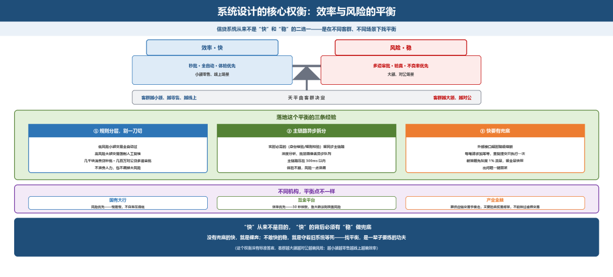

# 系统设计的核心权衡

> 公众号：侃西东　·　发布日期：2026-10-20　·　[微信原文](https://mp.weixin.qq.com/s?__biz=MzIzNzQ5NjU5NQ==&mid=2247484895&idx=1&sn=993759ab81018faf96cfcf983d44aa6b&chksm=e8c6f5a3dfb17cb5da758ca6e1d57c3c0b78f78d0755ad0affa1f2b904f576f0394633b44c7e)

---

九、系统设计的核心权衡：效率与风险的平衡

做了二十年信贷系统，我被产品经理、架构师问过最多的一个问题：你们做系统，到底是追求快，还是追求稳？我每次都答：这个问题本身就问错了——信贷系统从来不是二选一，是在不同客群、不同场景下找平衡。

这个权衡没有标准答案，客群越大额、越对公，越要往风险那边偏；客群越小额、越零售、越线上，越可以往效率那边偏。

**图4-48 效率与风险的平衡：客群决定天平**

### （一）怎么在系统设计里落地这个平衡：我踩出来的三条经验

第一条，规则分层，别一刀切。低风险小额交易全自动过，高风险大额交易强制人工复核——几千块的消费贷走秒批，几百万的对公贷要过好几道人工审批，这样既不浪费人力，也不漏掉大风险。

第二条，主链路异步拆分。必须实时的事（身份核验、规则校验）放在同步主链路，深度分析、批量画像这些不影响当下出结果的事，都丢到异步队列，主链路压在300 毫秒以内，体验不崩，风险也一点没漏。

第三条，快要有兜底。外部接口超时就降级熔断，别让一个征信接口挂了把全链路堵死；每笔请求加幂等，重复提交只执行一次；新策略先灰度1%流量，留全量快照，出问题一键回滚。

### （二）不同机构，平衡点不一样

这三条经验是通用的，但具体把平衡点落在哪，每家机构各有各的算法。

国有大行的逻辑是“风险优先”：一笔大额房贷往往要过好几道审批、押品要做实地或线上核验，慢是慢，但不良率压得低；互金平台的逻辑偏向“效率优先”：不少产品做到秒级放款、模型秒批，靠大数法则覆盖风险，快是快，但坏账率也更高；产业金融又不一样，系统要么嵌进核心企业 ERP，要么通过数据对接（ODS、线下对账）拉通交易数据，既要跟着供应链交易节奏走，不能让上下游等太久，又要验真贸易背景，不能把虚假交易放过去。

做信贷系统这么多年，我越来越觉得：“快”从来不是目的，“快”的背后必须有“稳”做兜底——没有兜底的快，就是裸奔；不敢快的稳，就是守着旧系统等死。怎么在这两者之间找平衡，就是一个老信贷系统工程师一辈子要练的功夫。
