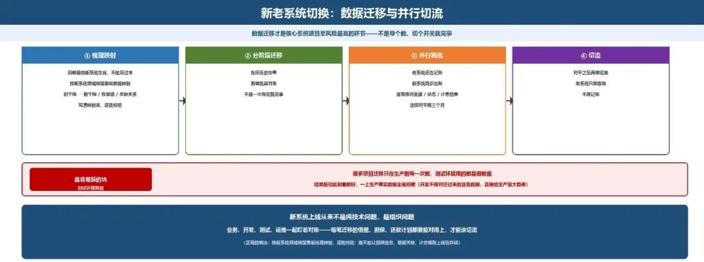

# 新老系统切换：数据迁移与并行切流

> 公众号：侃西东　·　发布日期：2026-10-21　·　[微信原文](https://mp.weixin.qq.com/s?__biz=MzIzNzQ5NjU5NQ==&mid=2247484896&idx=1&sn=ea95de50c2b8873ccea15eabc1d7ceae&chksm=e8c6f59cdfb17c8a33fe516cc2d51f1535330d6a9ac0828882b24563dac138a2df166a4d48ca)

---

十、新老系统切换：数据迁移与并行切流

我在PLPM 这类信贷核心系统替换项目里，踩过最狠的坑不是写代码，是新老系统切换。很多人以为新系统上线就是把旧数据导进去、切个开关就完事，实际做过的都知道，数据迁移才是核心系统项目里风险最高的环节。

**图4-49 新老系统切换：数据迁移与并行切流的四阶段**

第一，迁移原则必须是“旧数据向新系统靠拢”，不能反过来。我见过太多项目图省事，把旧库数据直接搬到新库就敢上线，结果担保信息和贷款借据关联不上、档案号对不上、计息规则不匹配，上线后直接炸锅。正确的做法是按新系统的领域模型重新梳理数据映射：旧系统的每个字段，要对应到新模型的哪个字段、哪个枚举值、哪个关联关系，写清楚映射表，逐批校验。

第二，迁移不是一次导完就完事，必须分阶段：先迁历史存量、再做批量对账、然后并行跑一段时间——老系统还在记账，新系统同步出账，两边逐笔核对金额、状态、计息结果，连续对平两三个月，再做切流，最后老系统只做查询不再记账。

第三，最容易被忽视的是测试环境数据。很多项目迁移只在生产前导一次数，测试环境用的都是假数据，结果新功能测着都好，一上生产真实数据全是问题。PLPM 项目里就吃过这个亏：开发自己都不核对迁过来的业务数据是不是完整、关联是不是对的，测试根本发现不了，直接给生产留了大隐患。

新系统上线从来不是纯技术问题，是组织问题：业务、开发、测试、运维一起盯着对账，每笔迁移的借据、担保、还款计划都要能对得上，才能谈切流。
