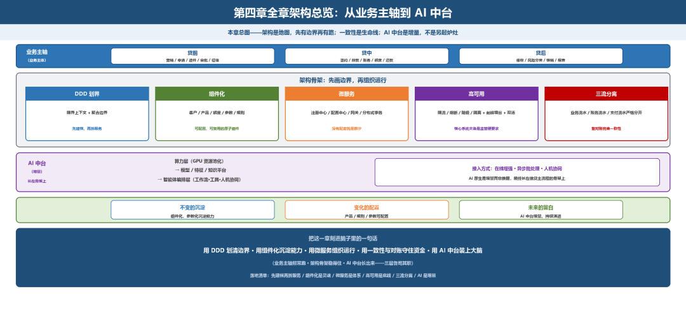

# 本章小结

> 公众号：侃西东　·　发布日期：2026-10-22　·　[微信原文](https://mp.weixin.qq.com/s?__biz=MzIzNzQ5NjU5NQ==&mid=2247484897&idx=1&sn=8cd983d97e44cd9ad5057c7712bb31c6&chksm=e8c6f59ddfb17c8b04d64f69b93adf4cc7d5b4a0c379acc8e10b13b0233f4e23ca63f53456da)

---

十一、本章小结

这一章把信贷系统的整体架构讲透了。抽干了看，最核心的就是三句话：

第一句话：架构是地图，先有边界再有路。模块怎么切、边界怎么画、组件怎么沉淀，是这一章的地基；边界不清，后面全是补丁。

第二句话：一致性是信贷系统的生命线。能强一致就强一致，不能强一致就靠流水、补偿、对账兜底；账对不上，系统再新也不敢上线。

第三句话：AI 中台是增量，不是另起炉灶。算力、模型、智能体三层叠加，最终都要长在信贷主流程的骨架上。

讲完这三句话，我用一张总图加一份落地清单给你收个尾，把这一章所有要点串起来。

一张总图（全章架构总览）：

**图4-50 第四章全章架构总览：从业务主轴到 AI 中台**

**表4-9 信贷架构设计落地核心要点清单**

| 行动要点 | 落地说明 |
| --- | --- |
| 先建模，再拆服务 | 用DDD划清限界上下文和聚合边界，别一上来就拆库拆表 |
| 组件化是灵魂 | 把客户、产品、额度、参数、规则做成可配置、可复用的原子组件 |
| 微服务是体系 | 拆服务必须配套注册中心、配置中心、网关、分布式事务，没有配套就是散沙 |
| 高可用是底线 | 限流熔断降级隔离四件套+削峰填谷+同城双活，核心系统灾备是监管硬要求 |
| 三流分离 | 业务流水、账务流水、支付流水严格分开，靠对账兜底 |
| AI是增量 | AI中台叠在传统系统上，不替换老底座，从人机协同、异步场景切入最稳 |

最后，我把这一章用一句话刻进你脑子里：

一套生产级信贷系统的骨架，就是“用 DDD 划清边界、用组件化沉淀能力、用微服务组织运行、用一致性与对账守住资金、用 AI 中台装上大脑”，而贯穿始终的那根线，是把“不变的沉淀、变化的配置、未来的留白”想清楚的架构智慧。

架构搭起来了，系统能跑了。但一笔贷款从放款到收回，系统里最不能出错的那个角落还没看。下一章，我们钻进贷款核心系统，借据、还款计划、计息引擎，把“钱怎么算、怎么还”讲透。
