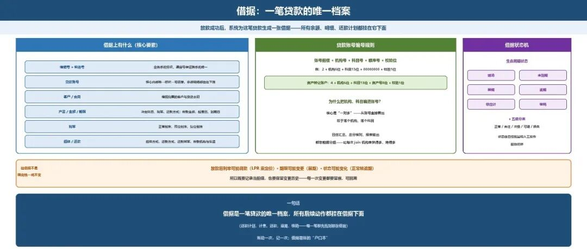
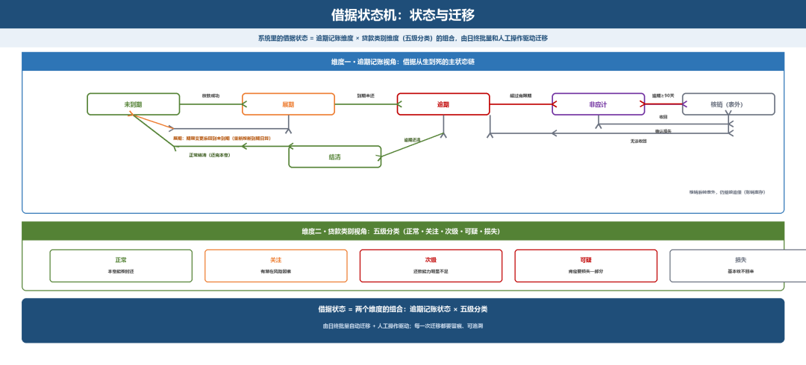

# 借据：一笔贷款的唯一档案

> 公众号：侃西东　·　发布日期：2026-10-24　·　[微信原文](https://mp.weixin.qq.com/s?__biz=MzIzNzQ5NjU5NQ==&mid=2247484958&idx=1&sn=42c5f67068f60a395f6759df4d15188d&chksm=e8c6f662dfb17f74954bca6d26b67a76a231e8b983f5645ec941b90bf17599e31f59d3615600)

---

二、借据：一笔贷款的唯一档案

### （一）借据上有什么

借据是核心系统里一笔贷款的档案。放款成功后，系统为这笔贷款生成一张借据，记录：客户、产品、合同号、贷款金额、期限、利率（正常利率、罚息利率、复息利率）、担保方式、还款方式、还款频率、放款机构与渠道、起息日与到期日。

**图5-6 借据：一笔贷款的唯一档案（核心要素 · 账号规则 · 状态机）**

**表5-1 借据的核心要素**

| **要素** | **说明** |
| --- | --- |
| 借据号+渠道号 | 业务系统的借据标识，渠道号保证跨系统唯一 |
| 贷款账号 | 核心内部唯一标识一笔借据，余额明细都挂在它下面 |
| 客户/合同 | 借据归属的客户与贷款合同 |
| 产品 | 决定科目、利率、还款方式的贷款产品 |
| 金额与期限 | 放款金额、起息日、到期日 |
| 利率 | 正常利率、罚息利率、复息利率 |
| 还款方式 | 等额本息、等额本金、先息后本等 |

### （二）贷款账号的编号规则

比如一笔贷款账号是“2 +机构号6位+科目号13位+顺序号8位+校验位1位”，科目号对应记账科目（如正常本金），顺序号就是这笔贷款的流水号；资产转让账户则是“4 +机构号6位+科目号13位+资产号8位+校验位1位”。

为什么要把机构、科目编进账号？因为核心是“一对多”的，一个贷款账号不只要知道是哪个客户的钱，还要能直接从账号里看出它属于哪个机构、哪个科目，日终汇总、总分核对、报表输出都靠这个前缀来分组。这是把查询压力前置到编号设计上，比每次join一张机构表快得多，也稳得多。

### （三）借据状态机

借据从生到死，要经历一系列状态。从逾期记账角度看，有：结清、未到期、展期、逾期、非应计、核销；从贷款类别看，正常、关注、次级、可疑、损失（五级分类，本章与第九章展开）。系统里的借据状态，就是这两个维度的组合，由日终批量和人工操作驱动迁移。

**图5-7 借据状态机：状态与迁移**

借据是一笔贷款的唯一档案，所有后续动作都挂在借据下面。但借据不是填完就一成不变的：放款后利率可能调整（LPR重定价）、期限可能变更（展期）、状态可能变化（正常转逾期），所以既要记录当前值，也要保留变更历史。
