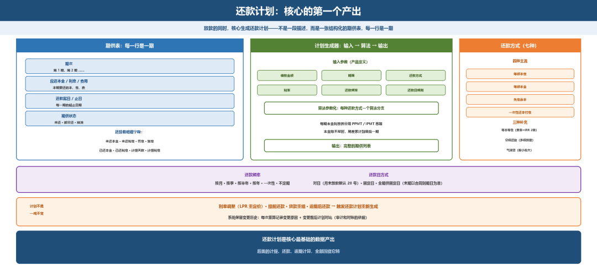
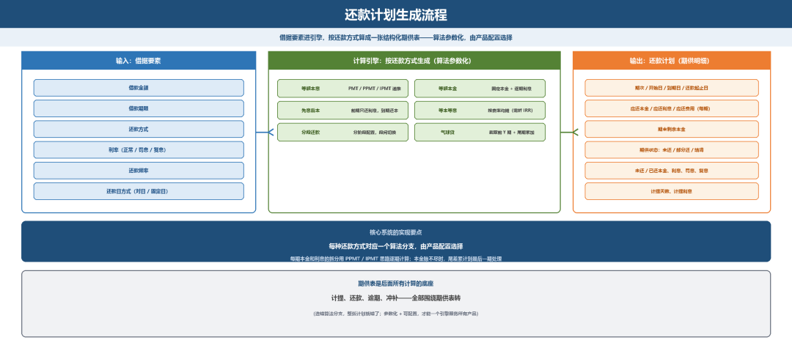

# 还款计划：核心的第一个产出

> 公众号：侃西东　·　发布日期：2026-10-25　·　[微信原文](https://mp.weixin.qq.com/s?__biz=MzIzNzQ5NjU5NQ==&mid=2247484959&idx=1&sn=280738fd3ae25e298c235d8726ca93d9&chksm=e8c6f663dfb17f7573a460faaf6aa7c058dcb7bd5278cf66582b3ba9e2bb333ada6ff99db516)

---

三、还款计划：核心的第一个产出

### （一）计划要素

放款的同时，核心要生成还款计划。在核心系统里，还款计划不是一段描述，而是一张结构化的期供表，每一行是一期，字段包括：期次、应还本金、应还利息、应还费用、还款起日、还款止日、期供状态。生成器的输入参数由产品定义：借款金额、期限、还款方式、利率、还款频率、还款日规则，输出是完整的期供列表。

**图5-8 还款计划：核心的第一个产出（期供表 · 生成器 · 还款方式）**

计划里每一期（期供）还有自己的状态：未还、部分还、结清，以及未还本金、未还利息、罚息、复息、已还本金、已还利息、计提天数、计提利息等字段。还款计划是核心最基础的数据产出，后面的计提、还款、逾期计算，全部围绕它转。

### （二）还款方式：不止四种

第二章表2-1讲过四种主流还款方式：等额本息、等额本金、先息后本、一次性还本付息（还有随借随还）。这里补充三种容易被忽略、但系统必须支持的：等本等息、分段还款、气球贷。

**表5-2 三种补充还款方式**

| **还款方式** | **每期还款特点** | **系统实现要点** |
| --- | --- | --- |
| 等额本息 | 每期还款额固定 | 按公式计算每期本息，本金逐月递增、利息逐月递减 |
| 等额本金 | 每期本金固定，利息递减 | 每期还固定本金，利息按剩余本金计算，月供逐期减少 |
| 先息后本 | 前期只还利息 | 前期期供只有利息，到期一次性还本金，适合经营贷 |
| 等本等息 | 每期本金利息都固定 | 利息按初始本金全额算，真实年化约为费率2倍，监管要求明示IRR |
| 分段还款 | 不同阶段还款方式不同 | 一笔借据按阶段配不同方式，如助学贷款在校期先息后本 |
| 气球贷 | 前期月供小，最后一期大额 | 按长期限算计划，截取前Y期，最后一期归还剩余本金 |

等本等息要特别说一句：它每期本金利息都不变，利息不随本金减少而减少，所以费率不能真实体现资金成本。监管要求明示年化利率后，等本等息的产品都要在展示层把费率折算成IRR，利率与费率的口径第三章讲过，这里提醒做系统的同学：费率转真实年化，一般是费率的2倍左右，公式上等价于“按等本等息的总利息，反推一个等额本金口径下的利率”。

### （三）还款频率与还款日

还款频率有按月、按季、按半年、按年、一次性、不定期。还款日方式有三种：对日（哪天放款，每月就哪天还，月末放款默认28号）、固定日（每月固定一天）、全期供固定日（所有期供都是固定日期，最后一期以合同到期日为准）。

核心系统的实现要点是：把算法参数化，四种主流还款方式各对应一个算法分支，由产品配置选择；

**图5-9 还款计划生成流程**

还款计划生成后不是一成不变的。利率调整（LPR重定价）、提前还款、贷款重组、逾期后还款，都会触发还款计划的重新生成。系统要保留计划变更的历史，每一次重算都要记录变更原因和变更前后的计划对比，这是后续审计和对账的依据。

气球贷和分段还款是两种特殊的还款方式。气球贷是按长期限（比如10年）生成等额本息计划，但只还前Y期（比如3年），第Y期把剩余本金一次性还清，这样前期月供低但最后一期压力大，像气球一样前小后大。分段还款是一笔贷款在不同阶段用不同的还款方式，比如助学贷款在校期间只还利息、毕业后开始等额本息，这需要系统支持多段计划的拼接和段间切换。

还款方式是还款计划的灵魂：不同的还款方式，本质是本金和利息在时间轴上的不同分配。四种主流加三种补充，一共七种，系统都要支持。
