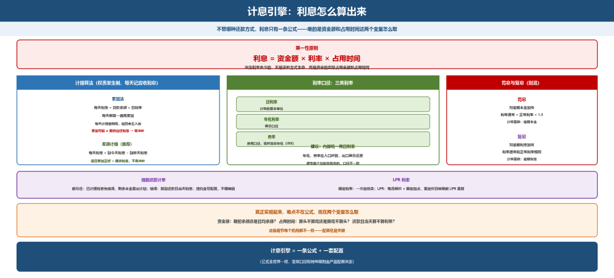

# 计息引擎：利息怎么算出来

> 公众号：侃西东　·　发布日期：2026-10-26　·　[微信原文](https://mp.weixin.qq.com/s?__biz=MzIzNzQ5NjU5NQ==&mid=2247484960&idx=1&sn=35a96212c40290df1e91ef1e38a091da&chksm=e8c6f65cdfb17f4a116c122ab9c4c60f4bbd5ef810018a284a5a3696da2a5e005250825e4e84)

---

四、**计息引擎：利息怎么算出来**

**图5-10 计息引擎：利息怎么算出来（第一性原则 · 计提算法 · 利率口径）**

### （一）利息= 资金额 × 利率 × 占用时间

不管哪种还款方式，利息的公式只有一条：利息=资金额×利率×占用时间。决定利息多少的，不是还款方式本身，而是资金的实际占用金额和占用时间。这是计息引擎的第一性原则，理解它，就不会被各种还款方式的公式绕晕。

### （二）累加法与差额计提

计提（按权责发生制每天记应收利息）有两种算法：累加法和差额计提。

**图5-11 累加法与差额计提：两种计提算法的对比**

累加法：每天利息=贷款余额×日利率，每天都算一遍再累加。特点是每天的计提值相同，但四舍五入后，累加结果可能不等于期供应还利息，需要到期冲补。

差额计提：每天利息=期供开始日到今天的利息−期供开始日到昨天的利息。比如期供利息为n×p×r，第一天计提pr，第二天计提2pr−pr=pr……这样逐日累加，结果正好等于期供应还利息，不需要冲补；代价是每天的计提值可能因四舍五入而略有差异。

工程实现上我建议用差额计提，它保证了“每天计提的累加=期供利息”这条恒等式，日终对账时少一类不平。

### （三）利率与费率：真实年化的换算

利率严格计算本金使用的成本，费率是简单计算费用、间接体现定价。系统里利率有三类：日利率、年化利率、费率。设计计息引擎时，建议内部统一用一个口径（日利率），年化利率和费率都在入口折算，出口展示时再按口径还原，避免每个功能各算各的，口径不一致。

提前还款的计息也有讲究。提前部分还款时，已计提的利息要先结清，剩余的本金重新生成还款计划；提前结清时，要算到还款日当天的利息，然后一次性结清本金和利息。有些产品对提前还款收取违约金，这部分费用的计算也要在计息引擎里配置，不能硬编码。

（冲抵顺序的三种特殊情况，见本章七（二）还款一节）

LPR（贷款市场报价利率）是近年来利率计算的一个重要变化。固定利率是在基准利率基础上上浮或下浮，一旦确定整个贷款期不变；LPR利率则是由20家报价银行每月报价、央行去掉最高价和最低价后算平均得出，贷款利率等于最近一个月的LPR加上一个固定的加点数。加点数一旦确定就不再变化，但LPR每月会变，所以LPR贷款的利率会在重定价日（通常是每年1月1日或贷款放款日）自动调整。对系统来说，LPR计息需要维护一个LPR利率表，每次重定价时查表取最新值重新计算后续期供。

真正实现起来，难点不在公式，而在资金额和占用时间这两个变量怎么取。资金额是用期初余额还是日均余额？占用时间是算头不算尾还是算尾不算头？遇到还款日当天算不算利息？这些细节每个机构可能都不一样，配置化是关键。
