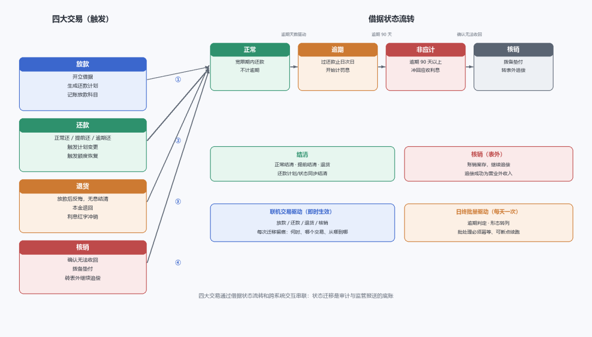
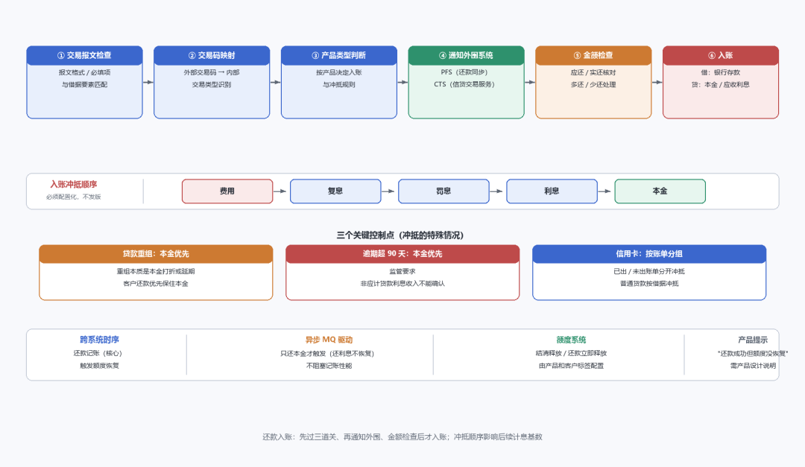

# 核心的四大交易

> 公众号：侃西东　·　发布日期：2026-10-29　·　[微信原文](https://mp.weixin.qq.com/s?__biz=MzIzNzQ5NjU5NQ==&mid=2247484993&idx=1&sn=699add253848d04a25c619780ac6d574&chksm=e8c6f63ddfb17f2bbec8bef1d453b8322db52b7fecf90b89cbf52e12f94d9696299606e13e34)

---

七、核心的四大交易

核心系统的四大交易，放款、还款、退货、核销，覆盖贷款从生到终的全生命周期。它们之间通过借据状态流转和跨系统交互串联：

**图5-16 核心四大交易状态流转图**

### （一）放款

放款做三件事：记录借据信息、生成还款计划、记账。记账要区分放款机构和放款渠道，钱从哪个渠道代付出去，就记到哪个渠道的指定专用账户；对应的具体分录，第六章放款案例里展开。

这里要分清支付行为和记账行为：代付是钱从银行账户划出去，记账是把这笔钱记为客户的贷款资产。两者通过交易流水号关联，但本质不同，很多刚做核心的同学把这两个搞混，导致对账怎么都对不上。

### （二）还款

还款分任意还（随时还任意金额：正常还、提前部分还、提前结清、逾期还）和按期还。还款时系统要维护借据信息、修改还款计划（如触发计划变更）、记账（本金、利息余额的冲减，分录第六章讲）。

还款入账不是“收到钱就记一笔”那么简单。从进系统到真正入账，要过交易报文检查、交易码映射、产品类型判断三道关，还要通知还款同步、信贷交易服务两个外围系统，最后做金额检查才执行入账。完整流程见图5-16。

**图5-17 还款入账全流程图**

（见图5-16关键控制点）

二是逾期超90天本金优先（非应计口径见本章五（三））；

冲抵顺序必须配置化，不要写死在代码里，监管政策变了（如逾期90天改60天）改配置即可，不用发版。但每次改配置必须有审批和回归测试，因为冲抵顺序错了账就全错。

还款计划变更是核心最容易出bug的地方。客户多还的钱会被视为提前还后续本金余额（不是提前还期供），需要重算计划。变更有四种方式：固期缩款（减本重算，默认）、固款缩期、固本缩期、缩期重算。

减免息要注意：营销活动的免息券、减免息不是不记账，而是“减免部分入营销费用”，利息照提，差额记入营销费用，账要平，只是收入变成了费用。

还款之后还有一个紧密相关的动作，额度恢复。

跨系统时序见图5-16。

### （三）退货：无息结清

退货（区别于商城退货）实质是无息结清：放款后客户反悔，钱退回去：本金退回、已计提的利息冲销（红字冲销的具体分录，第六章会计引擎有讲）。

退货也要改还款计划：期供状态改为结清，贷款状态改为结清。实际场景比这复杂，还会涉及收息、收违约金的场景，但原理就是“本金退回、利息冲销”。

### （四）核销与核销归还

核销是贷款确认无法收回时的处理：不是修改状态了事，而是从拨备里出钱。三步：拨备计提、本金核销、利息冲减；完整分录第六章讲核销时展开。

三个常见的误解，我一次说清：

第一，核销不是不用还，贷款的钱一定要还，核销是拨备垫付；

第二，不是只有逾期很久才核销，借款人死亡、公司破产也会核销；

第三，核销之后还会继续追偿，追偿回来的钱照样算收入。

核销后资产转到表外，仍然要维护表外账（表外本金、表外应收利息），并继续计息、继续追偿记录，第六章资产转让里会看到完整的表外账务处理。
