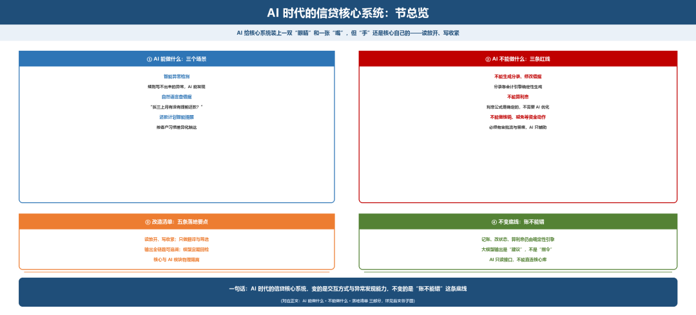
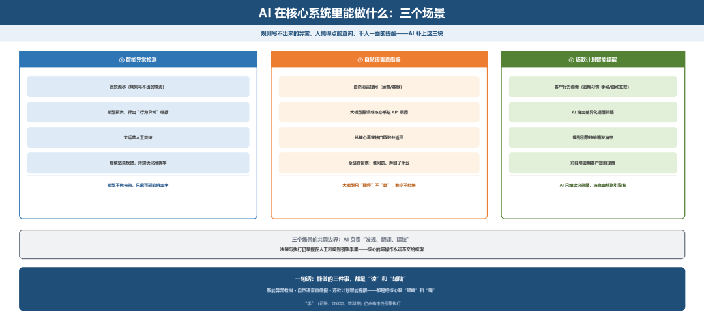
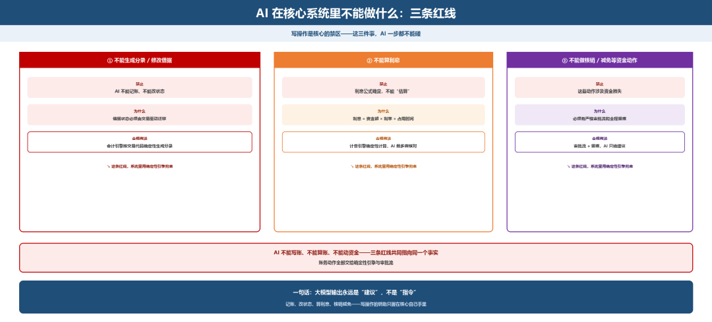
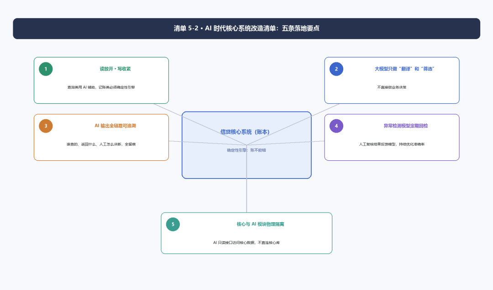
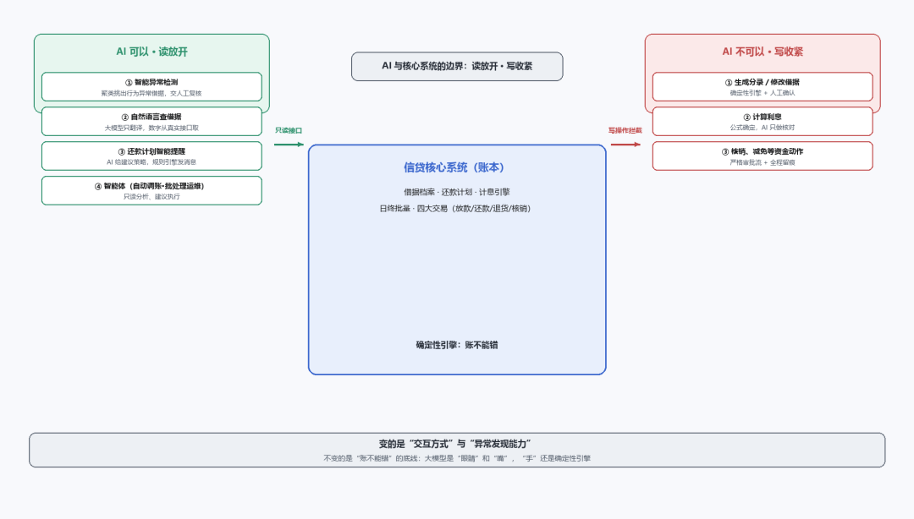

# AI 时代的信贷核心系统

> 公众号：侃西东　·　发布日期：2026-10-30　·　[微信原文](https://mp.weixin.qq.com/s?__biz=MzIzNzQ5NjU5NQ==&mid=2247484994&idx=1&sn=276f1ff3b6ed1ee2fc7d11a640fc8abe&chksm=e8c6f63edfb17f288740c6cabb7b745911af8f679a003ddbaecda175b574399041a268e0a813)

---

八、**AI 时代的信贷核心系统**

这几年我开始把大模型用在信贷系统里，这一节讲清楚它能做什么、不能做什么、落地时注意什么。

**图5-18 AI 时代的信贷核心系统：节总览**

### （一）AI 在核心系统里能做什么

第一，我在做产业金融相关系统时，用模型对还款流水做聚类，把行为异常的借据从海量流水中筛出来，再交给人复核。

第二，自然语言查借据。运营和客服查借据状态，以前要在系统里点好几个页面、输好几个条件。现在可以用自然语言问：“客户张三上个月有没有提前还款？”大模型把这句话翻译成核心系统的API调用，返回结果。这里的关键是：大模型只负责“翻译”，不负责“算”，借据余额、剩余期数这些数字，必须从核心系统的真实接口取，不能让大模型“编”。

第三，还款计划的智能提醒。传统的还款提醒是“到期前三天发短信”，千人一面。AI可以做差异化：对经常逾期的客户提前一周提醒、对习惯手动还款的客户只提醒一次、对设置了自动扣款的客户不打扰。这背后是客户行为画像，不是大模型直接发消息，消息还是规则引擎发，AI只给“建议策略”。

**图5-19 AI 在核心系统里能做什么：三个场景**

### （二）AI 在核心系统里不能做什么

第一，不能让大模型直接生成分录或修改借据。分录必须由会计引擎按交易代码确定性生成，借据状态必须由交易驱动迁移。大模型的输出是“建议”，不是“指令”，所有写操作都要经过规则校验和人工确认。

第二，不能用大模型算利息。计息的第一性原则是“利息=资金额×利率×占用时间”，这个公式是确定的，不需要AI“优化”。AI可以检测“这笔利息算得对不对”，但不能替代计息引擎。

第三，不能让AI直接做核销、减免等资金动作。这些动作涉及资金损失，必须有严格的审批流和留痕，AI只能做“辅助判断”和“材料整理”。

**图5-20 AI 在核心系统里不能做什么：三条红线**

核心系统里也有适合智能体的场景。第一类是自动调账智能体，日终对账发现差异时，智能体可以自动定位差异原因、生成调账建议，但调账执行必须人工确认。第二类是日终批处理智能运维，监控批处理进度，失败时自动重试或通知运维。这些智能体的共同边界是：只读分析、建议执行，不直接动账。

### （三）落地清单：AI 时代核心系统的改造要点

#### 清单5-2 AI 时代核心系统改造清单

1.读操作放开、写操作收紧：查询类场景可以用AI辅助，记账类场景必须确定性引擎。

2.大模型只做“翻译”和“筛选”：把自然语言翻译成API调用、把异常借据从海量流水中筛出来，不做业务决策。

3.所有AI输出必须可追溯：谁在什么时间用AI查了什么、AI返回了什么、人工做了什么决策，全链路留痕。

4.异常检测模型定期回检：模型标出来的“可疑借据”，人工复核后要反馈给模型，持续优化准确率。

5.核心系统与AI模块物理隔离：AI模块通过只读接口访问核心数据，不能直连核心库做写操作。

图5-21 AI 时代核心系统改造清单：五条落地要点

一句话总结：AI时代的核心系统，变的是“交互方式”和“异常发现能力”，不变的是“账不能错”这条底线。大模型是给核心系统装了一双“眼睛”和一张“嘴”，但“手”还是原来那只确定性的手。

**图5-22 AI 时代的信贷核心系统：读放开、写收紧**
