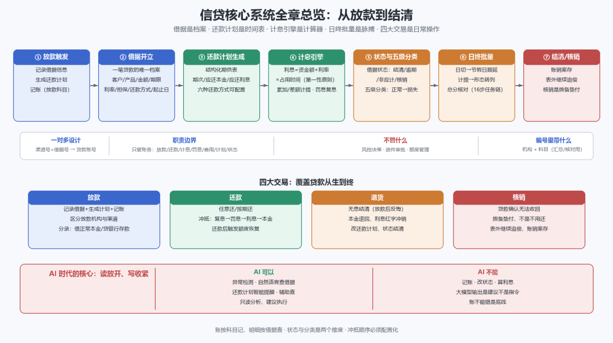

# 本章小结

> 公众号：侃西东　·　发布日期：2026-10-31　·　[微信原文](https://mp.weixin.qq.com/s?__biz=MzIzNzQ5NjU5NQ==&mid=2247484995&idx=1&sn=537a920a07afcd4c35a12940bffd1668&chksm=e8c6f63fdfb17f299acd7ecb9cbcb8cd701021aa7a0897b8e29304d6ce4ea69150247dd685dc)

---

九、本章小结

这一章把贷款核心系统讲完了。核心系统是信贷系统的“总账房”：借据是档案，还款计划是时间表，计息引擎是计算器，日终批量是脉搏，四大交易是日常操作。

留给你的三个关键认知：第一，核心系统一对多设计，贷款账号是唯一标识，编号里带机构、科目，为的是汇总和核对；第二，计息的第一性原则是“利息=资金额×利率×占用时间”，其他都是它的展开；第三，核心系统最怕的不是功能复杂，而是账不平，幂等、冲正、总分核对，是核心系统设计的铁律。

讲完这些，我用一张总图把这一章收个尾：

**图5-23 信贷核心系统全章总览：从放款到结清**

下一章，我们回答账是怎么记的：从会计分录到总账，把“账务核心”真正讲透。
