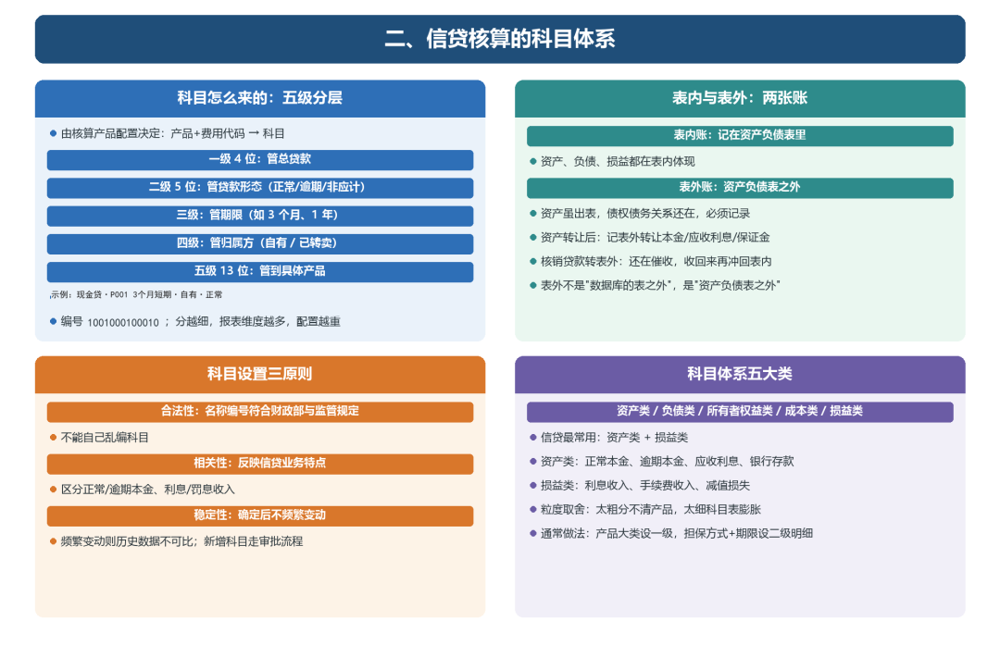

# 信贷核算的科目体系

> 公众号：侃西东　·　发布日期：2026-11-02　·　[微信原文](https://mp.weixin.qq.com/s?__biz=MzIzNzQ5NjU5NQ==&mid=2247485069&idx=1&sn=6dc8b97b9e6a7adbaeee28cf92b660ff&chksm=e8c6f6f1dfb17fe72faf8a36fe738d38cd1b457177782822ced01d6ddda20df5044a72c58565)

---

二、信贷核算的科目体系

### （一）科目怎么来的

科目不是程序员定义的，是核算的产品维度：什么产品、什么费用代码、记到哪个科目，由核算产品配置决定。比如费用代码“1-保证金”“14-利息”“2-滞纳金”，分别映射到不同的收入科目。

科目还讲究分层，当时按五级来命名：一级科目4位，管总贷款；二级科目5位，管贷款形态（正常、逾期、非应计）；三级管期限；四级管归属方（自有还是已转卖）；五级科目13位，管到具体产品。比如“现金贷P001 3个月短期自有正常透支”这个科目，编号就是1001000100010（13位）。分得越细，报表能切的维度越多，但配置和维护也越重，所以每级分到哪，是核算和产品一起定的。

**表6-1 信贷核算的核心科目（简化）**

| **科目大类** | **典型科目** | **借贷方向** | **说明** |
| --- | --- | --- | --- |
| 资产类 | 发放贷款及垫款 | 借方增加 | 表内贷款本金，按产品分科目核算 |
| 负债类 | 吸收存款、同业存放 | 贷方增加 | 客户存款、同业拆借等资金来源 |
| 损益类 | 利息收入、手续费收入 | 贷方增加 | 信贷业务产生的收入 |
| 费用类 | 利息支出、营业费用 | 借方增加 | 资金成本、运营成本 |

### （二）表内与表外

表内账记在资产负债表里，表外账不体现为资产。资产转让之后，贷款从表内出表，表外要记“表外转让本金”“表外转让应收利息”“表外转让保证金”，资产虽然不在表内了，但债权债务关系还在，必须记录清楚。

我见过不少系统把“表外”理解成“数据库的表之外”，其实表外是“资产负债表之外”：不出现在资产负债表上的账务。设计上，表内表外用不同的科目体系，一套核算代码里要能同时开两套账。

科目粒度的选择也是一个设计决策。太粗，比如所有贷款都记在一个本金科目，就无法区分不同产品的经营情况；太细，比如每个产品每个期限都单独设科目，科目表会膨胀到几百个，维护成本很高。通常的做法是按产品大类设一级科目，按担保方式和期限设二级明细，既满足管理需要，又不会太复杂。

这里有一个容易混的点：核销贷款为什么要转表外？因为贷款核销后，本金已经从准备金里冲掉了，不再是机构的资产，但这笔钱还在催收中，需要在表外记录，收回来的时候再冲回表内。

科目设置要遵循三个原则。一是合法性，科目名称和编号要符合财政部和监管的规定，不能自己乱编；二是相关性，科目要能反映信贷业务的特点，比如要区分正常本金和逾期本金、区分利息收入和罚息收入；三是稳定性，科目一旦确定就不能频繁变动，否则历史数据无法可比。新增科目要走审批流程，由财务部门确认后才能在系统里配置。

信贷核算的科目体系可以分成五大类：资产类、负债类、所有者权益类、成本类、损益类。对信贷系统来说，最常用的是资产类和损益类。资产类包括正常本金、逾期本金、应收利息、银行存款等，记录机构有什么；损益类包括利息收入、手续费收入、减值损失等，记录机构赚了什么、亏了什么。

**图6-3 信贷核算的科目体系：分层、表内表外与设计原则**
