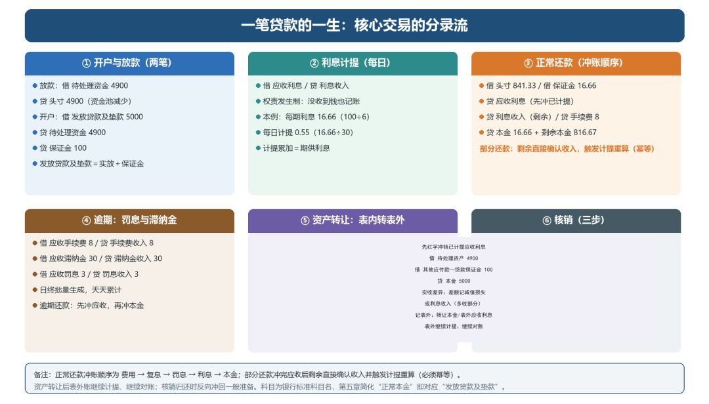

# 一笔贷款的一生：交易的分录

> 公众号：侃西东　·　发布日期：2026-11-03　·　[微信原文](https://mp.weixin.qq.com/s?__biz=MzIzNzQ5NjU5NQ==&mid=2247485070&idx=1&sn=7667d0d0f2c6ff9d5607ad45748c24bf&chksm=e8c6f6f2dfb17fe4922cc45ab6a6323c0ef739c98b315d386cf402513ee0e6c966003d0ca3d6)

---

（一）开户与放款

以我在互金平台做核算时的一个真实案例讲（这里用银行标准科目名，第五章简化的“正常本金”就对应“发放贷款及垫款”）：客户申请一笔6期线上消费贷款，放款当天的分录是两笔：

放款（资金付出）：借“待处理资金4900”，贷“头寸4900”（头寸就是机构的资金账户，核心侧叫“银行存款”），注意头寸记贷方，因为放款出去，机构的资金池余额是减少的。

开户（贷款入账）：借“发放贷款及垫款5000”，贷“待处理资金4900”，贷“其他应付款—贷款保证金100”，发放贷款及垫款等于实际给客户的钱加上砍头收取的保证金。

### （二）利息计提

计提每天跑：借“应收利息”，贷“利息收入”。本例每期利息16.66元（100/6），每日计提0.55元（16.66/30）。权责发生制下，客户没还钱，利息也要天天记。

### （三）还款

客户在第一期还款日还841.33元（第一期总欠款），分录是：借“头寸841.33”、借“其他应付款—贷款保证金16.66”，贷“发放贷款及垫款16.66”（本金部分）、贷“应收利息0.55”（冲计提）、贷“利息收入16.11”（剩余利息）、贷“手续费收入8”、贷“发放贷款及垫款816.67”（剩余本金）。

这里可以看到还款的冲账逻辑：先冲应收利息（已计提的），再确认剩余利息收入，最后冲本金。保证金的释放（16.66）随本金一起回来。

部分还款时，若还款金额不足以冲完已计提的应收利息，后续计提继续；若冲完还有剩余，剩余部分直接确认利息收入，并触发计提重算，每日计提从剩余应收倒推。这是核算里最容易出错的地方，重算逻辑必须幂等。

### （四）逾期：罚息与滞纳金

客户逾期后，系统在日终出滞纳金、手续费、罚息：借“应收手续费8”贷“手续费收入8”；借“应收滞纳金30”贷“滞纳金收入30”；借“应收罚息3”贷“罚息收入3”。逾期还款时，先冲应收（应收利息、应收手续费、应收罚息、应收滞纳金），再冲本金。

### （五）资产转让：表内转表外

资产转让是把表内资产转到表外。转让当日先记当天的计提，然后红字冲销已计提的应收利息（借：应收利息负数/贷：利息收入 负数），把表内资产转入“待处理资产”：借“待处理资产4900”、借“其他应付款—贷款保证金100”，贷“发放贷款及垫款5000”。

实际收到转让回款时，按实收金额记账：收到4800元，借“银行存款4800”，贷“待处理资产4900”，差额100记“资产减值损失”；收到5000元，贷“待处理资产4900”外，多出的100记“利息收入”。

随后把表外账记上：借“表外转让本金5000”，贷“其他应付款—表外转让保证金100”，贷“表外转让差价4900”（本金5000 =保证金100 +差价4900，与表内“待处理资产4900”对应）；借“表外转让应收利息1.65”，贷“表外转让利息收入1.65”。之后每天计提表外利息，客户还款时冲减表外本金，整个表外生命周期都要记账、都要对账。

### （六）核销

核销的分录分三步：拨备计提（借'贷款减值损失'贷'一般准备'）、本金核销（借'一般准备'贷'正常本金/逾期本金'）、利息冲减（红字冲'应收利息''应收未收利息''利息收入'）。核销归还时反向处理：冲回一般准备、确认本金归还和利息收入。

**图6-4 一笔贷款的一生：核心交易的分录流**
