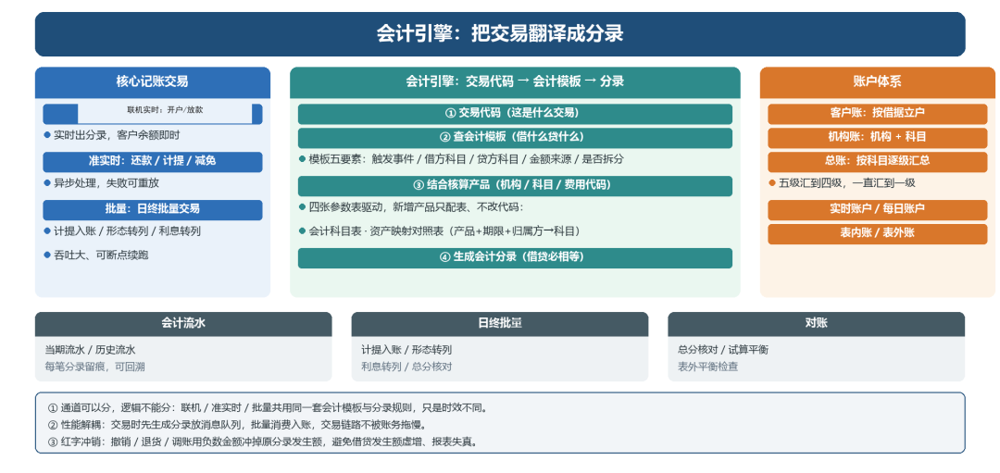
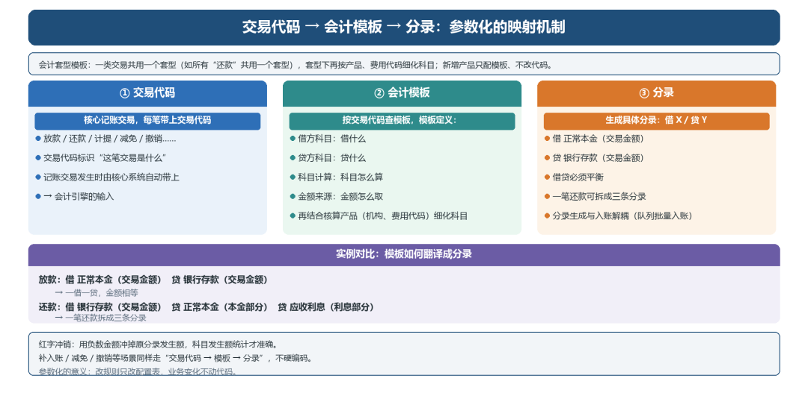
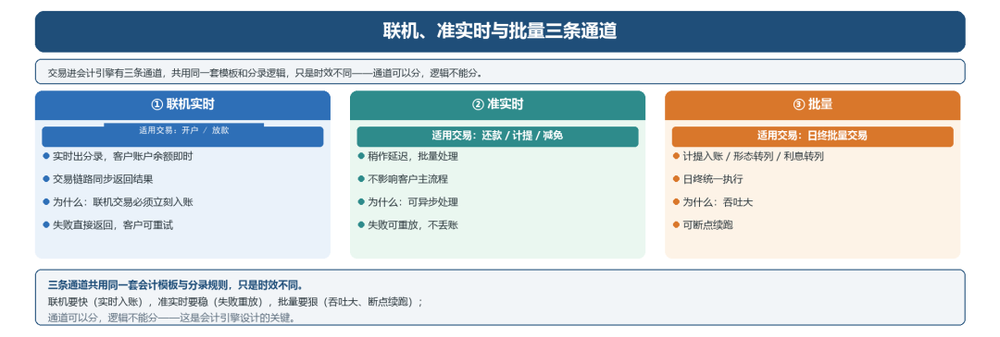

# 会计引擎：把交易翻译成分录

> 公众号：侃西东　·　发布日期：2026-11-04　·　[微信原文](https://mp.weixin.qq.com/s?__biz=MzIzNzQ5NjU5NQ==&mid=2247485071&idx=1&sn=dbacc5fd7161a55454afc943fc219ffe&chksm=e8c6f6f3dfb17fe5af8315d04fc4933da3c91ed88a7e11bf64183637aa04d5782f5f61da8df4)

---

四、会计引擎：把交易翻译成分录

**图6-5 会计引擎整体架构**

### （一）为什么核心与核算要分离

业务系统（核心）负责“发生了什么”，核算系统负责“账上怎么记”。两者分离，是因为记账逻辑复杂且稳定，且会计口径（科目、准则）会随监管调整，把核算独立出来，业务系统改的时候不碰账，核算口径改的时候不碰业务。

手工会计里有两道凭证：原始凭证（发票、合同、收据）和记账凭证（按原始凭证编的分录）。系统里对应：交易流水就是原始凭证，分录就是记账凭证。为什么要多一道翻译？因为原始凭证是业务的证据，记账凭证是账的依据，中间隔一道审核（原始凭证真实、科目正确、金额正确），防止业务还没发生就先记账。系统的做法是把两样东西分开存：业务流水记发生了什么，会计流水记账上怎么记；查账先找业务流水，找原因再查会计流水。

这就是会计引擎的定位：核心产生交易，会计引擎把交易翻译成分录。翻译不是写死的代码，靠一套参数在管，当时是四张表：会计科目表（科目本身怎么命名分层）、资产映射对照表（产品+期限+归属方映射到科目）、会计分录套型模板（什么交易借什么贷什么）、费用种类映射对照表（费用代码映射到收入科目）。新增一个产品，不用改代码，配这几张表就行。

### （二）交易代码→ 会计模板 → 分录

映射机制是参数化的：核心记账交易（放款、还款、计提、减免、撤销……）带上交易代码，会计引擎按交易代码查会计模板，模板里定义好借什么、贷什么、科目怎么算、金额怎么取，再结合核算产品（机构、费用代码）生成具体分录。

会计套型模板是模板的再抽象：一类交易共用一个套型（比如所有“还款”交易共用一个套型，模板里定义还款的借贷规则），套型下再按产品、费用代码细化科目。这样新增一个产品，只需要配模板，不用写代码。

**图6-6 交易代码 → 会计模板 → 分录：参数化的映射机制**

### （三）联机、准实时与批量三条通道

交易进会计引擎有三条通道：联机实时（开户、放款，实时出分录）、准实时（还款、计提、减免，稍作延迟批量处理）、批量（日终批量交易，如计提入账、形态转列）。

为什么要分通道？联机交易要立刻入账，保证客户账户余额实时；准实时交易可以异步处理、失败重放；批量交易吞吐大、可断点续跑。三条通道共用一套模板和分录逻辑，只是时效不同，这是会计引擎设计的关键，通道可以分，逻辑不能分。

性能是会计引擎的另一个挑战。高峰期每秒可能有几百笔交易，每笔交易要生成多条分录，还要保证借贷平衡和事务一致性。我们的做法是分录生成和入账解耦：交易时先生成分录放到消息队列，批量消费入账，这样交易链路不会被账务拖慢，账务侧也能按批处理提高效率。

更细的分工是这样：客户分户账要同步更新，客户放款、还款后要马上看到自己账上的余额，所以走同步接口；机构账、商户账不急着给客户看，可以走异步消息队列，日终再汇总，交易链路不会被账务拖慢。同步管体验，异步管效率，这是核算系统的标准分工。

会计引擎还要处理红字冲销。业务撤销、退货、调账都需要红字冲销原分录，红字不是简单地做一笔相反的分录，而是用负数金额冲掉原分录的发生额，这样科目发生额的统计才准确。如果用相反分录，借方发生额和贷方发生额都会虚增，报表数据就不准了。

分录模板的设计是会计引擎的关键。一个模板要包含：触发事件、借方科目、贷方科目、金额来源、是否需要拆分。金额来源可以是交易金额、本金余额、利息金额，也可以是这些金额的组合。比如放款的分录是借正常本金（交易金额）、贷银行存款（交易金额）；还款的分录是借银行存款（交易金额）、贷正常本金（本金部分）、贷应收利息（利息部分），一笔还款要拆成三条分录。用的时候，业务系统只需要告诉会计引擎发生了什么（放款1万元、还款5000元），引擎按事件类型、产品、机构等维度查到对应模板，生成借和贷两条（或多条）分录，保证借贷平衡。

**图6-7 联机、准实时与批量三条通道：时效不同、逻辑一套**
