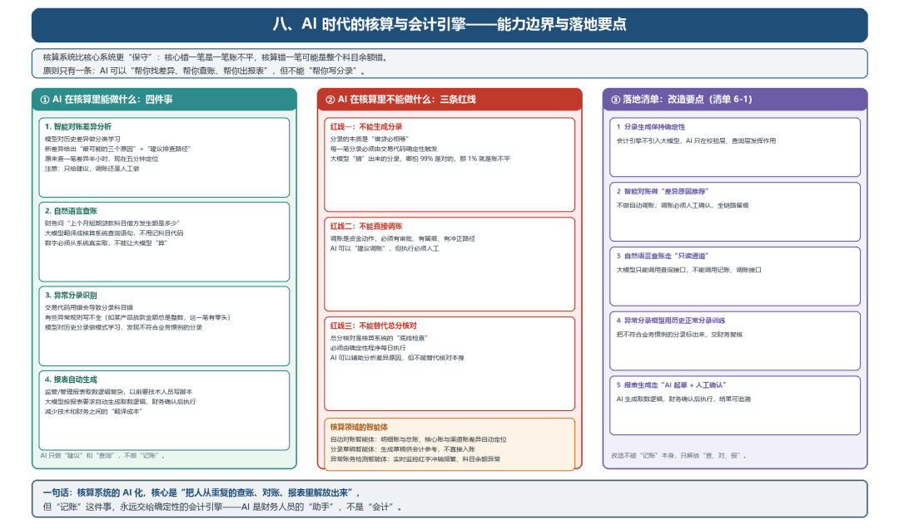
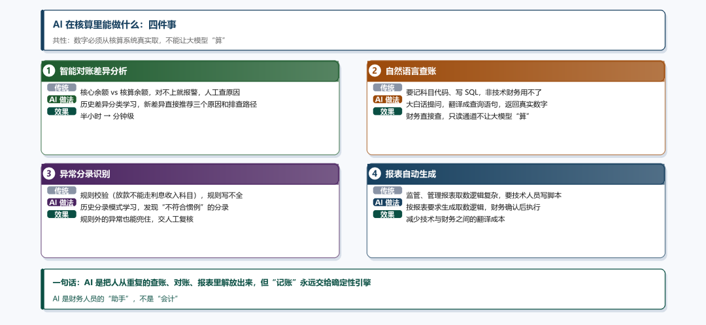
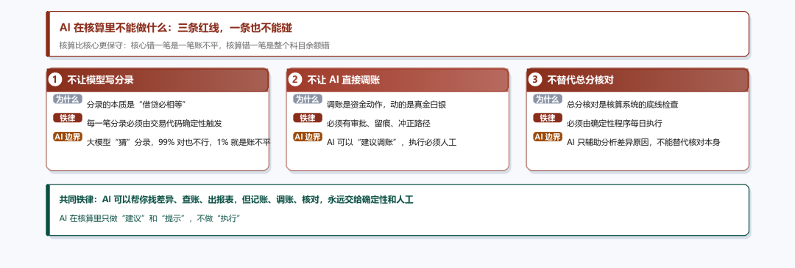

# AI 时代的核算与会计引擎

> 公众号：侃西东　·　发布日期：2026-11-08　·　[微信原文](https://mp.weixin.qq.com/s?__biz=MzIzNzQ5NjU5NQ==&mid=2247485091&idx=1&sn=f8941c42f44c8d7fa2bde8307521a846&chksm=e8c6f6dfdfb17fc9d3a22c0299e8516e98d2db4b25157a7ae0453c7e38138a52eeee22a856de)

---

八、**AI 时代的核算与会计引擎**

**图6-16 AI 时代的核算与会计引擎：能力边界与落地要点**

核算系统比核心系统更“保守”，核心系统错一笔是一笔账不平，核算系统错一笔可能是整个科目余额错。所以AI在核算里的边界更严。我在产业金融集团做核算智能化时，原则只有一条：AI可以“帮你找差异”、“帮你查账”、“帮你出报表”，但不能“帮你写分录”。

### （一）AI 在核算里能做什么

**图6-17 AI 在核算里能做什么：四件事**

第一，智能对账差异分析。传统对账是“对不上就报警”，报警之后要人工查差异原因。用模型对历史差异做分类学习，新差异出现时直接给出“最可能的三个原因”和“建议排查路径”，原来查一笔差异要半小时，现在五分钟定位。注意：模型只给“建议”，调账还是人工做。

第二，自然语言查账。财务人员问“上个月短期贷款科目借方发生额是多少”，大模型翻译成核算系统的查询语句，返回结果，不用记科目代码、不用写SQL。但同样，数字必须从核算系统真实取，不能让大模型“算”。

第三，异常分录识别。会计引擎生成分录是确定性的，但“交易代码用错了”会导致分录科目错，有些异常规则写不全（比如某产品的放款金额总是整数、这一笔有零头）。用模型对历史分录做模式学习，可以发现这类“不符合业务惯例”的分录。

第四，报表自动生成。监管报表、管理报表的取数逻辑复杂，以前要技术人员写脚本；现在用大模型根据报表要求自动生成取数逻辑，经财务确认后执行，减少技术和财务之间的“翻译成本”。

### （二）AI 在核算里不能做什么

**图6-18 AI 在核算里不能做什么：三条红线**

第一，不能让大模型生成分录。分录的本质是“借贷必相等”，每一笔分录都必须由交易代码确定性触发。大模型“猜”出来的分录，哪怕99%是对的，那1%就是账不平。

第二，不能让AI直接调账。调账是资金动作，必须有审批、有留痕、有冲正路径。AI可以“建议调账”，但执行必须人工。

第三，不能用AI替代总分核对。总分核对是核算系统的“底线检查”，必须由确定性程序每日执行，AI可以辅助分析差异原因，但不能替代核对本身。

### （三）落地清单：AI 时代核算系统的改造要点

#### 清单6-1 AI 时代核算系统改造清单

1.分录生成保持确定性：会计引擎不引入大模型，AI只在“校验层”和“查询层”发挥作用。

2.智能对账做“差异原因推荐”，不做“自动调账”：调账必须人工确认，全链路留痕。

3.自然语言查账走“只读通道”：大模型只能调用查询接口，不能调用记账、调账接口。

4.异常分录模型用“历史正常分录”训练：把不符合业务惯例的分录标出来，交财务复核。

5.报表生成走“AI起草+人工确认”模式：AI生成取数逻辑，财务确认后执行，结果可追溯。

一句话总结：核算系统的AI化，核心是“把人从重复的查账、对账、报表里解放出来”，但“记账”这件事，永远交给确定性的会计引擎。AI是财务人员的“助手”，不是“会计”。

核算领域的智能体应用更丰富。自动对账智能体可以自动核对明细账和总账、核心账和渠道账，差异自动定位；分录草稿智能体根据业务事件生成分录草稿，只能供会计参考，不直接入账；异常账务检测智能体可以实时监控账务异常（如红字冲销频繁、科目余额异常）。
