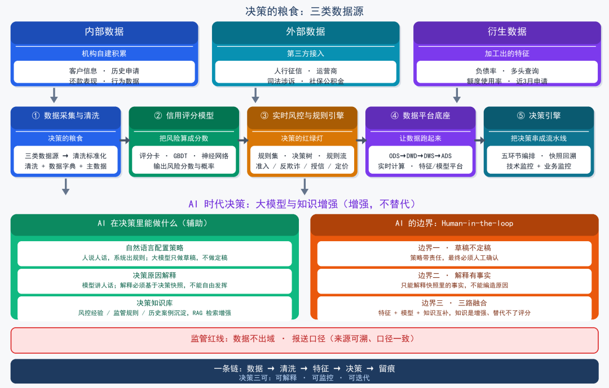
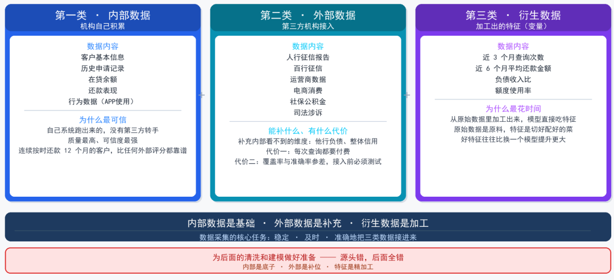

# 第七章 数据驱动的信贷决策-（一）数据采集与清洗：决策的粮食

> 公众号：侃西东　·　发布日期：2026-11-11　·　[微信原文](https://mp.weixin.qq.com/s?__biz=MzIzNzQ5NjU5NQ==&mid=2247485268&idx=1&sn=1a9d6ff3bb01bd7fc27af2e2baf74d8a&chksm=e8c6f728dfb17e3e3063892f805c709f4fc3bb83ee842cd30252e5f312e388ef0cba635bc6fe)

---

前面几章把架构、核心系统与核算引擎都讲透了，接下来要回答的是“系统凭什么做决策”。这一章，就把镜头从“账”转向“数据”。

在动笔之前，我想先请你忘掉所有技术名词，想一个朴素的问题：一笔贷款，凭什么借给你？客户经理会翻你的征信、看你的流水、问你的收入；互金平台会在你点申请的那几秒钟里，调用十几个数据源、跑几十条规则、打一个分数，然后告诉你额度是多少、利率是多少。这两个场景看起来天差地别，但说到底，是同一件事：决策。而决策的前提是数据：没有数据，客户经理只能凭感觉放贷，平台只能靠运气赚钱。所以这一章开头先给一句结论：信贷决策，说到底是数据决策。

我做了二十年信贷系统，换过五类机构，越来越确信一件事：信贷系统的能力边界，几乎等于它数据能力的边界——数据不准、不全、不及时，再好的引擎也是空转。下面，就带你把这整条链路从头走到尾：每一环我都会告诉你，数据从哪来、质量怎么保、算力怎么供、决策怎么出、出了错怎么查。

这一章，我分三条线讲：一是业务线，把信贷决策要用的数据，按内部、外部、衍生三类理清楚，讲数据怎么采、怎么洗；二是模型线，讲评分模型、规则引擎、机器学习这些“算风险”的工具，怎么从老手艺长成现代系统；三是实战线，我在国有大行做数据架构、在民营银行做额度系统、在互金平台做风控踩过的坑和留下的记录，都在这一章里。业务怎么算，系统就怎么做；数据怎么采，决策就怎么出。整体路线见图7-1。

**图7-1 数据驱动的信贷决策全章总览：从数据到决策**

## 一、数据采集与清洗：决策的粮食

### （一）决策需要哪些数据：三类数据源

信贷决策需要的数据，我习惯按来源分成三类：内部、外部、衍生。内部数据是机构自己积累的，质量最高、最可信——自己系统里跑出来的，没经过第三方转手；外部数据从人行征信、运营商、社保公积金这类第三方接入，能补内部看不到的信息，代价是每次查询付费、各家数据质量参差不齐；衍生数据是加工出来的特征，模型直接吃它，也最花时间。三类数据的完整清单，见图7-2。

图里画的是骨架，我补两句一线经验。第一句关于内部数据：我在互金平台做风控时最看重还款记录，一个连续按时还款12个月的客户，往往比外部评分更靠谱。第二句关于衍生数据：特征工程是信贷建模里最花时间的环节，我见过很多团队把大半时间花在特征上，这不是浪费，是正事。三类数据收个尾：内部是基础，外部是补充，衍生是加工。

**图7-2 决策需要哪些数据：三类数据源**

### （二）技术落点·一张客户数据表的清洗清单

讲完大原则，我把做信贷系统时总结的“客户数据清洗清单”放在下面，新同学照着做，能少踩一半坑：

#### 清单7-1 客户数据清洗清单样例

| 类别 | 说明 |
| --- | --- |
| 第一类·必填与格式校验 | 身份证号必须符合18位校验规则；手机号必须11位且首位合法；邮箱必须含@；日期必须合法（不能是2026年2月30日）；金额不能为负、不能超过合理上限。 |
| 第二类·枚举与字典标准化 | 婚姻状况、学历、职业、收入来源这类字段，必须映射到统一代码表，杜绝自由文本。通道传进来的原始值，统一经过“映射层”转成标准码再入库。 |
| 第三类·去重与主档合并 | 以身份证号+姓名为核心键做客户去重；命中同一客户的，合并档案、保留最新信息、记录合并历史。绝不允许同一客户在系统里出现两条“看起来是一个人”的档案。 |
| 第四类·交叉核验标记 | 自填的年龄和证件出生日期是否一致？自填收入和征信显示的职业是否矛盾？核验不一致的，打上“待核验”标记，转人工或降级处理。 |
| 第五类·数据质量看板 | 给每个关键数据源建质量看板：字段缺失率、格式错误率、来源分布、更新时效。质量指标异常时预警。 |
