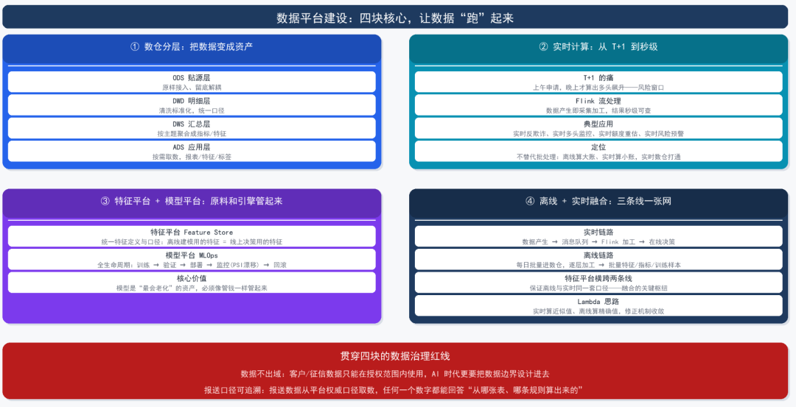
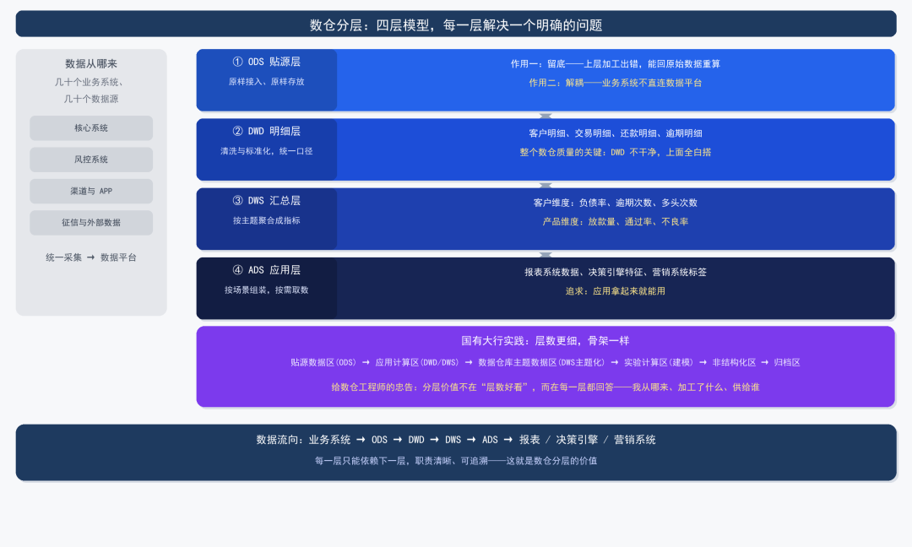
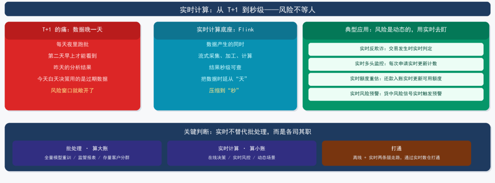
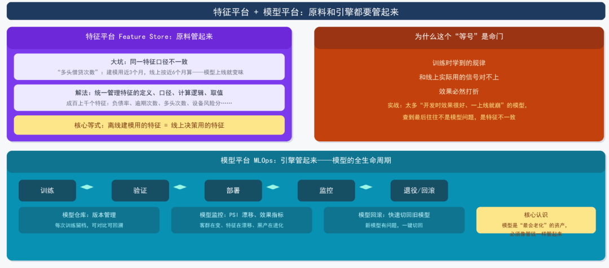
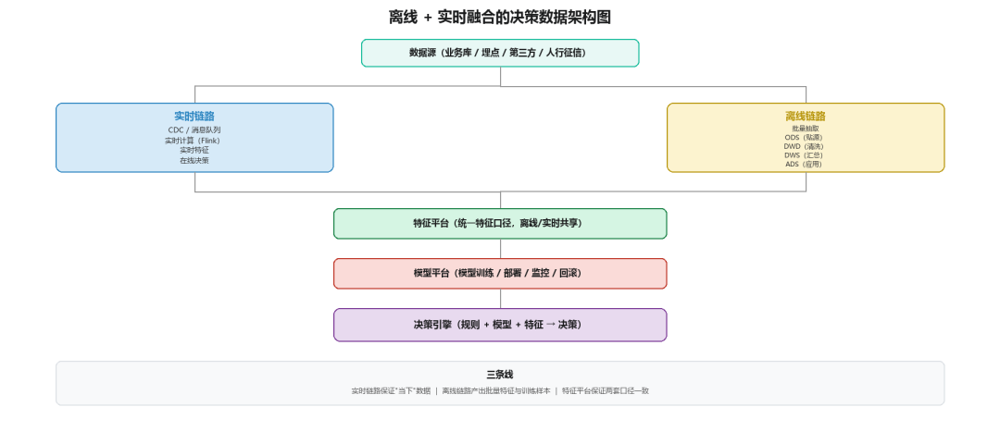
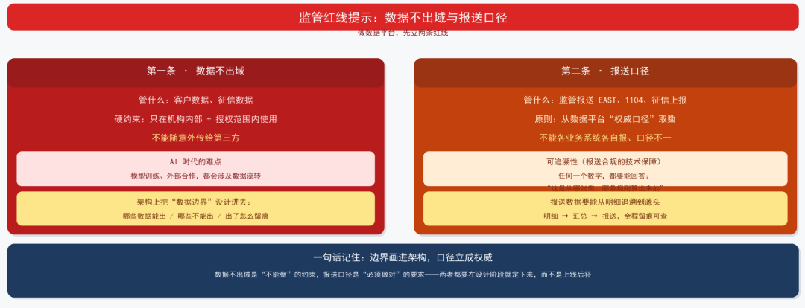

# 第七章 数据驱动的信贷决策-（四）数据平台建设：让数据“跑”起来

> 公众号：侃西东　·　发布日期：2026-11-14　·　[微信原文](https://mp.weixin.qq.com/s?__biz=MzIzNzQ5NjU5NQ==&mid=2247485271&idx=1&sn=b634f8597584bb9cad1bafa083e346b0&chksm=e8c6f72bdfb17e3d74abb48c15e871c37318a7bcbfb1fb6317eeb1cdaf11067259aa84cf448b)

---

四、数据平台建设：让数据**“跑”起来**

前两节讲的是“单个决策怎么算”，这一节把镜头拉高，讲“支撑海量决策的数据平台怎么建”。信贷决策不是一次两次，是每天几十万、上百万次；决策要用的数据也不是一条两条，要横跨几十个系统、几十个数据源。要支撑这种量级，光靠业务系统的数据库是不够的，得有一座专门的数据平台。这一节讲数据平台的四块核心，先看全景，见图7-10。

**图7-10 数据平台建设：四块核心全景**

### （一）数仓分层：ODS、DWD、DWS 与 ADS

数据平台的地基，是数据仓库。数仓要解决的核心问题是：把散落在几十个业务系统里的数据，统一采集、加工、组织，变成“可分析、可决策”的数据资产。数仓设计的经典思路是分层，我直接给你讲业界最通用的四层模型，你会看到每一层解决一个明确的问题。

第一层，ODS（贴源层，Operational Data Store）：原样接入、原样存放，把各业务系统的数据尽量不做加工地同步过来，保留原始真相。作用有两个——一是“留底”，上层加工出错能回原始数据重算；二是“解耦”，业务系统不直接连数据平台，通过ODS隔离。它的定位是“原始数据的镜像”，不做清洗、不做汇总。

第二层，DWD（明细层，Data Warehouse Detail）：做“清洗与标准化”，把ODS的原始数据洗干净、统一口径——前面讲的数据清洗、标准化、主数据，就是在这层完成的。它产出的是一张张“干净的明细表”：客户明细、交易明细、还款明细、逾期明细。这一层是整个数仓质量的关键，DWD不干净，上面全白搭。

第三层，DWS（汇总层，Data Warehouse Summary）：做“按主题汇总”，把明细数据按业务主题聚合成“指标”——客户层面的负债率、逾期次数、多头次数；产品层面的放款量、通过率、不良率。DWS产出的，就是决策直接要用的“特征”和经营直接要看的“指标”。你回想第一章讲的通过率、不良率、逾期率，它们的“权威计算地”就在这一层。

第四层，ADS（应用层，Application Data Store）：面向具体应用，按场景组装数据——报表系统的报表数据、决策引擎的特征数据、营销系统的标签数据。ADS讲究“按需取数”，追求“应用拿起来就能用”。

这四层模型，我在国有大行做数据架构时有过更细的实践：新一代大数据架构把数据区划成贴源数据区（对应ODS）、应用计算区（对应DWD/DWS）、数据仓库主题数据区（对应DWS的主题化）、实验计算区（支持数据挖掘建模）、非结构化数据区和归档数据区。你看，大行的分层更细，但骨架是一样的，贴源、加工、汇总、应用，一层层往上走。我给年轻的数仓工程师一个忠告：分层的价值不在“层数好看”，而在“每一层职责清晰、可追溯”——加层容易，但每一层都要回答“我从哪来、我加工了什么、我供给谁”，答不上来的层就是多余的层。数仓分层的四层模型，每一层解决什么问题，见图7-11。

**图7-11 数仓分层：ODS、DWD、DWS 与 ADS**

### （二）实时计算：从T+1 到秒级

传统数仓是“批处理”的天下：每天晚上跑批，第二天早上才能看到昨天的分析结果，这就是经典的T+1模式——今天决策用昨天的数据。T+1在过去够用，但互联网信贷时代不够了，原因很简单：风险不等人。

你想想看：客户上午申请贷款，你晚上才能算出他的多头是不是飙升了、行为是不是异常了，那白天这笔决策用的就是“过期”数据，风险窗口就此敞开。更极端的场景是反欺诈：黑产团伙可能在一小时内批量进件几千笔，如果数据是T+1的，等你想起来，钱已经放出去了。所以互联网信贷平台普遍引入实时计算，把数据时延从“天”压缩到“秒”。

实时计算的技术底座是流处理引擎，目前最主流的是Flink：数据产生的同时，流式地采集、加工、计算，结果秒级可查。实时计算在信贷里的典型应用：实时反欺诈（交易发生时实时判定）、实时多头监控（每次申请实时更新多头计数）、实时额度重估（还款入账实时更新可用额度）、实时风险预警（贷中风险信号实时触发预警）。这些场景有一个共同点：风险是“动态”的，得用“实时”去盯。

这里有个重要判断：实时计算不替代批处理，它和批处理“各司其职”——批处理适合“计算量大、对时效不敏感”的场景（全量模型重训、监管报表、存量客户分群），实时计算适合“计算量可控、对时效敏感”的场景（在线决策、实时风控）。现实中的架构是“离线+实时”两条腿走路：离线算大账、跑重活，实时算小账、盯动态，两边通过“实时数仓”打通。离线与实时怎么分工、实时计算管哪些场景，见图7-12。

**图7-12 实时计算：从 T+1 到秒级**

### （三）特征平台与模型平台：把“原料”和“引擎”管起来

数据平台的第三、四块，是特征平台和模型平台。这两个名字听起来新，但解决的问题很实在，我分开讲。

特征平台（Feature Store）解决的是“特征怎么统一管理”的问题。信贷决策要用成百上千个特征：客户负债率、逾期次数、多头次数、设备风险分……这些特征有个大坑：同一个特征，建模和上线算的口径不一致。比如“多头次数”，建模时用“近3个月申请机构数”，线上却按“近6个月”算，模型上线就变味——训练时学到的规律和线上实际用的信号对不上，效果肯定打折。特征平台要做的，是把特征的定义、口径、算法、取值统一管起来，保证“离线建模用的特征=线上决策用的特征”。这一个“等号”，是模型能不能稳定上线的前提。我见过不少“开发时效果很好、一上线就崩”的模型，查到最后不是模型问题，是特征口径不一致。

模型平台（MLOps）解决的是“模型怎么全生命周期管理”的问题：一个风控模型，从训练、验证、部署、上线、监控到退役，是一整个生命周期。模型平台把它管起来——模型仓库（版本管理）、模型部署（发布到决策引擎）、模型监控（PSI漂移、效果指标）、模型回滚（新模型有问题快速切回旧模型）。为什么模型要平台化管理？因为模型是信贷系统里“最容易老化”的资产：客群在变、特征在漂移、黑产在进化，模型上线就开始“过期”。没有平台化的监控和迭代机制，一个模型用三年，坏账率悄悄涨上去你都不知道。前面第四章讲的“模型资产化”，就是这个意思：模型是资产，要像管钱一样管起来。两个平台各管什么，见图7-13。

**图7-13 特征平台与模型平台：把原料和引擎管起来**

### （四）离线+ 实时融合的决策数据架构

把数仓、实时计算、特征平台这三块数据链路拼起来，我画一张“离线+实时融合的决策数据架构”给你，这是这一节的总图，也是决策引擎的“数据底座”：

**图7-14 离线 + 实时融合的决策数据架构图**

这张图你重点看三条线：实时链路喂在线决策（数据一产生就进消息队列，Flink实时加工成特征）、离线链路喂建模与报表（数据每天批量进数仓逐层加工）、特征平台横跨两条线（保证离线建模和实时决策用的是同一套口径）。三条线的分工，图里已经画清楚了。

“融合”背后有实打实的工程难度。很多人以为融合就是“两套都建”，其实难点在“一致性”：离线指标和实时指标要能对得上。怎么对？业界常用的做法是“Lambda架构”的思想：同一份数据，实时路径算“当下近似值”（供在线决策），离线路径算“精确值”（供报表和模型），两边通过一个“修正机制”收敛，比如实时多头次数可能少算，等离线跑完再校正。这背后是一整套“流批一体”的工程，也是数据平台建设里很考验功力的地方。我的做法是：别一上来就追求“流批完全一体”，先保证“特征口径统一”（靠特征平台），再逐步做“结果对账”（实时结果和离线结果定期核对），最后才谈“计算引擎统一”。稳扎稳打，平台才建得稳。

这里还得补一句数据治理的事：数据老化。信贷数据会无限增长，而决策其实只需要“近期数据+关键历史数据”。我在额度系统改造时做过数据老化：90天前结清的贷款明细、还款明细、息费计划，转移到历史数据表，线上只保留热数据。这不是偷懒，是“热数据快、冷数据省”的成本治理。数据平台的每一层，都要有明确的数据生命周期策略：哪些数据要热存、哪些要温存、哪些要归档、哪些要销毁（合规要求）。数据不是越留越多越好，是“该留的留够、该删的删得掉”。

#### 【监管红线提示·数据不出域与报送口径】

做数据平台，我提两条监管红线。第一条，数据不出域：客户数据、征信数据只能在机构内部和授权范围内使用，不能随意外传。尤其AI时代，模型训练、外部合作都涉及数据流转，“数据不出域”是硬约束，做架构时就要把“数据边界”设计进去：哪些能出、哪些不能出、出了怎么留痕。第二条，报送口径：监管报送（EAST、1104两套报表，加上征信上报）的数据，要从数据平台“权威口径”取数，不能各系统各自报、口径不一。我做监管报送系统时很深的体会是：报送数据要能从明细追溯到源头，每个数字都要能回答“这是从哪张表、哪条规则算出来的”。数据平台可追溯，就是报送合规的保障。两条红线怎么落，见图7-15。

**图7-15 监管红线提示：数据不出域与报送口径**

### （五）技术落点·决策特征的计算与缓存

这一节落到实操，给你一个决策特征工程的建议。在线决策对时延极其敏感，而特征计算往往是最耗时的环节，所以特征工程有“三快”原则：

第一快，能预计算的就别实时算。高频使用的特征（客户负债率、历史逾期次数、评分），提前在特征平台算好、缓存起来，决策时直接取，别在请求路径上现算。

第二快，能异步刷新的就别同步等。贷后评分、批量标签这类“不需要实时精确”的特征，用异步任务定期刷新，别堵在实时链路上。

第三快，能降级取旧值就别硬等新值。实时特征源挂了或者超时，决策引擎要能降级用“上次缓存的特征值”继续决策，而不是把请求卡死。这条在下一节“决策引擎架构”里还会细讲，决策的可用性，往往比“每一秒都新鲜”更重要。
