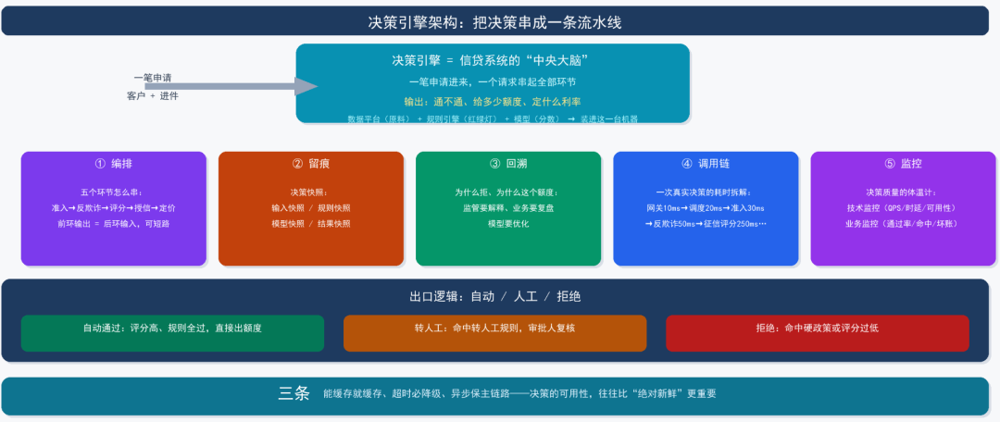
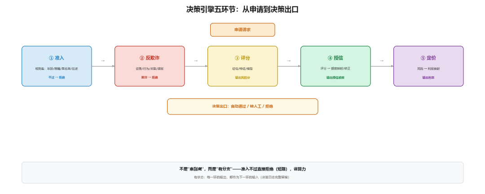
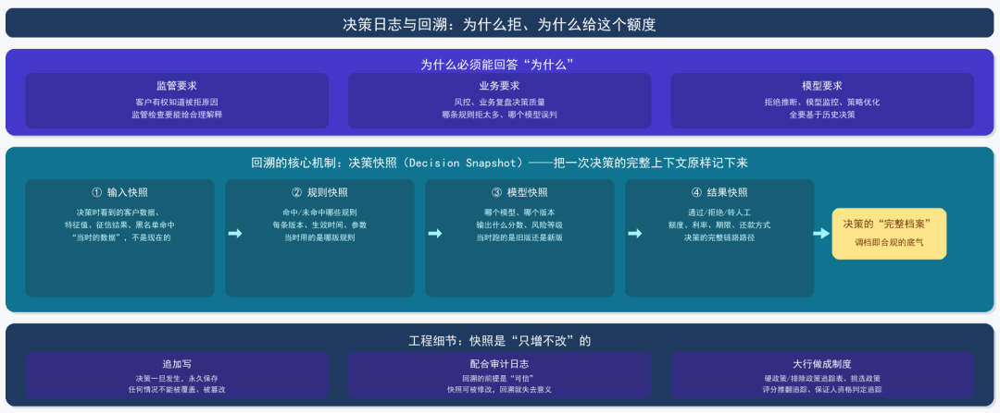
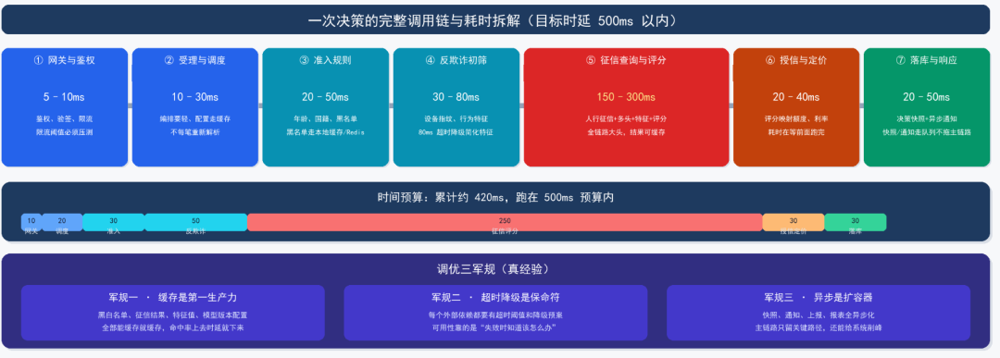
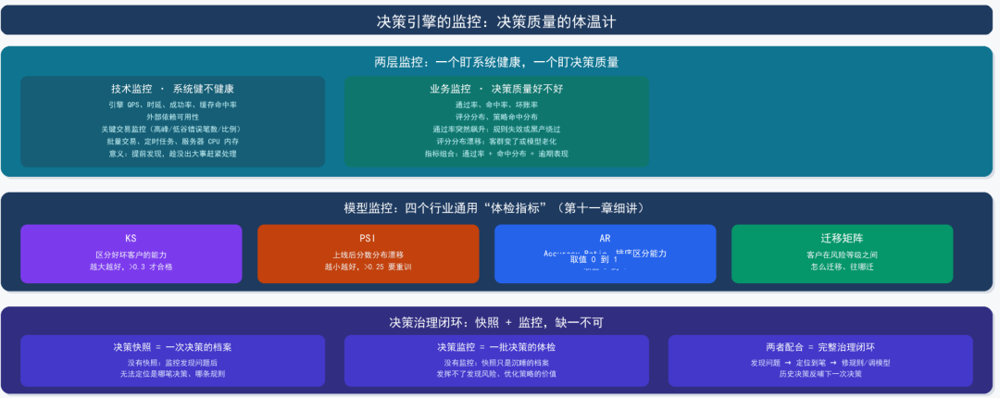
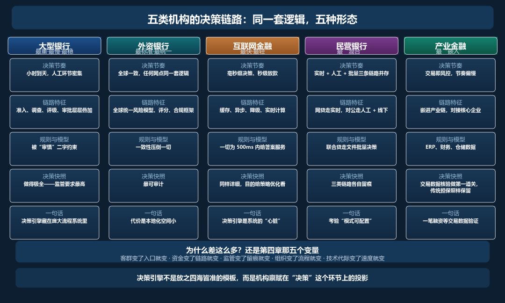

# 第七章 数据驱动的信贷决策-（五）决策引擎架构：把决策串成一条流水线

> 公众号：侃西东　·　发布日期：2026-11-15　·　[微信原文](https://mp.weixin.qq.com/s?__biz=MzIzNzQ5NjU5NQ==&mid=2247485272&idx=1&sn=758ed67d3be82cfd17a958cfc9a0f1c3&chksm=e8c6f724dfb17e32a3069791c6db2119460f950ff0b640dc92a76725a6103c11ff6d30358560)

---

五、决策引擎架构：把决策串成一条流水线

数据平台把“原料”备好了，规则引擎把“红绿灯”造出来了，模型把“分数”算出来了。这一节，把它们全部装进一台机器里，决策引擎。决策引擎是信贷系统的“中央大脑”：一笔申请进来，它在一个请求里串起准入、反欺诈、评分、授信、定价这些环节，输出“通不通过、给多少额度、定什么利率”的最终决策。这一节要讲的五件事，我用一张图给你画成地图，见图7-16。

**图7-16 决策引擎架构总览：中央大脑与五件事**

### （一）决策流编排：五个环节的串联

先说这条流水线本身。一笔申请进决策引擎，按固定顺序跑五个环节：准入（资格够不够）→反欺诈（是不是骗贷）→评分（风险有多高）→授信（敢给多少额度）→定价（收什么利率）。前一个环节的输出，是后一个环节的输入。

五环跑完，决策引擎还要处理一个分支：自动通过还是转人工。评分高、规则全过，自动通过直接出额度；评分居中、命中转人工规则，转给审批人复核；命中硬政策或评分过低，直接拒绝。这个“自动/人工/拒绝”的分支，就是决策引擎的出口逻辑。这套分支在真实大行系统里有四个专门的名字，下面逐个讲。

这些名字，我在国有大行做个人信贷评分卡时天天打交道。它们合起来，就是一套完整的“评分卡政策体系”。

第一个叫排除政策，管的是“哪些客户根本不配被评分”——不符合借款主体规定的客户，不进行评分，直接进入最终拒绝，比如借款人和共同借款人都未满18周岁。它是“一票否决”的最前端，先于评分发生。

第二个叫硬政策，管的是“哪些客户不管评分高低，直接通过或直接拒绝”。它不考虑评分，只要满足条件就自动审批通过或拒绝，比如人行信用记录“良好”的客户自动通过、“差”的客户自动拒绝。硬政策是监管和业务反复博弈出来的红线，触发条件全部量化，一旦定下来就绝不含糊。

第三个叫阈值（Cutoff），管的是“评分出来后，按分数分人群”——系统设定高、低两个Cutoff点，把客户分成自动通过、人工判断、自动拒绝三档，真实系统按产品、按担保方式分别配置。我拿国有大行个人消费贷款申请评分的分值判断表给你看（参数化控制，随时可调）：

**表7-4 双评分模式阈值对比**

| **评分模式** | **客户类型** | **自动通过线（高Cutoff）** | **自动拒绝线（低Cutoff）** | **人工判断区间** |
| --- | --- | --- | --- | --- |
| 申请评分 | 其他客户 | 617分 | 487分 | 487–617分 |
| 行为评分（贷后行为反哺） | 信用卡行为评分潜在通过客户 | 596分 | 487分 | 487–596分 |

这张表你仔细品，能读出三层意思。第一层，同样是自动通过的门槛，信用卡行为评分潜在通过客户是596分，其他客户是617分，低21分，这就是我前面讲的“用贷后行为反哺贷前决策”的量化体现：你的信用卡用得好，贷款申请的门槛就低一档。第二层，两类客户的低分拒绝线都是487分，风险底线不因客群而松动。第三层，中间的人工判断区跨度很大（都在100分以上），说明银行对“中间客群”是很审慎的，宁可花人工成本去审，也不轻易一刀切。这套Cutoff的精细设计，就是大行“审慎”二字的具体体现。

第四个叫挑选政策（Pick up），管的是“被系统自动拒绝/通过的客户里，哪些要捞回来人工再看一眼”。低分客户本该自动拒绝，但如果他是银行VIP，或者是医生、律师这类有执业资格、收入稳定的客户，就要“挑出来”人工复核——这类客户可能是评分没覆盖到的优质客户，直接拒掉太可惜。挑选政策说白了，是给“评分之外的优质信号”留一扇门。

这四个词，排除政策、硬政策、Cutoff、挑选政策，就是大行评分卡决策树的标准骨架。你把这四个词记住，再去看别家银行的评分卡需求文档，多半会发现它万变不离其宗。这四件套的完整机制、触发红线和国有大行申请评分卡（A卡）系统的真实打法，第九章“从策略矩阵到硬政策与挑选政策”一节会给你看全。

我把五个环节串起来画成一张图，这是决策引擎最核心的架构图：

你注意这张图的两个特点：一是有分支，准入不过直接拒绝，后面环节不用跑，这就是“短路”设计，省下大量算力；二是有状态，每一环的输出是下一环的输入，评分喂授信、风险喂定价——“数据驱动、环环相扣”，这正是决策引擎和“一堆规则各自判断”的区别。

### （二）决策日志与回溯：为什么拒、为什么给这个额度

决策引擎的第二件大事，是留痕。这一小节回答一个信贷行业最常被问到、也最考验系统的问题：这笔贷款为什么拒？为什么给他这个额度？凭什么给他这个利率？

先说为什么要能回答。三个理由：第一，合规要求，拒绝得有说得清的理由，监管检查时要能合理解释；第二，业务要求，风控和业务要复盘决策质量，哪条规则拒得太多、哪个模型判断失误，都要能查；第三，模型要求，拒绝推断、模型监控、策略优化，全都要基于“历史决策”，没有留痕就没有优化。说白了：决策不回溯，风控就是黑箱，优化就是空谈。

那“回溯”在系统里怎么实现？核心机制是“决策快照”（Decision Snapshot）：把一次决策的完整上下文，原样记下来。落成实体，就有“快照类型、快照版本”这些要素，我把一个完整决策快照的要素列出来：

第一，输入快照：决策时看到的客户数据、特征值、征信结果、黑名单命中情况，全部原样保存。为什么“原样”？因为数据会变——客户今天逾期了，但三个月前决策时他还没逾期，回溯要用“决策当时的数据”，不能用“现在查到的数据”。快照和“现查”，差的就是这一点。

第二，规则快照：命中/未命中哪些规则，每条规则的版本、生效时间、参数，回答“当时用的是哪版规则”。

第三，模型快照：用了哪个模型、哪个版本、输出什么分数、对应什么风险等级。模型版本在升级，回溯时要知道“当时跑的是旧版还是新版”。

第四，决策结果快照：最终输出通过/拒绝/转人工、授信额度、利率、期限、还款方式，以及决策的完整链路路径。

这四份快照合起来，就是一个决策的“完整档案”。客户来投诉“为什么拒我”，你调出档案一五一十告诉他：你命中第127条规则（多头借贷超过6次），该规则当时生效；你的评分为480分，低于487分的自动拒绝线——每一条都有据可查。监管来检查，你给出同样的档案，这就是合规的底气。

“留痕可溯”这件事，大行做成了制度。我翻过评分卡系统的需求文档，里面就有一整套“追踪报表”，专门盯着决策的每一步：硬政策/排除政策命中、挑选政策决策、评分推翻、担保方式通过率，都有专门报表。注意这里的关键词——“评分推翻”：系统判了，人工又改了。为什么“推翻”要单独追踪？因为在信贷里，“机器决策被人工修改”是最需要盯的环节：改了是为什么？改对了没有？改多了，说明机器决策不靠谱，要调模型；改得没有依据，说明人工在乱来，要查人。国有大行专门为“评分推翻”建报表追踪，就是把“机器和人的分歧”摊在阳光下，让它成为改进决策的燃料。

快照还有个工程细节要盯住：快照是“只增不改”的——决策一旦发生就永久保存，什么情况下都不能被覆盖、被篡改。为什么？因为回溯的前提是“可信”，快照可以被事后修改，回溯就失去意义。我在做决策系统时，快照存储用“追加写”模式，配合审计日志，保证决策档案的完整性和不可篡改性。这个设计看似简单，却是决策系统合规性的地基。四份快照怎么合成完整档案、为什么只增不改，见图7-18。

**图7-18 决策日志与回溯：四份快照合成完整档案**

### （三）技术落点·一次决策的完整调用链与耗时拆解

光讲架构不够，我给你把一次真实决策的调用链完整拆开，看每一环花多少时间、在哪可能出问题。这是我做线上信贷决策引擎时，真实调优过的一条链路。假设一笔消费贷申请，从请求进来到结果返回，目标时延500毫秒以内。我按时间线拆：

第一步，网关与鉴权（约5-10毫秒）：请求进网关，做鉴权、验签、限流。这一步一般很快，但网关是入口，限流配置不当会把正常请求也拦掉——我见过“限流阈值拍脑袋配”导致放款高峰期大量正常申请被拒的案例，限流阈值得压测出来，不能拍脑袋。

第二步，申请受理与风控引擎调度（约10-30毫秒）：网关把请求转给风控引擎，引擎开始编排决策流。关键是“编排本身要轻”——决策流定义从配置读取，不能每笔请求都重新解析，配置加载走缓存。

第三步，准入规则执行（约20-50毫秒）：跑准入规则集——年龄、国籍、黑名单。黑白名单是高频查询，得走本地缓存或Redis；去数据库查，一次就可能100毫秒，把预算全吃光。这是决策引擎性能优化的第一课：能缓存的坚决缓存。

第四步，反欺诈初筛（约30-80毫秒）：设备指纹匹配、行为特征查询、频率计数。设备指纹服务通常是独立的，响应慢就会成为整条链路的瓶颈。这里有个典型的降级场景：设备指纹服务超时，是等还是降级？我的经验是得有明确的超时和降级预案——80毫秒超时，就用简化特征继续，绝不能无限等。

第五步，征信查询与评分（约150-300毫秒，整条链路的大头）：调人行征信、算多头、拉特征、跑评分模型。这一环为什么最慢？因为要调外部征信接口——网络往返、响应时间不可控；跑模型本身通常只要几毫秒，特征计算和外部数据等待才是大头。优化手段：征信查询结果缓存（短期内的重复查询直接命中）、特征预计算、模型常驻内存。这里要提醒一句：征信接口时延波动很大，得有“超时保护”——征信超时了，是降级用“无征信评分”还是拒绝，要有预案，而且预案要合规：无征信数据时不能盲目放贷。

这里补一个大行特有的细节：评分往往不由信贷系统自己算，它调“中央风险计量引擎”。那会儿在大行，这个引擎叫N-CRME（信用风险管理·中央风险计量引擎），它把申请评分做成联机服务，信贷系统按约定报文通过HTTP调过去，引擎跑完评分和策略，把结果返回。为什么单独做？第一，口径统一：全行评分模型、策略、参数都收在引擎一处，换模型、调Cutoff只动引擎，不碰各产品系统；第二，能力复用：评级、评分、风险参数（EAD/LGD）这些能力，放贷、风险、资本计量、监管报送都要用，要沉淀成企业级服务。这就是第四章说的“模型资产化、服务化”：评分不再是系统内部函数，而是全行共享的“风险计量发动机”。

第六步，授信与定价（约20-40毫秒）：根据评分映射额度和利率。计算量小，但依赖前面评分的结果，耗时主要花在“等前面跑完”上。

第七步，决策结果落库与响应（约20-50毫秒）：生成决策结果、写决策快照、异步触发后续动作（短信通知、征信上报、额度生效）、返回响应给前端。快照和通知是“异步”的——决策结果可以先返回，快照和通知走消息队列慢慢落，不能让它们拖慢主链路。

把这条链路的时间预算汇总一下：网关10毫秒+调度20毫秒+准入30毫秒+反欺诈50毫秒+征信评分250毫秒+授信定价30毫秒+落库30毫秒，合计约420毫秒，跑在500毫秒预算内。你能看出两件事：第一，征信评分占了一半以上的时间，是整条链路的“命门”；第二，除了征信，其他环节都能靠缓存、异步、降级压下来。所以决策引擎的优化顺序很清晰：先管好征信（缓存+超时+降级），再优化其余环节的缓存与异步化。

这条链路调下来，我留下三条军规：

军规一，缓存是决策引擎的第一生产力：黑白名单、征信结果、特征值、模型版本配置，全部能缓存就缓存——命中率上去了，时延自然下来。

军规二，超时和降级是决策引擎的保命符：每个外部依赖都要有明确的超时阈值和降级预案——征信超时怎么办、设备指纹超时怎么办、额度服务超时怎么办。决策引擎的可用性，不靠“每个环节都可靠”，靠“每个环节失败时都知道该怎么办”。

军规三，异步是决策引擎的扩容器：凡是“不需要即时返回”的动作——快照、通知、上报、报表——全部异步化，主链路只保留非同步不可的关键路径。异步化不仅降时延，更关键的是给系统“削峰”的空间（呼应第四章的削峰填谷）。七步链路、时间预算和三条军规，见图7-19。

**图7-19 一次决策的完整调用链与耗时拆解**

### （四）决策引擎的监控：决策质量的体温计

决策引擎跑起来了，还有一个问题要回答：它跑得好不好？这就是决策监控。我把它分成“技术监控”和“业务监控”两层。

技术监控，盯的是“系统本身健不健康”：引擎QPS、时延、成功率、缓存命中率、外部依赖可用性。我在额度系统里设计过一套监控——关键交易错误笔数与比例、批量与定时任务是否正常、服务器CPU内存。意义在“提前发现”：时延涨了、成功率降了，说明某环节在恶化，趁没出大事赶紧处理。

业务监控，盯的是“决策质量好不好”：通过率、命中率、坏账率、评分分布、策略命中分布。这一层是风控的眼睛——通过率突然飙升，可能规则失效或被黑产绕过；评分分布漂移，可能客群变了或模型老化。这里要盯一个组合：通过率+命中分布+逾期表现。只看通过率不够：涨了可能是好事也可能是风控失守，得结合命中分布和贷后表现一起判断。这是第十一章模型监控和冠军挑战者实验的地基。

模型监控里，有四个行业通用的“体检指标”，第十一章会细讲：KS（区分好坏客户的能力，越大越好，业内常说KS大于0.3才算合格）、PSI（上线后分数分布有没有漂移，超过0.25说明客群或环境变了、该重训了）、AR（Accuracy Ratio，排序区分能力，取值0到1）、迁移矩阵（客户在风险等级之间怎么流动）。这四个指标是模型的“体温计、血压计、心电图”：还灵不灵、有没有老化、准不准、客群在怎么变。做决策系统的人可以不亲手建模，但这四个指标得看得懂。

把决策监控和前面讲的“决策快照”串起来说一句：快照是“一次决策的档案”，监控是“一批决策的体检”。没有快照，监控发现问题后无法定位是“哪笔决策、哪条规则”出了问题；没有监控，快照只是沉睡的档案，发挥不了“发现风险、优化策略”的价值。两者配合，决策治理才算完整。两层监控、四个体检指标和治理动作，见图7-20。

**图7-20 决策引擎的监控：两层监控、四个体检指标与治理闭环**

#### 【机构对比框·五类机构的决策链路】

把这一节的内容放到五类机构身上看，你会看到同一套决策逻辑，长出了五种完全不同形态的系统。

大型银行：决策链路最重、最慢，但也最稳。准入、调查、评级、审批层层叠加，决策以“小时到天”计，人工环节密集，规则和模型都被“审慎”二字约束。决策引擎藏在庞大的流程系统里，决策快照做得极全——监管要求最高。

外资银行：决策链路最标准、口径最统一。全球统一的风险模型、评分标准、合规框架，本土只是全球拼图的一块。决策系统强在“一致性”：全球任何一个网点、任何一个客户，走的是同一套决策逻辑。代价是“本地化空间小”——在中国市场未必是最优解，但可审计性更强。

互联网金融：决策链路最快、最轻。毫秒级决策、秒级放款，决策引擎是系统的“心脏”，所有环节为“快”服务——缓存、异步、降级、实时计算，全是围绕“在500毫秒内给出答案”设计的。决策快照同样详细，但目的不在“给监管看”，在“给策略优化看”，每个决策都是下一次优化的数据。

民营银行：决策链路是“混搭”的。我那家银行就是这样：网贷业务走实时决策链路，对公业务走人工+线下评估，联合贷走文件批量决策。一个行里长着三条完全不同的决策链路，考验的是“模式可配置”：决策引擎要能同时支撑实时、人工、批量三种模式。

产业金融：决策链路是“嵌进去”的。风控建立在真实交易数据上，决策引擎要嵌进产业链，对接核心企业ERP、财务、仓储数据，用交易数据核验做第一道关，应收账款质押、存货抵押、核心企业担保这些传统增信照样保留。决策特征是“数据驱动但节奏慢”：一笔供应链融资要等交易数据验证，不是秒级决策，是“交易即风控”。

五类机构，五种决策链路。对照着看，第四章讲的“五个变量”在这里同样成立：客群变了，入口就变；资金变了，链路就变；监管变了，留痕就变；组织变了，流程就变；技术代际变了，速度就变。决策引擎不是一套到处都能用的模板，它更像机构自身条件在“决策”这个环节上的样子。五类机构的决策链路对比，见图7-21。

**图7-21 五类机构的决策链路对比**
